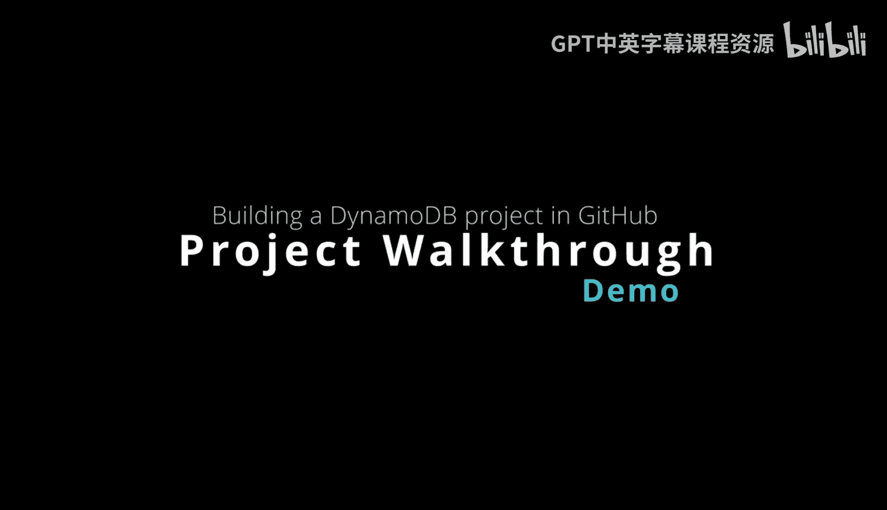
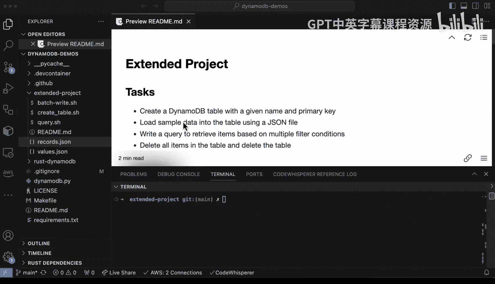
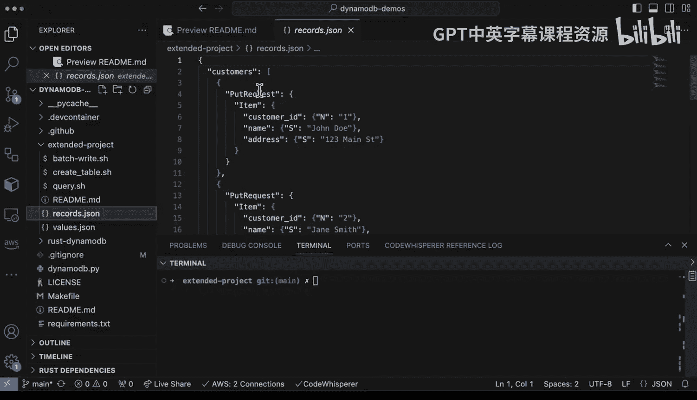
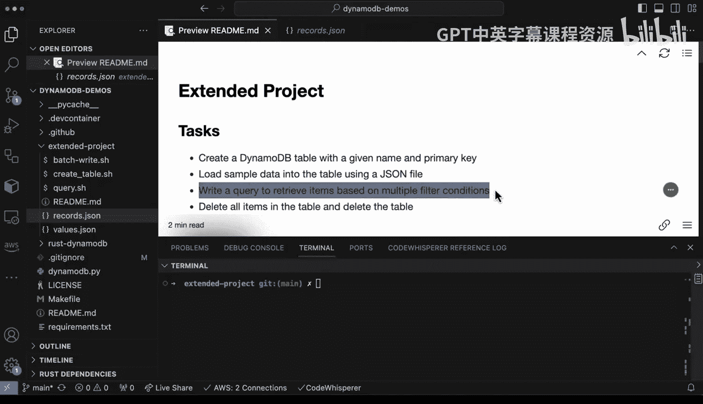
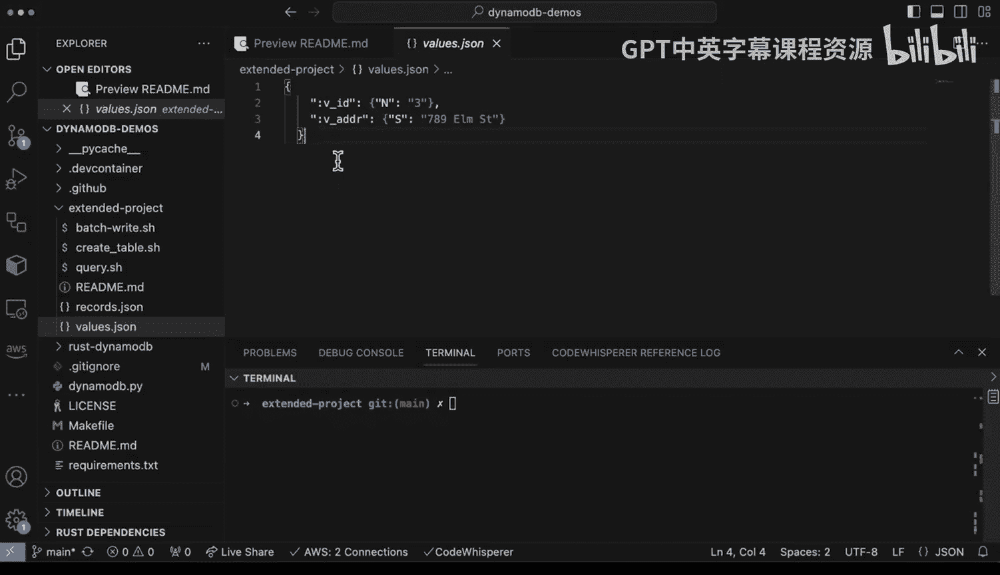
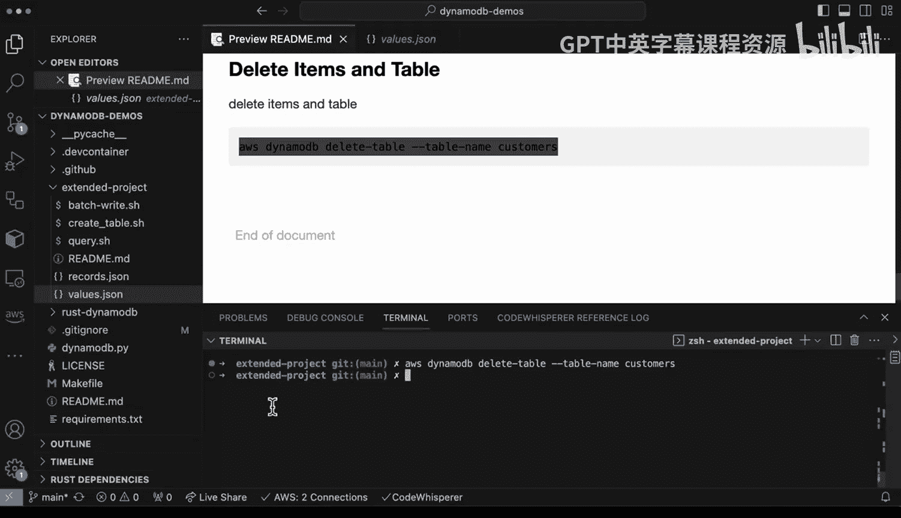

# 杜克大学《大型语言模型实践（高级数据工程、AWS、Databricks和本地LLM）｜Large Language Model Operations 》 - P60：60_04_09_项目演练.zh_en - GPT中英字幕课程资源 - BV1oi421Q7GT

Here we have a project that is a project designed to be extended and there are a series of tasks here so first up we have a task of create a dynamo DB table with a given name and a primary key and you can see this later when I scroll to that section how to do this。

Then load the sample data into a table using adjacent file。 So in this particular set here。

 we have records and we also have values in the case of the input。

 we're going to go ahead and go for the records and can see the structure of those records。

 then write a query to retrieve items based on multiple filter conditions。

 So what's nice about using the values here is it lets you easily go into a set of filtered queries。

 Then finally go ahead and delete all the items in the table and delete the table。

 So let's go through here and see next what the challenges。

 So the challenge that once you're done with that task add a global secondary index to the table。

Load a data set from a CSV file instead of J。Also， try a different query scenario and scan operations。

 So the reflection here would be what are the benefits of NosQqL databases like dynamo Db。

 How can you model data efficiently for fast queries And also what factors determined provision capacity needs。

 And then finally， what was your experience with dynamo Db Ci versus the console。

 So in here we again have create table， and this is something you can customize We have right batch to dynamo。

 which feeds in adjacent file。We also have the records here that are listed。

We have query with values， which， again， allows us to have a filter expression。

And we also have the ability to delete the items and the table as well， and in fact。

 we can actually do that right now。If we run this command， this will actually clean up our work。

So in a nutshell， walk through this project， extend it。

 follow the challenge items and the reflection items。

 and then build a great portfolio project that shows that you know Dynamo DB。

