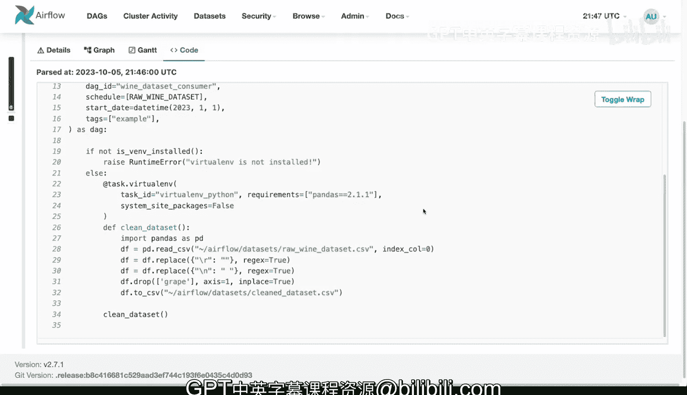

# 杜克大学《大型语言模型实践（高级数据工程、AWS、Databricks和本地LLM）｜Large Language Model Operations 》 - P62：62_04_03_管道需求概述.zh_en - GPT中英字幕课程资源 - BV1oi421Q7GT

We have seen a little bit of this wine ratings CSB file right here previously and the idea here is that we're going to build a more complex set of tasks。

 we're going to create a pipeline that is going to do multiple different things and we're going to persist certain information that is going to be coming from the CSB in this case we have the columns name。

 Cpe region， variety rating and node。

For effects of what we want to try to do， we are only going to want to capture name。Rizin。😔。

Variety and rating， and we're not going to want to capture in the same group。

 We're not going to want to capture the notes。 Now， what we're going to do， however。

 is we're going to keep the notes because the assumption is that this project is going to be using the notes。

As data that is later eventually going to be used for training a machine learning model。

 the details of that machine learning model are not important。

 however the requirement is to capture all of the notes separately and we're going to do that in a separate table to accomplish that。

 this is going to go into one table while these other ones are going to go into a different table。

 so two tables and we're going to group that information in that way and drop the index and drop the grape we're no longer interested in those。

All right， so that is the requirement let's take a quick look at what we have for the DAGs that we had we had the data set get and if you remember we have to go ahead and retrieve that information from。

From from the GiHub repository， in this case， we define the raw wine data using the data set class here from。

Apache airflow and this is just defining a string like an identifier for what we're going to try to do we're going to install pandas and we're going to retrieve that and save it to disk so this task is pretty straightforward we've seen it before and once it's complete it will set triggers for the raw wine dataset which is defined here in line 10 If I go back to the DAs and we get to the consumer。

Here in the consumer is where things are going to be changing and right here what we're going to do is we're going to depend on the rawW dataset to make some changes so we're going to have this da here and we're going to do the processing。

 we're going to clean the data and then we are going to then persist that data to disk。

The idea here is that we're going to use this consumer to create two tables in the same database and we're going to make that operation even potent that means that it can run many different times with the same with the same result so we're going to see how we're going to be affecting that so that is what we have in those are requirements here we have a single task and what we're going to be creating is at least two more tasks to complete what we need to do which is to persist these things into a database with at least two new tables that will contain the information that we want。

