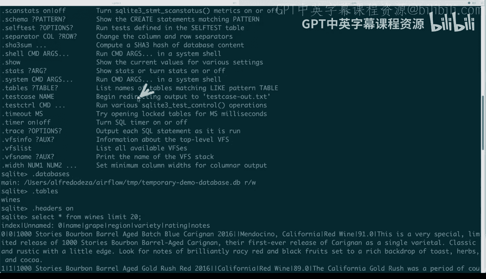

# 杜克大学《大型语言模型实践（高级数据工程、AWS、Databricks和本地LLM）｜Large Language Model Operations 》 - P63：63_04_04_将SQLAlchemy与Pandas结合使用.zh_en - GPT中英字幕课程资源 - BV1oi421Q7GT

One thing that I want to show you so that we can put all of these together is to actually see how we can make pandas work with SQL alchemy SQL alchemy is a library that will allow me to connect two different various backends various database backend so that we can store we can persist that data now pandas has the ability to produce the SQL that is needed and SQL alchemy understands the SQL and how to make that go to the database and persisted over the database。

 so let's see how we can make that work I have here already a virtual created I've called it SQLite you can call it whatever it doesn't matter create that virtual environment and we're going to go ahead and do install I'm going to say SQL alchemy and pandas I'm going to install the latest versions I'm going to see what those versions are in the end alright so we have。

Let's take a look here， we have SQL alchemy at version 2。0。1 and we have pandas at 2。1。

1 so how do we make this work I'm going to open up the Python the Python Reple the dynamic interpreter by just doing Python and let's check the version before I do that Python 39 so I'm going to run Python and in here I am going to request or import panda so I'm going to say import pandas as PD。

And then I am going to import， create underscore engine from SQL alches， so I'm going to say SQL。

Achemy import， create engine。 and what create engine will allow me to do is basically create the communication layer for the database that we're going to be communicating with The engine is going to be defined by a specific string。

 so so to create the engine I'm going to paste here the actual command。

 I'm going to define the engine as variable and I'm going to call the create engine function。

 what I'm passing here is the string that will allow me to configure everything this portion right here tells SQL alchemy。

 by the way， I'm connecting to a sQL light database by using the three slashes I'm saying that the path is relative and this is going to be the actual name the relative path is going to be relative to the temp directory that I have here。

 So I'm going to hit return and that will create。My my engine now the engine is fine。

 now I need to retrieve the data set。 Now I'm going to paste that so that I don't have to type that whole URL manually and make mistakes So now I have these W writing CSP right here as part of the Df if I look ahead I'll get there the columns that I need alright so how would this work if I want to save everything to the SQLite database So what I'm gonna to do is Df and I'm going to use the to underscore SQL here。

And I'm going to put this into a wines table and that table is this call is going to accept two arguments。

 one is the table name and the other one is going to be the engine。

 so what is going on here pandas is going to produce the two sQL is going to transform the Df to actual SQL and it's going to use the wines argument to create。

This table called wines and the engine is going to come from this that we've created。

 which defines that this is going to be a sQLite and a path to that database。

SQL alchemy has the capacity， the ability， the flexibility to connect to various different types of backend including my SQL and postg SQL as well。

 and in this case for demonstration purposes， the demonstration will require me to just use SQL light al right so let me do that。

And the response is going to be 32780。 That means the row that he has written。

 I'm going to exit out of here。 I'm going to do Ls now and you can see that now I have a temporary demo database that TV so let's actually call SQL light and execute on that database to poke around the data that we have there so I'm going to clear my screen and'm going to say sQLite3 and temporary demo database so let's make some changes so that we can visualize these better I'm going to call that help help we'll give us the ability to look at all of the different things that we can do there we can say databases we're going to say that we have only one let's take a look at tables and we have our wine table so let's do heaters on and then let's do a query I'm going to do select everything from wines。

Then we'mre going to do a limit 20。And we're going to run this query and what's going to happen。

 I'm going to scroll very quickly I'm going to have the index， the unnamed0。

 the name the grade the region， the variety， the ratings and the notess。

 essentially everything that we have from our CSB and this is actually contents inside SQLite inside the database that we had from here Now this is the first initial step in order to put and port everything over to Apache airflow to adapt to our pipeline where we're going to be producing this in a pipeline kind of like way。

 but it is important to understand how we can use both SQL alchemy and pandas together so that we can put it inside the implementation of the pipeline later。

