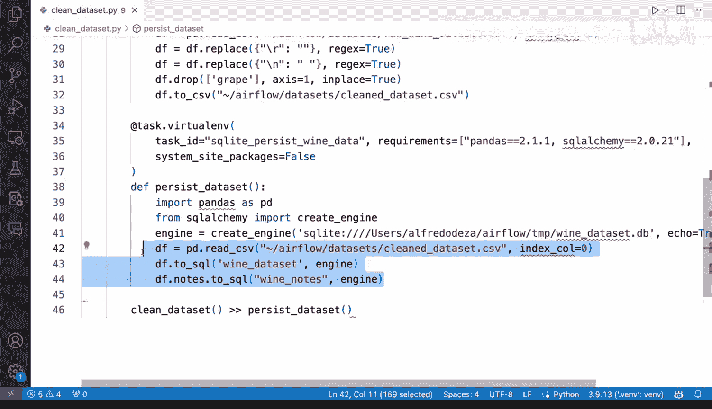
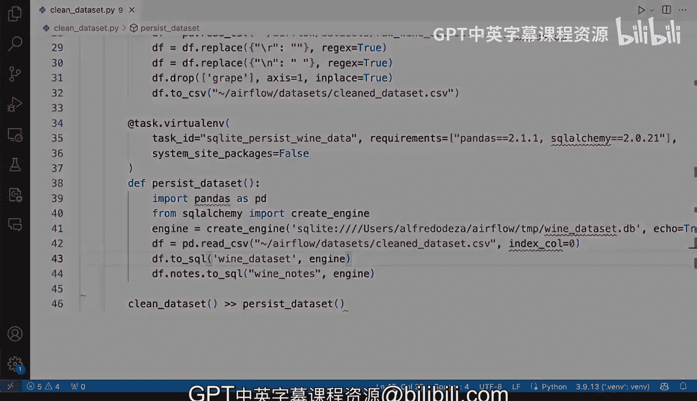

# 杜克大学《大型语言模型实践（高级数据工程、AWS、Databricks和本地LLM）｜Large Language Model Operations 》 - P64：64_04_06_在任务中持久化数据.zh_en - GPT中英字幕课程资源 - BV1oi421Q7GT

Following our review on how we're going to make these persist what we're going to do here is we're going to create a new task following here the pattern inside the clean data set so let's very quickly create a new task right here and what we're going to do is I'm going to create a new line here and we're going to say task Python we're going to go one more level in and we're going to say task virtual M and we have to define a task ID right so this is almost right so I'm going to accept this suggestion from what I have here but instead of calling a virtual M Python I am going to make these persist SQL light persist。

Wine data， and we are going to require pandas again。

And the other thing that we're going to do is also require SQL alchemy and the SQL alchemy version that I'm going to be using here is not 1。

4 I am going to be using 2。0021 which is what I was using before I was trying to do the demo on how to persist this All right so that has been created and now I need to actually create the function that we're going to be decorating in this case we're going to call it persist data set that sounds correct and yes we're going to go ahead and import do these imports where we're going to be importing how we're going to do this now we need to change certain things here from the suggestion from Gihacopiot that what I had here。

But let's go ahead and try to map exactly what we had from before。 Now。

 you can see before I had these airflow data sets， clean data set。 Now， let's take advantage of that。

 right， we want to reuse these clean dataset。 That's one of the main steps。

 I'm going to be reusing that。 So let's go ahead and actually copy these。

And make sure that that is part of here and it is， so you can see here in line 44 that has been correctly used now。

What we have here on line 43 is almost correct so it is using SQLite and the four lashes here means that this is going to be an absolute path now the absolute path for these will be in my case my machine。

 it would be users Aredodessa and then airflow but I don't want to put it inside airflow。

 I don't want to put it inside datas I'm going to put it inside TmpP I'm going to create it temporary directory and I'm going to put it there W data is correct。

 to me echo true will mean that this will actually output every single operation is something that we haven't tried before and we will try it right now。

And what we're going to do next is we're going to create the data frame by reading the clean data set。

 we're going to say that the index column is0 and we're going to save that to sQL。

 Now one and the actual table is going to be called wine dataset set but remember that we're no longer going to be capturing certain parts。

 but we also we really want to capture the node， So how do we do that with panda So let's actually try to implement that here as well。

 So we have the whole Df to sQL that's going to go to the wine dataset set。

 but we want to have the node and the one way we can do this is we can say Df and we have nodes and we can say two sQL and do the same thing。

 we can say wine。W nodes and we're going to use the engine there as well。

 We don't we don't need to define it this way and we can do this pretty， pretty fine。 Al right。

 so when we do this by doing this persist data in this way we're going to be able to actually to do this persisting of how things are working Now we want the clean data set to go first right we want this clean data set to go first and then persist data set to go next。

 So what we're going to do is we're going to remove line 34 from there。

And we're going to put in here is' going to say clean data set。

 and let's actually get these moved over here。And then we're going to say that is the bitwise operator is going to help us here and then we're going to say persist data is going to come in next。

 What does this mean and it' something that we haven't gone into lots of details before means that clean dataset is going to come first and then we're going to do persist data the connection here is that Per data won't execute until clean data comes before so perfect this will allow us to set everything into practice we have a little bit of extra room here to put in there that's why that's why the Li in this case FlakeA is complaining。

 so that will allow us to get everything running and put a good dependency。

 a good pipeline that will not only clean everything but will allow us to persist everything exactly in the way that we want it and also have。

The nodes in a separate table as the wine data set as the rest of the data that we had。

