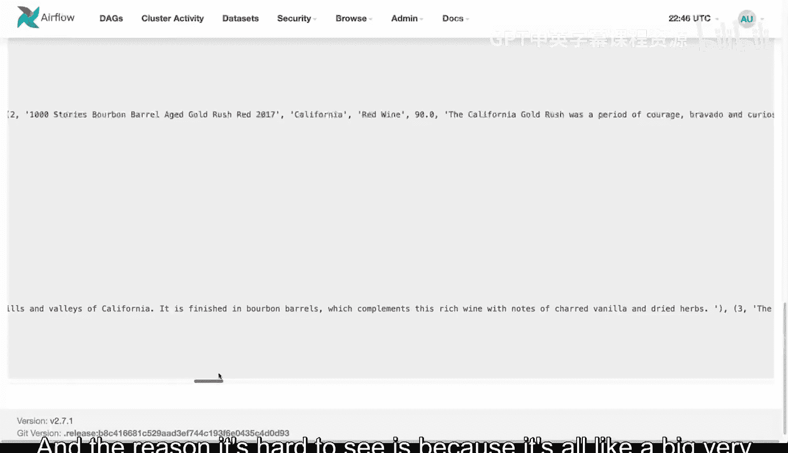
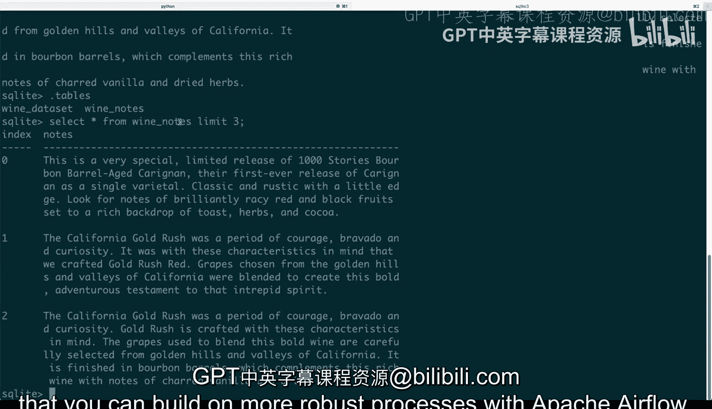

# 杜克大学《大型语言模型实践（高级数据工程、AWS、Databricks和本地LLM）｜Large Language Model Operations 》 - P65：65_04_07_结果审查.zh_en - GPT中英字幕课程资源 - BV1oi421Q7GT

Finally， we're back into the UI。 I've reset everything to scratch。

 I've like resets the database and added everything again。 we don't have any runs。

 I'm going to start these from the very beginning we've made the changes to the consumer that means that the code will now have everything that we're looking for and in this case we're going to be persisting everything that we want here with the persistent data in this task。

 the clean data is going to going to trigger or persist data and they're not going to be working independently of each other。

 they're going to depend on each other actually so let's go back to the daAs and let's go to now we have all of the tasks they running but I'm going hover and go all the way scroll all the way down rather and start with a wine dataset get and'm going to enable both and I'm going to go here。

triggergger this one and as soon as I do， this is going to take a second and once it completes。

 it's going to trigger the other one。 So I'm very quickly going to go to DAgs scroll all the way down you can see that this is running and very quickly this is going to complete and it's going to trigger the one data consumer which you can see right there so I'm going to click here and you can see that the run id is triggered this is running and now virtual M Python has been completed and sQl I Per point data is running and here in the graph。

 you can actually see the state on how this is actually working so we have virtual M Python completed now I went to process point data and we're able to get that nice nice graph in there Allright so one thing that I wanted to show you is actually if we go here and we actually go into the details of。

was running let's go into here and then let's go and click into the SQL hyperis wine data and take a look at the log output remember we had echo on and that will cause SQL alchemy to give you everything you need in order to take a look at the actual SQL that was generated in order to process these so we have created the engine and that was fine and it was able to create the wine nodes and then it was able to produce all of both the wine data set and the wine nodes and it is hard to see but the actual the actual data is created here and insert right there and the reason is hard to see because it's all like a big very long string with absolutely all of the data。

So that's it on the Ui。 That's how you verify。 That's how you see the connection on all of these tasks。

 Let's quickly do one last verification by going to the terminal。

 So I'm in my terminal I'm going to do Ls and you can see that one underscore data set is there。

 So let's call sQL I 3， let's do heaters heaters on。

If I can actually type and then do mode column and what we're going to be doing here is we're going to check what tables we have。

 We verify that we have the notes and the full data set over there So let's do select everything from wine data set and want to do limit three and of course I have a syntax error。

 I have to save from and there we go， well， it's a little bit big。

 but if I scroll here you will see that I have the index。

 the name region variety rating and notes we have everything that we need including the things that we were wanting to see Now if we go and check tables again if I want to check the notes I can say select everything from winenots limit three and we have the notes with the index very well like everything has been captured。

 So now we have this task this pipeline complete weve been。

Able to produce exactly the requirements that were asked from us and this is a solid way to work with Apache airflow Now this was done with SQLI which is an embedded database you can connect to Postgres SQL you can connect to remote databases as well and this is this definitely allows you to do that this just setting the foundation so that you can build on more robust processes with Apache airflow。

