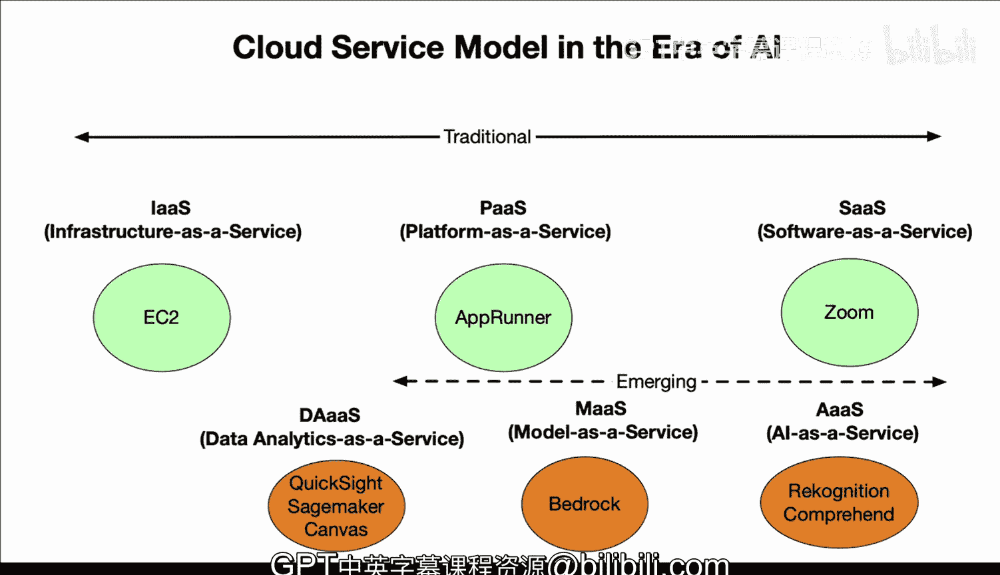

# 杜克大学《大型语言模型实践（高级数据工程、AWS、Databricks和本地LLM）｜Large Language Model Operations 》 - P68：02_01_03_人工智能云服务模型.zh_en - GPT中英字幕课程资源 - BV1oi421Q7GT

The cloud service model is a foundational model to understand cloud computing。

 but it's changed in the era of AI First let's take a look here at infrastructure as a service on the AWS platform we have things like EC2 which is a compute instance that is the lowest level of service that you can get in terms of compute and it provides fundamental building blocks for things like compute storage networking and also all of these infrastructure as a service offerings have the ability to be used on demand and it's a foundation for higher levelve services。

 other infrastructure as a service services include things like S3 object storage or even VPC。

Let's take a look next at platform as a service。 A good example of that on the AWs platform is the apprun service where you can take a function。

 essentially or microservice， put it into the cloud and run it AWs Lada you could also consider as a platform as a service and it also allows you to take a piece of logic and deploy it。

 and these allow you to focus on the app development， the testing， the deployment， the security。

 the monitoring and so you're focusing on the logic versus managing servers。

 So it can save you a lot of time。 and then we have software as a service。

 And I think many people are familiar with this， things like zoom for example or mail services and this is the entire things run the internet。

 and you don't have to do anything you just provision it and you pay as you go。

 Now there are some emerging models though in the era of AI。 let's talk about what some of those are。

 So we have data analytics as a service and a good example would be quicksight sageMaker canvasva these include。

knowScalalable， secure data storage， things like services for ingestion， transformation。

 visualization。A good example of this on the AB platform would be Quickight。

 which allows you to just upload essentially some data and it has automatic visualizations for you。

 Theyre also are model as a service offerings and in the case of bedrock， this is a good example。

 you can host many different models so for example。

 Mistrral or you could host maybe a proprietary model like Claude。

 all those models are inside of this service and you can access it via the API so you don't have to build custom API offerings for each of the models as you tread them out and this is one of the advantages is you have a centralized spot where you can actually launch this service。

Now we also have things that are emerging like AI as a service。

 and this has actually been around for quite a while。

 a good example of this would be recognition which has office shelflf computer vision know labeling image recognition we also have comprehend for natural language processing So these were actually developed before the era of the large language model。

 but that doesn't mean that they're not going to continue to be developed and we also have things like for example。

 chat GT and Clade and all these other chatbots and we could consider those AI as a service as well so it's important to think about where do you want to play when you're building things in cloud computing in the era of AI how low level do you want to do for example with EC2 you can be GPU but you also could use at the very opposite in a chat as a service。

 but in some cases there could be problems with the data governance or the privacy。

Or there could be legal reasons why you want to run it locally。

 so you have to decide where you're going to play in the era of AI。

