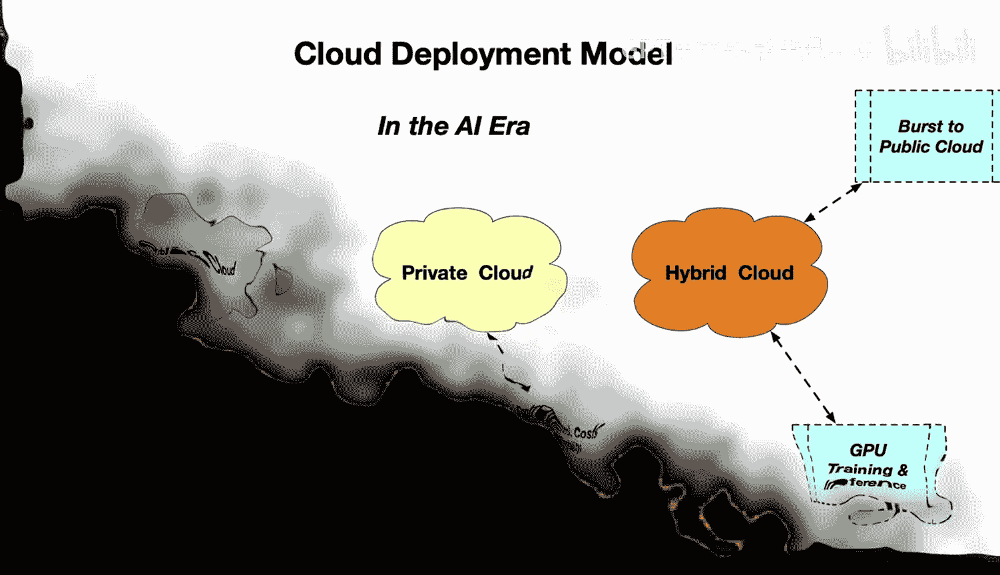

# 杜克大学《大型语言模型实践（高级数据工程、AWS、Databricks和本地LLM）｜Large Language Model Operations 》 - P69：03_01_04_人工智能云部署模型.zh_en - GPT中英字幕课程资源 - BV1oi421Q7GT

Yeah。Cloud deployment in the AI era introduces some new concepts。

 let's first talk about what are the main models for development。

 We have the public cloud and this includes things like provisioning over the public internet。

 you have scalability， flexibility， pay as you go pricing and you could use inference with AI if the latency allows it right so if you have some optimized cloud providers AWS for example。

 has many services that allow you to do AI inference this would be an option Now there are some cons though as well。

 and one of them is that there is skill required in order to effectively use cloud native technology so you're optimizing for the public cloud。

 you need to have highly skilled workers able to do that。Next up。

 we have the private cloud and this means that the resources are provisioned for a single organization in their data center。

 some of the benefits are security control， you even could minimize latency。

 for example two servers could be right next to each other so that's about as low latency as it gets but there are some cons as well so some of the cons would be flexibility you may not be able to buy the hardware exactly when you want it because you have to purchase everything also you potentially giving up resilience so maybe that's not important for your use case but with a public cloud。

 you go global day one， you have the ability to move across multiple data centers etc and then there's also the complexity there's complexity with a private cloud and that you have to hire specialized staff to rack servers pull out disk drives now at a certain scale many organizations find that that complexity is fine because they want that private cloud。

Feel， but really the complexity does exist there because you have to have these specialized data center employees and then also cost could be an issue as well depending on what it is you're doing there could be some scenarios where it could cost more money if you're in a private cloud Now the hybrid cloud has the ability to do a little bit of both so for example you could do AI training on private cloud for data security and low latency you could do AI inference on a public cloud to scale out with demand and then you're able to optimize for cost performance and security。

There also could be some other cases like data governance。

 So you may not be allowed to put your data in a cloud because of regulatory environment also。

You may want to prevent another vendor from having access to your data because it's a competitive advantage。

 and so in a nutshell here， there are many use cases where you would not be allowed to use a public cloud and so some other cases would be a migration strategy so let's say you're moving from private to a public cloud。

 one of the ways you would do that is to have a hybrid cloud and then maybe a more simplistic one is that you already are happy with your private cloud。

 but you want to burst out occasionally to a public cloud vendor。

 So there are a lot of options that are becoming more and more available and once we get into these specialized era of large language models running locally the hybrid cloud could make a comeback and it's something that many organizations should at least consider depending on what kind of scenario they want to use large language models in。

