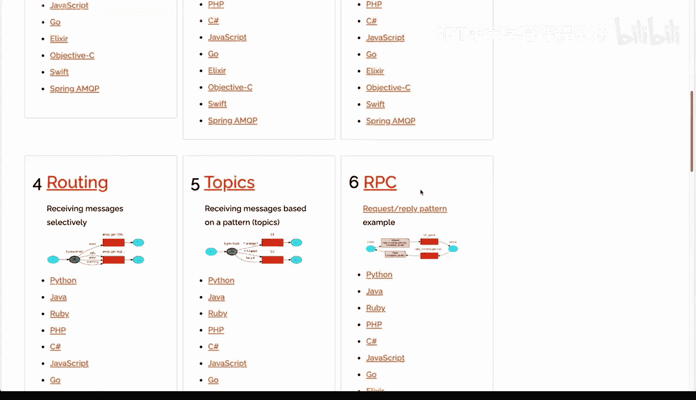
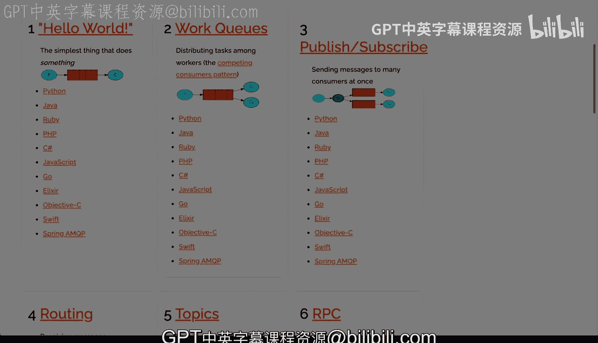

# 杜克大学《大型语言模型实践（高级数据工程、AWS、Databricks和本地LLM）｜Large Language Model Operations 》 - P6：06_01_06_RabbitMQ的用例.zh_en - GPT中英字幕课程资源 - BV1oi421Q7GT

Let me show you some of the use cases for RaitMQ and for creating something that will be using a queue in this case I want to refer to the RaitMQ tutorials which is coming from the RaitMQ documentation and here they have a few different things that you can do and I'm going to go through some of them which I think are pretty good let's not is the hellello world example here。

 we're going to take a look at work usees work use is essentially what we've described before you have something like a producer something that creates creates the unit of work and that gets put into the queue and you have many different consumers taking taking from that queue Now this is like one too many but it could be many producers putting things into the queue and many consumers consuming from that queue some examples of that for example image processing you have。

And I've done similar systems before where you would upload an image that can be quite large and then you would put it into the queue and I would have separate notes that would pick up that unit of work that image and do resizing to different types of formats and that's useful for example if you're running a website super large scale and you want to have down samples of large images so that's one pretty good example there the other one is published and subscribe that is when you want to send messages so if you're wanting to send messages and what type of messages we're talking about here well imagine a system that needs to communicate between each other and its you have several different producers but you can subscribe to a queue so subscribing to a queue means that you can get notified when things。

Are happening and why they're happening and what are some of the things that you might want to be interested in there's all kinds of different things that you can do with a publish subscribe or popS also known popS for short where you can consume messages not necessarily units of work but messages where you can communicate essentially allow many notes to communicate with each other We have also a little bit of routing receiving messages selectively well that's kind of like more of like trying to say。

 well， I want to send these messages based on to this queue or these ones to this orQ but that's more of like less of things that you can do and more of like a type of architecture。

Similar to topics， but this one RPC is definitely something that is interesting because RPC is something where you can not only request something but you can also reply and you can see here that it starts here with a client sending sending these over getting through the queue to the server and then there's a reply back so our request reply pattern is also pretty useful but I think the most common ones would be things like work use and publish and subscribe for messages。

