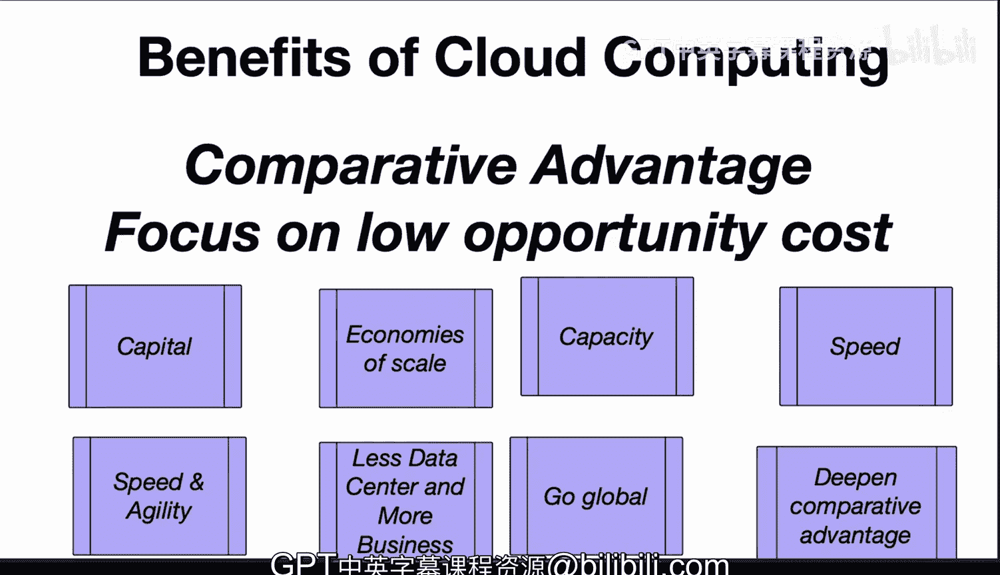

# 杜克大学《大型语言模型实践（高级数据工程、AWS、Databricks和本地LLM）｜Large Language Model Operations 》 - P70：04_01_05_云计算优势.zh_en - GPT中英字幕课程资源 - BV1oi421Q7GT

The benefits of cloud computing include comparative advantage as really the key driver behind these opportunities。

 You're focusing on the lowest opportunity cost or what is the thing that you're going to give up the least in order to focus on。

 And that's really the principle of cloud computing in a nutshell。

 if we take a look first at capital here， you're trading capital expense for a variable expense。

 So it means that you don't have to put a million dollars on a bunch of servers。

 you can piecemeal add capacity when you need it， and this can be a dynamic capacity as well。

 You can add to it and take it away。 It's a lot like a utility company。

 We also have the ability to benefit from economies of scale。 because cloud providers buy in bulk。

 they have lower cost， they can deliver those resources due to scale。

 we also have the ability to not need to guess capacity as well。 So just like the utility company。

 you have the ability to turn turn off the thermostat。

Imagine if you had to buy you bundles of wood and guess exactly how much wood you would need for the winter。

 know it's that same problem of if you over or underestimate you come into a lot of problems that are difficult to solve Now speed is another one and it's easy to think that it's not important but it is important to be able to say that you can move quickly you're able to deploy faster。

 you're able to move more quickly， but then we also move into speed and agility So when you combine both together。

 then you're able to really pivot quickly， go fast and this could mean a 10 or 100 times you know difference in what you're doing and really the difference between speed and agility is that you can go fast。

 deploy often， but agility means you can completely swap out the infrastructure change a keyvalue database to a relational database you can do these kinds of changes because you have the combination of both。

 Now there's also the ability to focus less on a。er and more on your business。

 a lot of companies don't want to be experts and data centers。

 they don't want to hire staff that's dedicated that are going to do networking and handle servers。

 etc。 And this is a key advantage that you get from cloud computing and a many scenarios they're going to do better than you are Also you have the ability to go global So you can leverage the cloud providers global infrastructure footprint immediately and this is a huge advantage to cloud computing。

 We also have the ability to deepen the comparative advantage that you have。

 So let's say you're an expert on some particular technology。

 you don't have to focus some of your time on something you're not as good at。

 you can focus on the thing that really is going to make you successful as a business or focus on higherpro aspects of what you're doing。

 So there's a lot to be said about the benefits of using comparative advantage outsourcing the things you don't want to be an expert on and focusing on the things where there's low opportunity cost or things that you're going to make the highest Ro away from pursuing。

