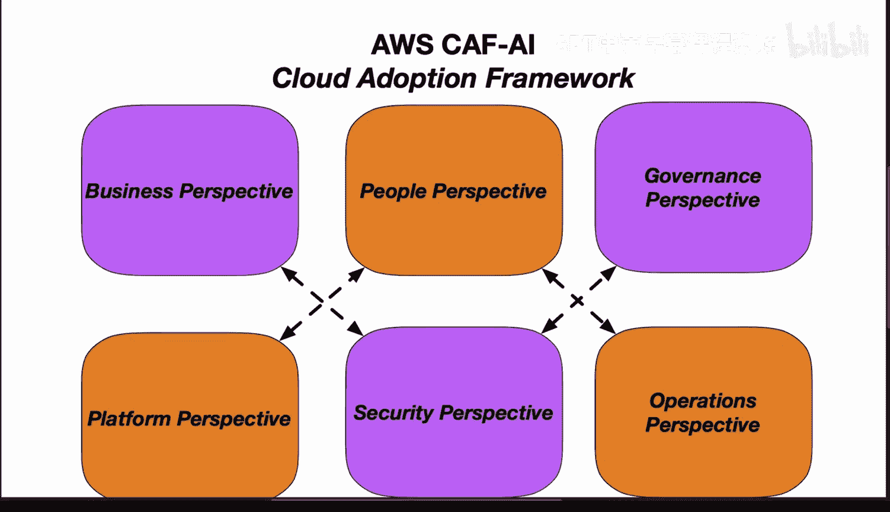

# 杜克大学《大型语言模型实践（高级数据工程、AWS、Databricks和本地LLM）｜Large Language Model Operations 》 - P71：05_01_06_AWS人工智能云采用框架.zh_en - GPT中英字幕课程资源 - BV1oi421Q7GT

Here we have the AWS cloud adoption framework and an AI perspective around it。

And let's start with this business perspective here first， when a company is thinking about using AI。

 one of the things that can first start off with is the strategy for AI。

 Can you unlock new business value， So are there things that your organization is doing that are very manual and repetitive and AI could help。

 for example， generating certain documents or summarize summarizing documents from historical data also how do you manage this data-driven AI enabled product lifecycle。

 how do you leverage AI and M for predictive insights and analytics and also how do you identify which are the initiatives that are going to align to the business outcomes you need and how do you innovate business models with AI and M capabilities and then finally。

 how do you fine-t and customize foundation models。

 So this is a big issue that's coming up is you have one that's pretty good。

 but can you make it better from a people perspective。

 how do you build AI and M fluency and common vocabulary。

How can you attract and able and manage the AI talent can you foster cross-te collaboration and can you evolve a culture to be AI MLl first This is another one that we're talking about next is governance as well and this is optimizing and measuring AI and ML cloud costs making sure that you're curating the data assets and products and managing AI MLl risks and then ensuring responsible development and use of AI from a platform perspective It's important to establish scalable architecture for AI workloads also integrate AI capabilities into applications and then manage the full machine learning lifecycl So are you doing undifferentiated heavy lifting or are you using the services that are going to make your life easier from a security perspective it's important to be able to identify and mitigate AI model vulnerabilities as well。

 so for example， there could be。SomethingThat is going to expose bad code if you're using a specific type of open source model。

 are you able to mitigate that with maybe better code reviews or better languages。

And then in terms of operations perspective， how do you manage and monitor AI performance and also identify and respond to unforeseen AI behavior。

 so there's a lot to think about when you're adopting a cloud for AI in particular and all these categories have to combine together to make sure that you're doing the right thing in terms of strategy。

