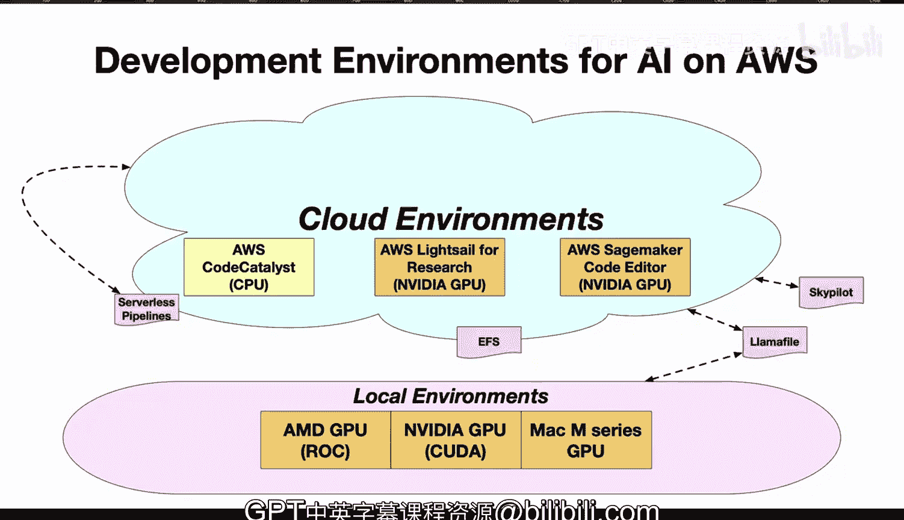

# 杜克大学《大型语言模型实践（高级数据工程、AWS、Databricks和本地LLM）｜Large Language Model Operations 》 - P72：06_01_02_人工智能开发环境.zh_en - GPT中英字幕课程资源 - BV1oi421Q7GT

Yeah。There are many different options for development environments for AI development on AWS。

 Let's talk through some of the workflows here。 First up。

 we have AWS code catalyst to CPU based cloudbased development environment and what's interesting about code catalyst is that you can pick from instances that are preconfigured with AWS options like Amazon Linux 2 for example。

 all the the tools are there and also it works with a local IDdeE as well so you can interface with it from Intelj for example and talk to that particular cloud-based environment and even have a whole series of specialized environments depending on what problem you're solving。

 So this is helpful in a AI pipeline because you can build。

 let's say serverless pipelines and rust with step functions and La does and this could be a great place to rapidly develop solutions Now there's actually even more interesting emerging cloud environments and these new ones have GPU embedded。

So one of them is AWS Light sale for research， you have access to NVIDA GPUs and you also have access to other AWS features like the Elastic file system or EBS for example。

 and what's really interesting about this is that it means that many different people could be collaborating on a GPU based project like let's say you're running Lama file inside of AWS LightSa and then maybe the results of this go into a EFS volume。

 potentially let's say you're looking at a bunch of documents and you're summarizing those documents and then putting the results in some database this could all be something you're doing inside of this AWS light sale for research environment。

There's another emerging one， which is AWS SageMaker code Editor。

 which also has access to GPU resources and you can develop inside of a more traditional SDK type environment。

Using visualual Studio code and actually start to develop code as well。 Now。

 these are very interesting because again， you get access to the GPUus and you have access to the entire Aws cloud environment。

 So this is really unique in the sense that you're still inside the cloud。

 you have low latency and you have access to the GPU at the same time。

 Now there is a integration here that we're also starting to see that exposes local environments for AI development as well。

 And so a few of these could be Amd。 there's becoming more and more support for local large language models with Amd GPUus using RC NviDdia has the couda drivers that you can install on let's say。

 Linux laptop and do local large language model development but also the Mac M series that M1 and2 M3 series as well in4 in the future。

 these are all starting to become available for local large language models a good example this is Lama file from。

Zilla where you can take the latest mixture run it on the Mac and use all of those m series GPUs as well as use NviDdia GPUs and also Amd GPUs so you can use this both in a local environment in a cloud environment so this wasn't necessarily the case that you would have local environments where there's some advantages to it and the AI world that kind of shakes things up and that there still is a lot to like about the cloudbased environments because they're directly inside of the AWs cloud and you have low latency but there are also many things to like about local environments now as well another tool I'll talk about is Skypilot which allows you to run LLM's AI batch jobs in a cloud and also allows you to pick different cloud offerings as well so you can put let's say a Yaml file in run Lx which allows you to do lots of different models at the same time using the open source technology from perbase all these things。

Available when you're developing with this mixture of either cloud environments or local environments。

And so it's important to be aware of these features。

 pick the right one for the job that you have in hand。

 there's pros and cons to each of the approaches， but it's good to actually know what you've got before you get into developing for AI in the cloud。

