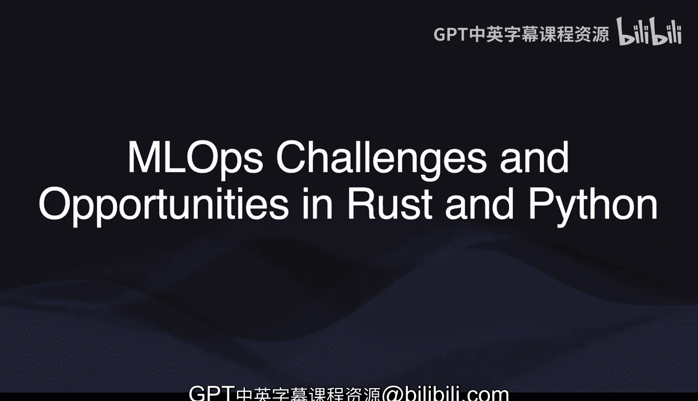
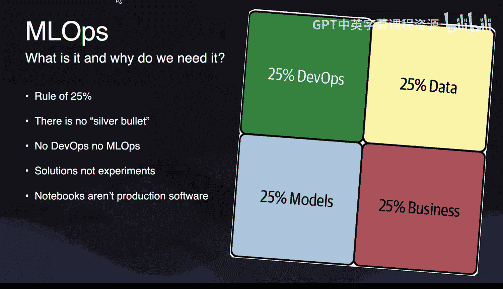
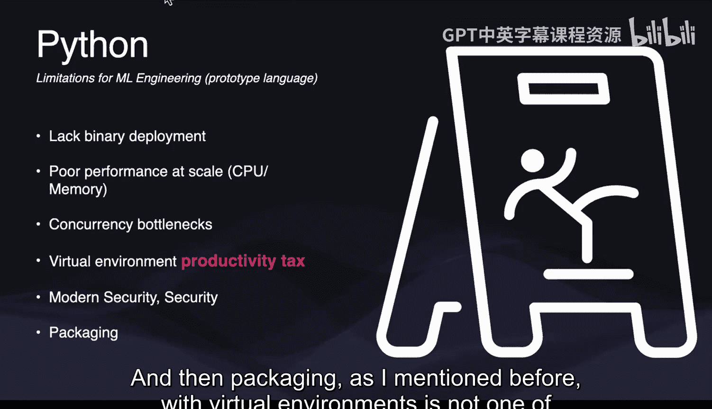
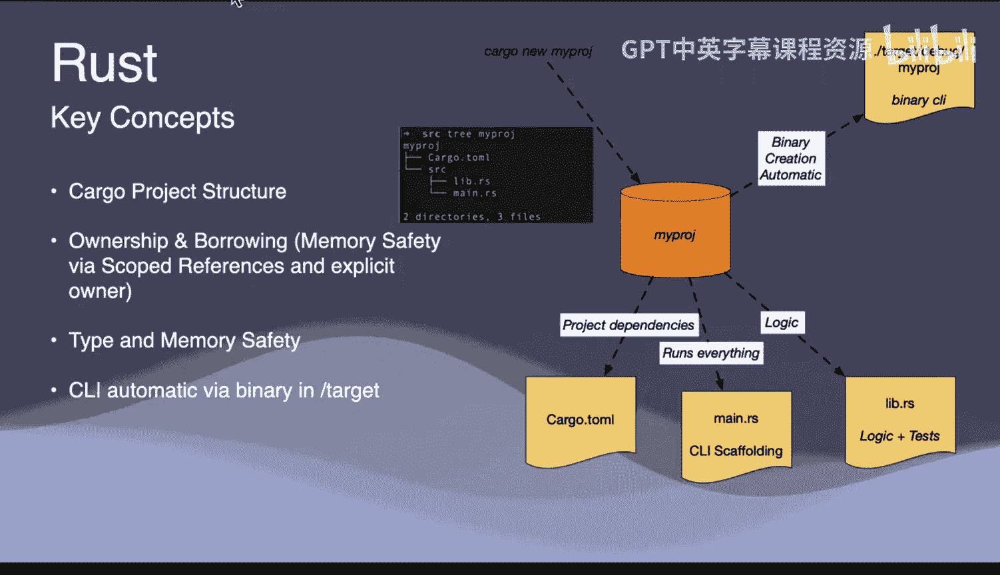
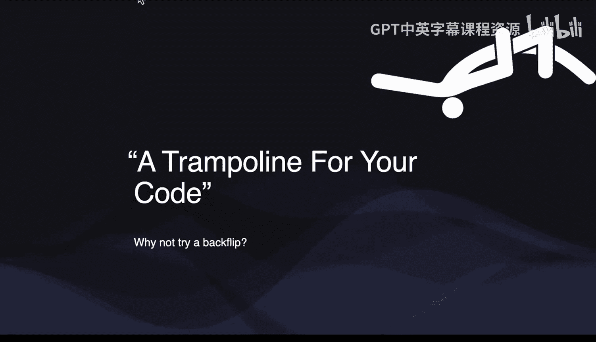

# 杜克大学《大型语言模型实践（高级数据工程、AWS、Databricks和本地LLM）｜Large Language Model Operations 》 - P73：07_01_03_Rust与Python中的MLOps挑战与机遇.zh_en - GPT中英字幕课程资源 - BV1oi421Q7GT

MLops， challenges and opportunities in rust and Python。

 Let's go ahead and take a look at some of the key issues that are happening。 First step here。

 we have a definition of MLopps。 So what is it why do we need it to start with there is a rule of 25%。

 MLops is not just one process where you flip a switch and then you get it。

 you have to divide the problem into different sections。 First up， we have devops。

 if you don't have devops， you do not have MLops， This is continuous integration。

 continuous delivery infrastructure as code， microservices。

 all these kinds of iterative best practices have to be in place for you to even get to that next level of doing MLops and with data as well。

 you have to have a focus on data operations doing data engineering best practices。

 building data pipelines that are robust handling batch data streaming data。

 And then if we get into the models， obviously for machine learning， you have to have a model and。

It's important to make sure that the model is fitting the problem that you're trying to solve。

 that it has good accuracy， that it is limiting bias that it is able to ethically source data。

 there's all these issues with models that you have to be aware of and then finally。

 let's say you get all those things correct， it's important to make sure you solve an actual business problem if you say I'm going to deploy AI to production and you don't know what you're doing。

 you're just generating essentially hallucinations that isn't going to help your business you need to specifically have the problem。

 For example， if you're an insurance company and you want to look at a bunch of historical data and find key insights by summarize it documents that could be a very specific business use case and then that would return more value to the customers。

 for example， but if you don't match all of these engineering best practices to the business best practices you're gonna to have a problem and the other thing as well is that notebooks are not。

SoSo this is one of the things to be aware of is that if you're building in a notebook environment almost by definition。

 you're starting on the wrong approach because notebooks are for tryout ideas。

 but with a continuously integration system， the concept of continuously testing something that is idiosyncratic and is not designed to be tested really is off the focus of MLOs。

 So let's take a look here at Python。

Now one of the problems with Python is that it has severe limitations for machine learning engineering because it's a prototype language Now it has huge advantages in terms of the standard library it's been around for decades。

 you know that the standard library is about as good as it gets in terms of prototyping if you had some idea you wanted to try it out or you go into a machine that's got Python3 installed on it。

 you know there's amazing things in the standard library so let's give it credit for what it really is good at。

But there's some limitations in terms of looking at machine learning engineering part of it is that there is no concept of binary deployment。

 binary deployment is amazing because everything's packaged into one executable that you can push into production it makes it easy to use things like serverless technology or do inference。

And we also have problems with poor performance， so Python was never designed to be a high performance language。

 it's good for readability， it's good for developers understanding what's happening but CPU memory performance are very poor with Python there also is concurrency bottleneck。

 it doesn't have true threads and even if it did get two threads in the future。

 it could introduce all kinds of issues because there's no concept of a compiler checking for the safety of the concurrency。

As well， there's a virtual environment productivity tax。

 and you can think of this as essentially like a productivity tax。

 you have to pay every time you use Python。 So there's wins you get by using， for example。

 in the standard library， which is truly amazing， But the second you have to start installing a package。

 you have to start remembering， okay do I use virtually in V， do I use Conda。

 Do I use some other solution and then those other solutions even have conflicts within the workflow。

 So there are substantial problems with virtual environments that lead to productivity taxes。

And then we also have modern security and safety issues that we need to think about and then just security in general。

 and then packaging， as I mentioned before， with Earthho environmentrons is not one of the things that Python is well known for solving in a robust way。

Now rustT has many of these benefits though， now what are the things that we think are good about rust in terms of the benefits for machine learning operations。

 well there's binary deployment， a binary deployment is a huge。

 huge factor in terms of making MLOs more productive because all you have to do is take this binary ship it somewhere it could be shipped to a container it could be shipped to serverless。

 it could be shipped to maybe some GPU that you would do inference like in the case of Lmaophile and then we have performance rust has sea levelvel type performance。

 it also has amazing concurrency without bottlenecks and there's libraries that are very robust like rayon and a compiler will protect you from many common use cases。

We also have security。 Rust is well designed for security。

 Many security vulnerabilities don't exist because of the memory model and the ownership model。

 and then there are very good libraries for MLOs LLMOs and data engineering some of the ones you may have heard of are polars。

 another one is rust candle all these libraries are very well suited for MLOs。

 Now let's take a look at some of the key concepts for rust to be aware of if you're dividing yourself you know from a python side to a rust side let's go ahead and take a look at how it's a little bit different here。

 the big difference is there's a tool that does everything for you。

 and this is a huge win for rust is that cargo is essentially the single spot that you need to deal with and everything is done in a treebased structure so there is no concept of a global state in the case of a virtual environment。

 you're actually taking everything in one directory and it's going to be a cargo2Ml file which handles the dependencies the source。

Dictory handles your libraries and your main code， and then in terms of ownership and borrowing。

 you automatically get that with the Ru languages because you have to actually declare。

Varis immutable， mututable and the safety mechanisms are built in from the default。

 also the type of memory safety is there as well， like typing you know could be a real issue for many people in a scripting language and often you'll find that the unit tests are basically just type checkers。

And then we have the automatic。Kme integration by getting a binary that you can execute in the target directory。

 So this is a huge win， I think for MLOs， very fast feedback loop And one of the things that we can think about is that with the world of generative AI。

 you can consider in a trampoline for your code so a good example would be if you're going to try to do a backflip and you're having some issues with it。

 you could go to a trampoline。

And a trampoline， if you have already some pretty good technique。

 can help you get to that next level and then you can do that backflip And so even though rust has many things that are unpleasant to look at and the syntax is harder than Python is a lot like eating your vegetables。

 the compiler even though it's mean to you is actually good for you and you can lean on the cargo ecosystem to solve lots of problems and you can lean on generative AI tools So rust isn't a purely a you difficult language to learn。

 it actually has many benefits as well， just like broccoli or Bruss sprouts and especially in the world of generative AI where you get a lot more ideas and suggestions。

 the combination of a very strict language plus generative AI tools like for example。

 AWs code whisperhi can be a great combination。

