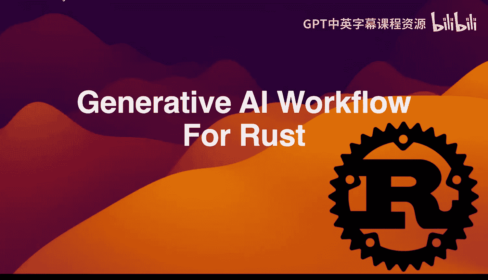
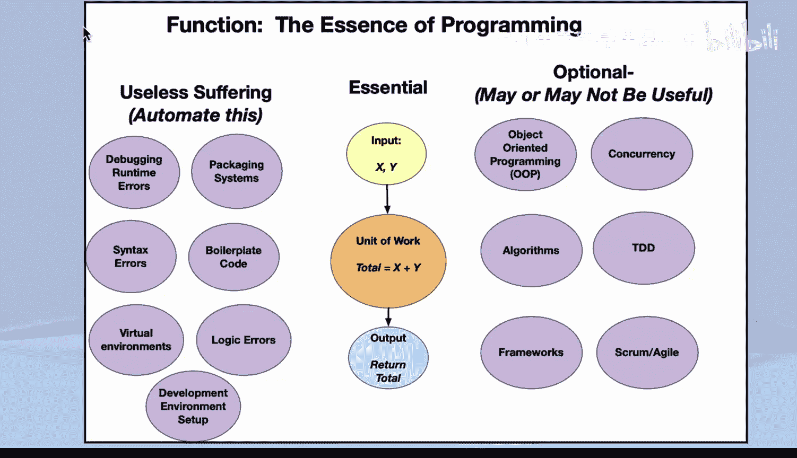
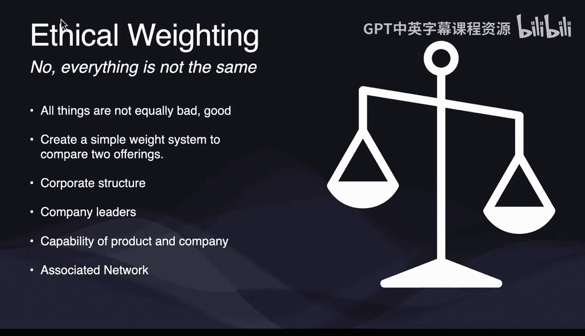
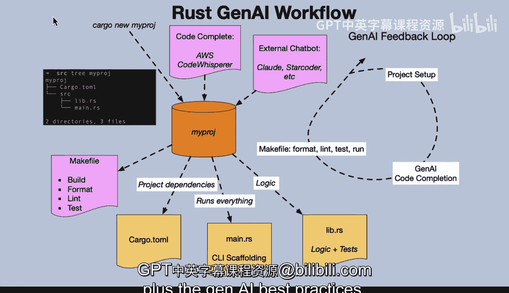

# 杜克大学《大型语言模型实践（高级数据工程、AWS、Databricks和本地LLM）｜Large Language Model Operations 》 - P74：08_01_04_Rust生成式AI工作流.zh_en - GPT中英字幕课程资源 - BV1oi421Q7GT

Generative AI workflows for rustT have many new ideas that are worth considering and let's go ahead and dive into some of those generative AI workflows。

 so first up here， if we take a look at rust， it really starts to make you think about the essence of what programming is。

If you take useless suffering， these are things that we should automate。

 so it could be the packaging system， so for example。

 do I use PIP or Conda virtual in V or whatever debugging runtime errors， syntax errors。

 boilerp code， virtual environments， logic errors。Setting up your development environment。

 I've worked places where they've taken a month to set up a development environment now in the era of cloud based development environment。

 you literally click a button and you get a full environment。

Now that's all useless and has absolutely nothing to do with programming and it can be confusing to newcomers because they feel like they're wasting all this time and they don't know that that has nothing to do with programming。

 really the essentials are you have an input that input takes a couple things you do a unit of work。

 and then you have an output。 That is programming。 There's nothing else involved other than that logic and then we have optional things that are may or may not be useful。

 So for example， object or programming in Python you could actually get away with doing functional programming for decades and it won't even come into play Likewise。

In rust， if you only wanted to use functions and use command tools。

 that's a totally appropriate way to program in many scenarios。

 Concurrency may or may not be a solution that you want to reach for immediately algorithms as well doing all kinds of fancy algorithms if the standard library has these already there for you framework。

 Scrum agile test development。 So I think once you start to think about what do we actually care about we care about the logic and we want to solve a problem with that logic that's really the essence of what programming it is。

 And that's why when we think about using these generative AI tools， we know that they're good。

 but we also have to consider of the you know3，4 or 5，67，8，9。

10 tools that we could use which are the things that we should consider using and can we compare two different tools like is one design for customer trust and one is designed for productivity you can look at those and say。

 well。

Maybe I want to weigh towards tools that are going to have a high degree of customer trust。

 So if you look at the balance beam here and you look at the scales of justice right we're already used to this for thousands and thousands of years weighing things out and some of the things to look at or corporate structure company leaders the capability of the product and the company。

 the associated network， have you ethicalally sourced the data。

 whereas the data containing pirated data sets that were kind of slaploppily put together So those are some of the things to consider it would just be like using dolphin free tuna or regular tuna。

 like why would you pick something where there are some side effects that that are very bad that everyone agrees are not really useful you can do the same thing with generative VI pick the solutions that are ethically appropriate for the problem that you're solving。

Now， if we get into now deciding that we do want to use generative VI。

 which I think is a great technology。Let's think how we would do this in rust。

 So if we take a look at how this rust workflow would work。

 so you would do the same things that you would normally do。

 youd just say cargo new my project and you would have a tree structure where you had cargo do2Ml。

 you' would have a source directory with Lib RRS， meanRS， for example。I like to have make files。

 so you have a build a format a link to test， you have the project dependencies and the cargo do2M。

 you have the mean doRS that is the CLI scaffolding， you have the logic right。

 which is the Lib do RRS， the logic and test。And then here's where I think a very good workflow comes into play。

 which is use a code completion tool like AWS codeWhis， which can do multiline rust support。

 and then you're getting this feedback loop of DevO best practices right。

 makefi you best practices with cargo， you have the scaffolding for CLI。

 but you also have this nice tradeoff here of having yet one more great tool that complements your existing DevOs best practices now one other thing I'll recommend is also to have an external chatbot as well。

 maybe you have Claude or you have a mixture roll or you have some other open source you external chatbot and you can complement the answers and get a little bit of kind of a mixture of experts right where you ask one model one thing double check it from the other one。

 and then again you still do the traditional DevOs best practices， you formats your code。

 your linear code， your tester code。run your code and in fact by formatting and liing your code。

 you'll slightly tweak the way the code looks and if you put it back into the coding assistant it might actually have a slightly different answer for you or you could even get enhanced feedback so really it's complementary to a language like Ru to have these DevOps best practices combined with gene BI and it's a very powerful technique that many people should consider in moving to a rust is that you're able to actually leverage the synergy of a powerful language like rust plus DevOs plus the Gen AI best practices。

