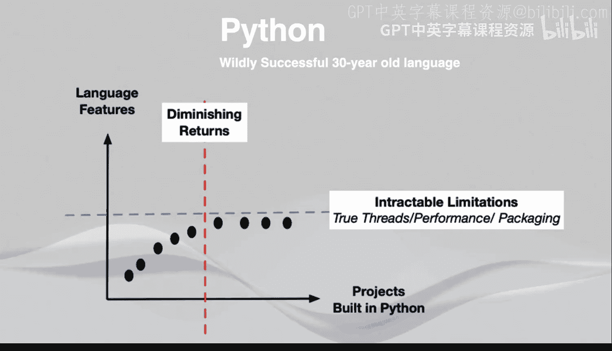
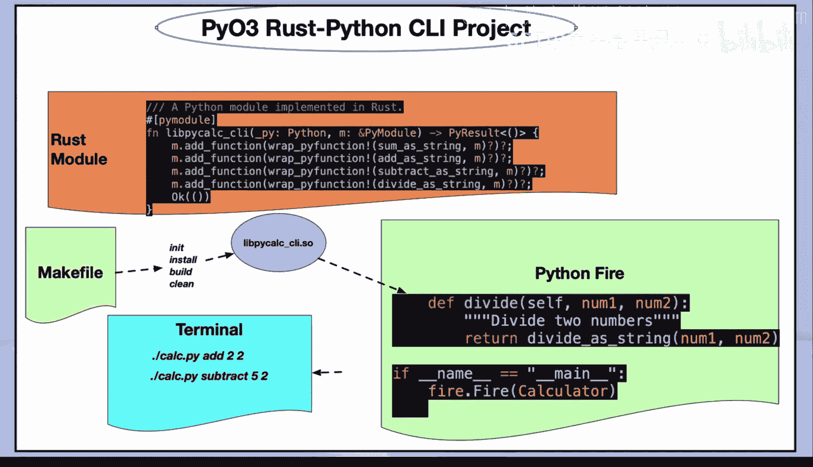
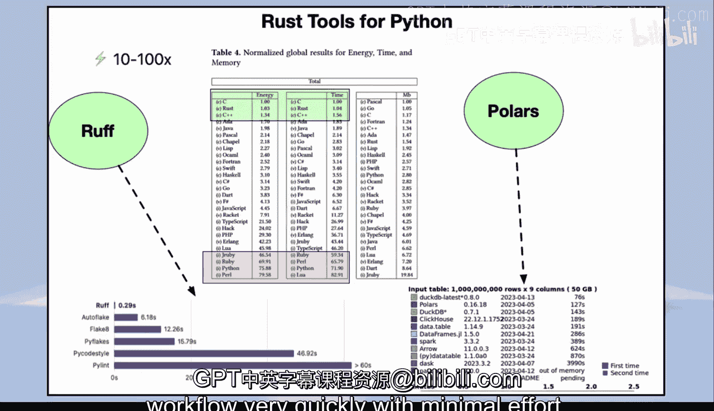

# 杜克大学《大型语言模型实践（高级数据工程、AWS、Databricks和本地LLM）｜Large Language Model Operations 》 - P75：09_01_05_Rust与生成式AI时代下的Python数据科学.zh_en - GPT中英字幕课程资源 - BV1oi421Q7GT

Let's talk about Python for data science in the era of rest and generative VI。

 There's a few things that are very interesting that are emerging solutions。 First up。

 let's talk about Python the good parts， So Python is a very successful language It's the most popular programming language in the world and there are many things that are very good so one of them is the data science libraries are very good the prototyping is just amazing。

 deep learning libraries are very good。 it's an amazing language to teach with in terms of documentation It's just amazing as well because you can look at Python and understand many different systems。

But I would say they're at their best when they're in a hosted notebook。

 This is probably the sweet spot for many of the optimal workflows because the packages have already been installed for you。

 And this is really the weakness of Python is the packaging system。 but if you're using， let's say。

 Google Coabb or a university has a very optimized Jupiter environment where everything's already installed for you or you're using Coursera and you have a guided lab you know for that kind of scenario。

 It's a great experience right So this is what I would call the the good part。

 And in terms of the standard library as well for prototyping。

 it's just amazing what you can do with the standard library。

 more people don't use the standard library enough。

 and it's often on most systems that you encounter so。

You can actually leverage the Python Standard Library much more without getting into packaging Now the problem though。

 with exponential growth is that there's an S curve， So at the very beginning。

 you have this exponential growth， but then you get diminishing returns and things start to flatten out because of the fact that you've achieved everything you can achieve And so in terms of the language features are we really going to get much more value like should we really add typing threads you know different packaging etc ce。

 and it's an interesting question here in terms of whether those things actually are going to add value to a wildly successful language versus switching to new technologies right so leave all the things you've done with Python the way they are it's been very successful。

 there's lots of good things that does hosting environment standard Library how do we go beyond this。

 Should we keep on tacking features。

Onto it，Or should we try new workflows， new languages， new ideas？

And so I think this is something to consider is know when is the peak and what does less Python。

 what does less Jupiter look like and are we going to see more rust tools， for example。

 you know there were python tools that were made for Linting but now they're going away for rust tools and there's lots of examples of people using rust-based libraries like polars so we're seeing actually this is happening organically and we may be at the peak here of Python。

And we can also think about how we could take advantage of both of these ecosystems by mixing Python and rust。

 So this could be a pretty good solution for many scenarios。

 especially if someone has strong experience with Python is is mixing Python rust and one pattern that I found that's a very interesting pattern is to take the Pyth3 library。

 which lets you mix rust and Python and do your computationally expensive operations in a rust module for if we take a look at a calculator。

 this would be a very good example of something that would work very well mixing rust and Python So you add these functions together。

 which are computationally expensive and then you compile it and you get a dotSO and then what's even better is that you can use libraries that are doing very magical things like Python Fire where they can actually inspect the code and turn it automatically into a command tool。

 So I think this is probably one of the more optimal。

Workflows for people that want to mix Python and rust together is build that computationally expensive rust module with Pyon 3。

Create that SO have a very good make file that has an initialization， an installation。

 a build a clean， and then there's almost no code to write。

 It'll actually go automatically into the dotso file here and you can actually have a raper that's a chiulan tool So this would be potentially the best of both worlds if you're working with a lot of scientists and a lot of people prototyping different ideas as you can mix the best of both worlds。

 Now the other thing I'll mention here as well is one of the reasons that we're seeing so many rust tools for Python is that there is this 10 to 100 x or even 100 x performance increase when you use rust and you see this with the linting right like it doesn't make sense to use any of these other lis they're just so slow compared to subseconlynting with rough Now we also see this with polarers just amazing performance So why would you use something that has a lot of slow Python。

codeode into it。And then we also see with serverless technology that because by default you get charged by how much memory your serverless application uses in the case of this table here we can see that there are severe penalties for energy time you memory and all of those play a role in basically how much you pay when you use a serverless application。

 so it's really happening organically anyway that people are starting to mix rust in Python and we may be at peak Python so I think it's important in the era of rust in the era of generative VI to have a strategy like what are you going to do to address some of these issues how can you build very robust workflows and I think some of these ideas would be able to enhance anybody's workflow very quickly with minimal effort。

