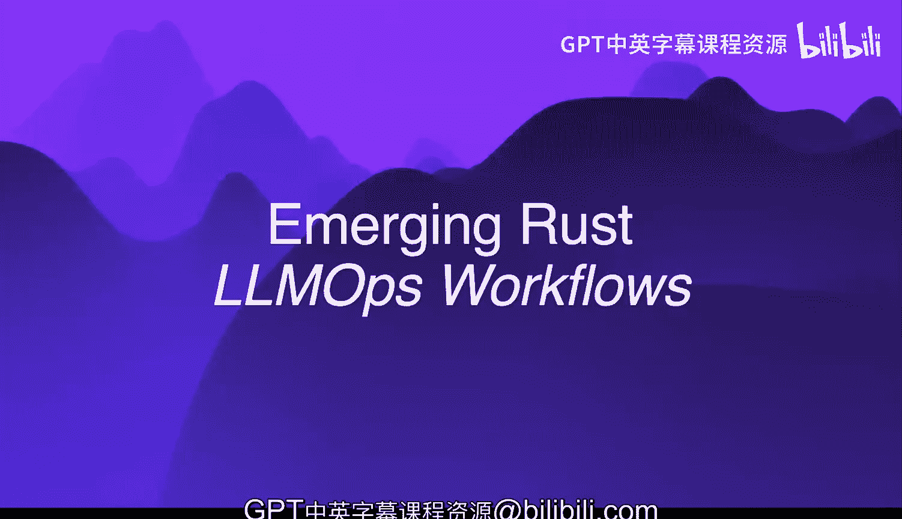
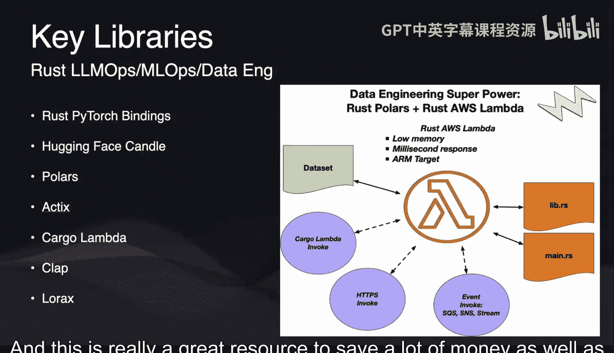
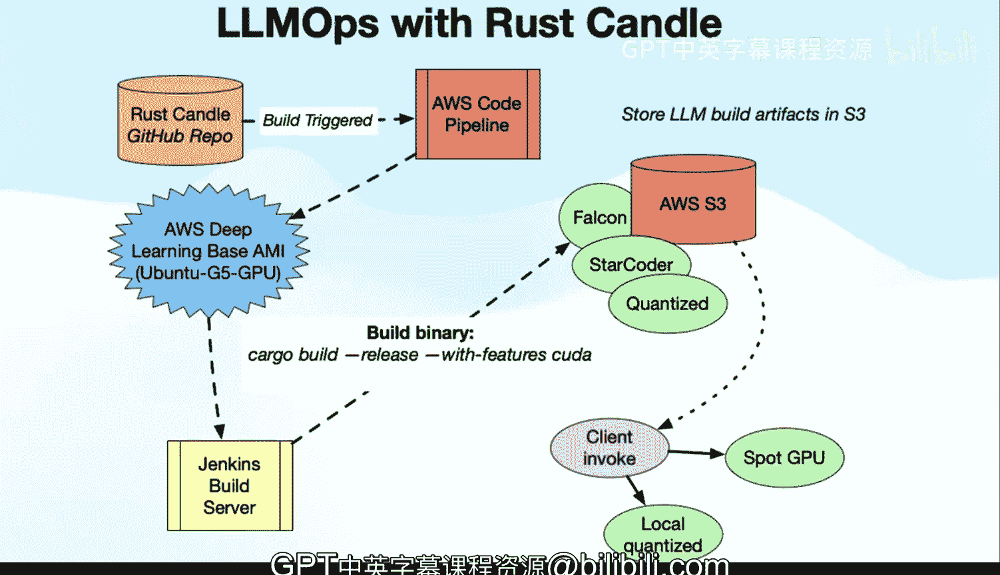

# 杜克大学《大型语言模型实践（高级数据工程、AWS、Databricks和本地LLM）｜Large Language Model Operations 》 - P76：10_01_06_新兴Rust-LLMOps工作流.zh_en - GPT中英字幕课程资源 - BV1oi421Q7GT

Let's talk through some emerging rust LLMOs workflows。 First tap here， if we dive into the libraries。

 there are many libraries that are pretty amazing when you dive into what they actually do。 First up。

 we have rust by torch bindings。 So this is a binding around the C+ plus by torch framework and it has the ability to do things in pure rust。

 we also have huggingface candle， which allows you to wrap large language models in rust and get all the benefits of developing against large language models using the rust framework。

 so you can， for example， pull down the latest mixtureal library and run it or run some other model as it comes out。

AndThere's really not much to do。 you just do cargo run and you actually can compile the model with the files as well。

 We also have polars which allows you to do high performance data frame operations。

 and we also have the high performance web service acttics one of the fastest in the world。

We have cargo Lambda， which allows you to do binarybased deploy to Lambda doing lowmemory millisecond response。

 you can target arm to save money， we have clap for writing command tools。

 we have Lx which allows you to build AI workloads in the cloud and get extremely great performance so all of these rust integrations here。

 give us these superpowers and you can see that there' are some different scenarios where for example。

 if you're going to build data engineering， you can have a data， you can load it into polars。

 use cargo Lambda Voca via HtPS， also tap into let's say SQS， SNS streams。

And this is really a great resource to save a lot of money as well as provide high performance。

We also have the MLOs and LLMOs cloud developer Workspace advantage as well and this is changing rapidly。

 there's new tools being developed。 I mean there's some real problems with a laptop because in many cases this nondeterministic。

 it costs a lot of money it's not the same environment as your deploy environment now there are advantages as well including if you're using these high performanceform laptops you can keep all of your data on your laptop。

 you don't have to send it to a cloud provider but in general these cloud developer workstations have many interesting features like GPUs they have coding assistance like the AWs code whisperser that works with Intelge you also have AW lights sale which has GPU capabilities you have AWS SageMaker with these GPU capabilities。

 coab notebooks so what we're seeing here is that the cloudbased advantage can really be helpful especially with rusts Ru works very well。

A GPU enabled environment in the cloud Now here's a workflow that I think is a very good workflow for many organizations thinking about developing their own workflows for local or self-hosed large language models is use Rus candle。

 you trigger a build， you have a code pipeline that spits out potentially a new image that has everything you need inside of it。

That then releases a binary that binary has an optimization so that it works with GPU and you can load any large language model as well as a fine tuned model into S3 and then you could invoke it via maybe a local quantized version on a CPU client or even potentially in a serverless application or you could use spot instances as well or potentially even install on a local device。

 So this rustbased candle workflow is a very interesting emerging workflow that were seen as well。

 So rust really does give you lots of options for large language models because of the performance in the packaging and really the ecosystem is very friendly for large language models。

