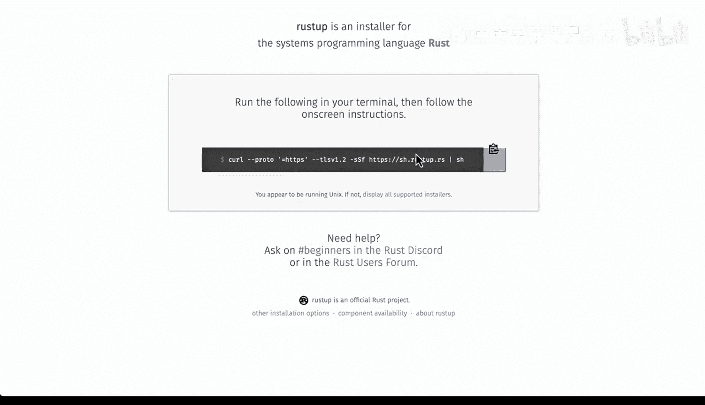
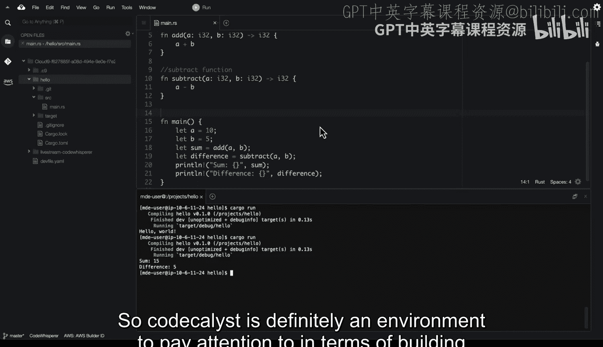

# 杜克大学《大型语言模型实践（高级数据工程、AWS、Databricks和本地LLM）｜Large Language Model Operations 》 - P77：11_01_07_Rust版CodeCatalyst入门.zh_en - GPT中英字幕课程资源 - BV1oi421Q7GT

Here we have Amazon code Catalyst， which is a very new service from Ews that allows you to do cloudbased development。

 And there' are some very beefy boxes as well that you can get access to and let's go ahead and take a test drive of code catalysts for rust first up here I have a dev environment you can see that I have in this particular environment a running instance Now let's talk a little bit about how this works and some of the things you can do。

 So one of the more exciting things you can do is if you go to create dev environment here you can launch a development environment in your browser。

 So this is actually pretty cool because cloud 9 allows you to have a preconfigured AWs environment。

 a lot of the things that are complicated all go away by having this cloud 9 environment and we're gonna to use that in a second you also can do visual studio code as well or you can also do Jebrains IDde so you can actually。

😊，Have a intelligentj connection to it goland， Pychar， etc。

 So there's some really cool integrations here。 And these are all local integrations that proxy into the codecalys environment through the AWs toolkit plugin。

 So now how do I actually get access to this。 So I just click on open and this will open up a new environment let's go ahead and see what that looks like。

 you can see that it opens up this environment。 and I already have one open。

 so I won't do that but if we go to rust up here in order to install rust。

 you literally just copy this。 go to your environment paste it in。 and that's it。

 that's all you have to do to actually install rust and proceed to the installation。

 Now once you've got rust installed， then it's pretty straightforward to get started with developing and let's talk about some of the things that are unique to this particular cloud9 environment。

 So the first thing that we will need to pay attention to。😊。

Is that on this left corner here we have AWS and notice that I'm connected with AWS  builder ID。

 So this is a free ID that you can get just not connected to your AWS account and it allows you to authenticate with other services like。

 for example， code whisperhis。 So codeWhisper is the code completion tool here。

 and you can see that it's currently running。And how would we actually use this together to program some rust。

 Let's go ahead and take a look。 So first up， I'm going to type in cargo new。

 and we'll just type in hello， make a hello world application。 And right here we have a main file。

 So we're ready to go， I can just type in or CDd into the hello project。

 type in cargo run and we're good to go we have a hello world。 Now。

 if I want to make a slightly more complex。 we can tap into code whisper and I can actually make a calculator。

 So what I can do is add a rust comment and say calculator。scriptcrs。And then from here。

 we can save it and I can say the first thing we can do。You know， add function。And then from this。

 we'll do FN add。And then I'm going to get some good code completions。

 and then we'll go here to subtract function and then。We。

 we can take out that a little bit right there， and then we can get a F in。Subtract as well。 right。

 So you can see that there's some reasonable code completion here。

 And then in order to tweak this a little bit， I'm going to say， basically lets。嗯。A equals 10。

 and then let's let B equals 5。 and then we can sum。 We can， we can add some things together。

 and then we can do a difference。 We can subtract some things together。

 And then we can print the sum and we can print the difference。

 right So kind of an intuitive co completion there。 And if we type in cargo run。There you go。

 We are able to actually do that。 That's the old copy。 Now， notice I saved it。

 If I do Cargo run again。 we get the new copy sum a difference。

 So really right out of the gates here， you get a lot to like about developing in the cloud and imagine you can save these environments。

 install certain packages， get things cooked up and then for large language models as well。

 this could be something you could explore， especially if it's a quantized environment where you're building serverless pipelines。

 So code catalyst is definitely a environment to pay attention to in terms of building rust for large language models and machine learning operations and it's very easy to get started with。

😊。

