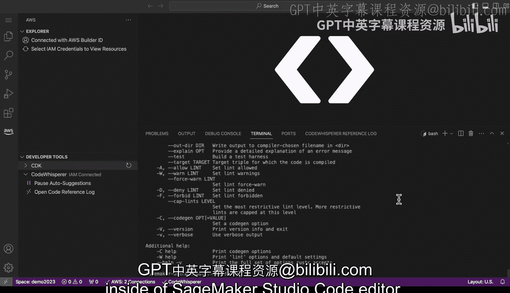

# 杜克大学《大型语言模型实践（高级数据工程、AWS、Databricks和本地LLM）｜Large Language Model Operations 》 - P78：12_01_11_SageMakerEditor入门.zh_en - GPT中英字幕课程资源 - BV1oi421Q7GT

Here we have sagemakerr studio， which is a full fledged environment for dealing with machine learning and also working with large language models you can see on the left here。

 there's a lot of stuff going on。 So we have the ability to launch Jupyter lab our studio canvas code editor we also have this studio classic which is an older version and if we take a look at the different tabs here as well。

 we have running instances， data， Autol experiments， jobs， pipelines， models。

 jumpstart deployments right so basically full MLops pipeline here。

 The one that I'm the most interested in demoing right now， though is code editor。

 very new feature and it has a visual Studio code， open source editor。

 and you can test debug and run the analytics and MLl code right inside of the browser and it has the full ID extension available in the open VsX extension registry。

 So if we take a look at how this works here notice here we have this。

mo environment and you could stop it started， etc。 And if I want to go back to what I've already got open here。

 which is this sageMaker code editor Now how we do we know that we're in this code editor not just a generic you know hosted visual studio environment Well one of the things that we can do is we look at the logo right so that tells us exactly what's going on we also see sageMaker here in the terminal prompt。

Now， a few other things to show that are very interesting here are that if you go to AWS here。

 this is where you could enable other developer tools。

 So this is kind of a game changer in that a lot of the traditional sageMaker tooling was around Jupiter。

 which is not really friendly to building applications now because we have this developer environment。

 you can just get right into writing code and if you have a software engineering background。

 you can use that software engineering background to build code inside of SageMaker studio code editor。

 So if we take a look at what's going on here。I would say one of the things that's kind of a cool thing to play around with is we could in fact。

 do a get remote here and you can see that I've been playing around with a large language model library in this case。

 Huface candle and if I wanted to do some development， some pull requests， etc。

 I could actually do that right in this environment now the other thing to mention that's a very powerful thing to play around with is that it already has the GPU enabled。

 So this is a big one So how would we know if we type in NviDdia。SMI。And we do dash L， for example。

This will pop open a dialog box that shows us like a running monitoring of what's going on with the couda version。

 also the driver version， how much GPU is being utilized in this case we see that right here and we can see in fact this is a Tesla T4 as well so we do have the ability to start doing GPU programming。

 we can do this in rust， we can do it in Python， we can do it whatever language you want to use and one of the really strong advantages of using rust for example。

 is that you can actually get access to binarybased deploy of large language models So this is really an emerging kind of cuttingage thing that's happening to get access to a development environment plus a full MLLops pipeline with AW sageMaker and of course because I've got rust already installed in here I can start developing rust code for large language models right inside of sageMaker studio code editor。

