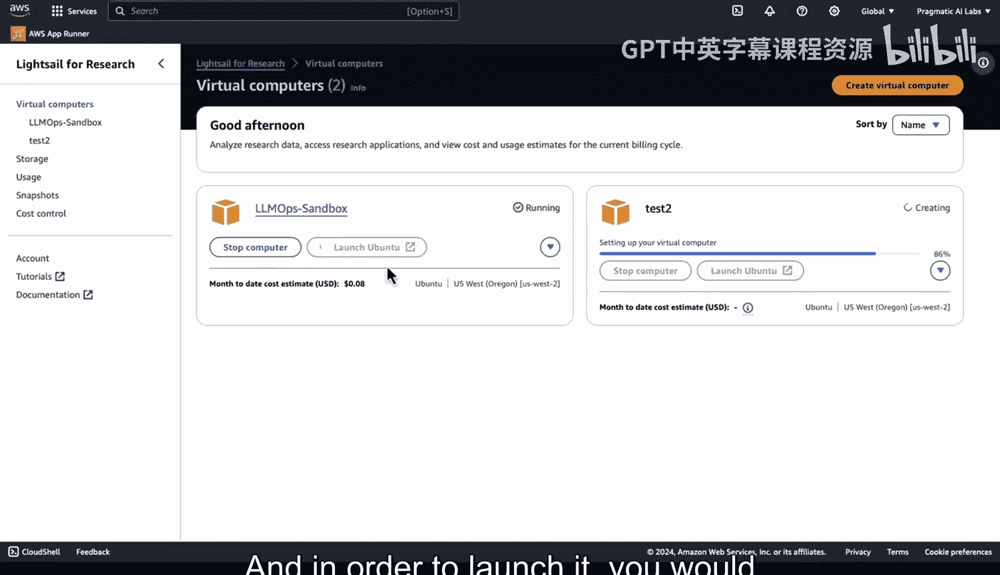
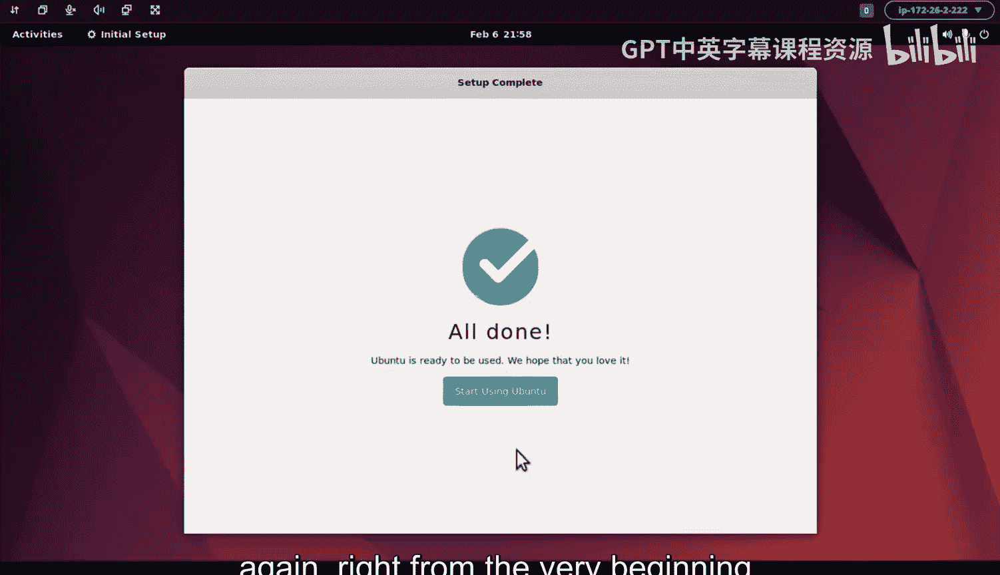
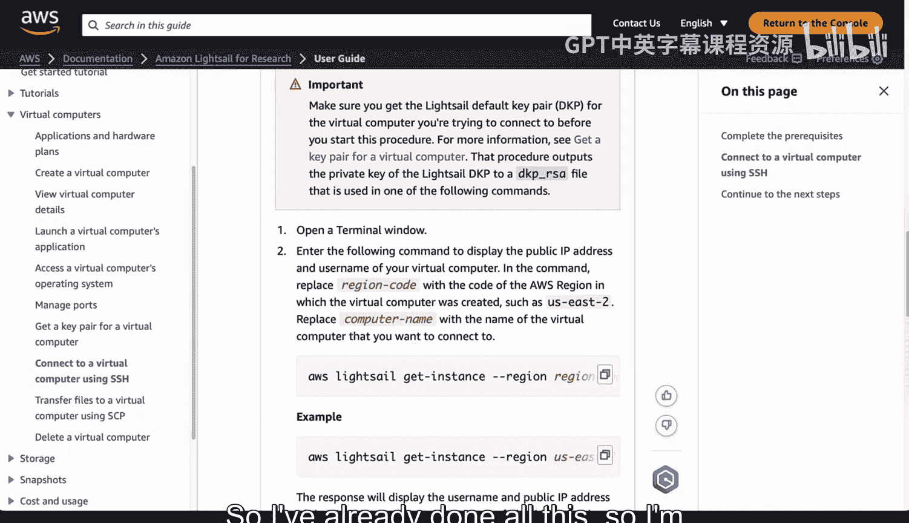
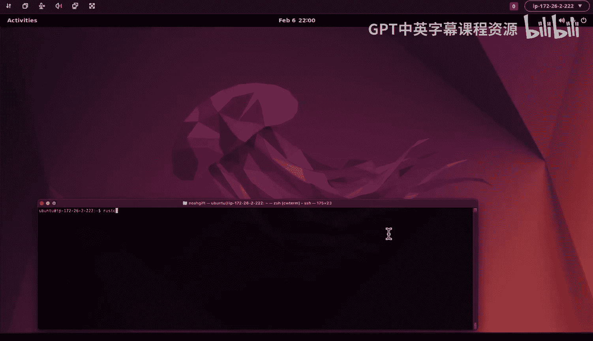
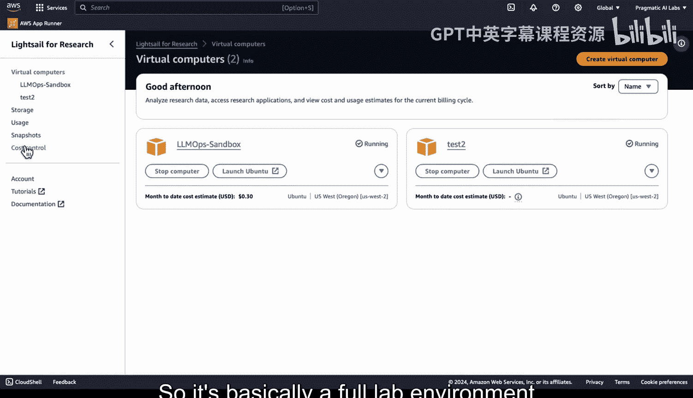

# 杜克大学《大型语言模型实践（高级数据工程、AWS、Databricks和本地LLM）｜Large Language Model Operations 》 - P79：13_01_13_研究型Lightsail入门.zh_en - GPT中英字幕课程资源 - BV1oi421Q7GT

Yeah。Here we have LightSa for research， which is a new service from AWS that gives you the ability to launch very beefy machines for doing large language model development。

 working with machine learning， doing simulations， etc， and here you see that there's some defaults。

 you can have a base abuuntu， you can have Jupipyter Lab， SAB， VScodium。A community driven V code。

 and there's our studio。 Let's go ahead and pick abuuntu first。

 Now notice inside of here that you get access to standard standard2 X standard 4 X。

 So we have the number of V CPUus here as well as in this particular scenario。

 a very strong GPU here that has lots of CPUs， lots of memory， lots of storage。

 And so you're charged only by what you use。 Now let's go ahead and just pick a very easy one here。

 and we'll just call this one test2 or something。And if we create a virtual machine here。

 you can see it's gonna go through here and start building out this application。

 And then once it's running， you have other features as well like closed session。

 delete virtual machine， etc。 Now notice here that I already have one running called LM op sandbox and in order to launch it you would just click this button and we launch it and from here what I can do is actually start to play with it directly inside of the browser。

 So this is a really cool way to get started with doing development because again。

 right from the very beginning， I don't have to actually do anything， I get access to it。

 and I can start putting my editor on here。 So I have a workspace that's right in the cloud and it gives me a lot of the capabilities that I would be used to if I'm doing desktop development。

 Now there's even another way to access it as well。

 which is also pretty cool and that I can also just SS into it。 Now it's a little more complicated。

 but let's take a。😊。

Real quick how this would work so if you go to the instructions here。

 you would have to get a key pair for your computer， follow the instructions here。

 you know there's a couple of different commands that you would run and then you would connect to it via SSH。

And then from here， you can see the instructions as well。 So I've already done all this。

 So I'm going bring a browser over here， and I'll just。

Have the terminal right inside of here。 And if we go to the upararrow。

 you can see that I can connect to this particular machine。 There we go。And and from here。

 what we could do as well is verify that， let's say I wanted to install rust。

 did I already install it， you know I could do the rust up command here。

 which is right here if we go through here， it's going to go through and do a rust up command great it was already installed and I can do a rust C and we can see that the rust compiler is installed as well So a very powerful way to develop in a researchbased environment you get desktop。

 you get the terminal you also have a lot of ability to customize and so it's something that definitely if you're in the large language model MLl op space is worth taking a look at this capability and you also get things like snapshots。

 for example， cost control。 So it's basically a full lab environment that's available with light cell for research。

