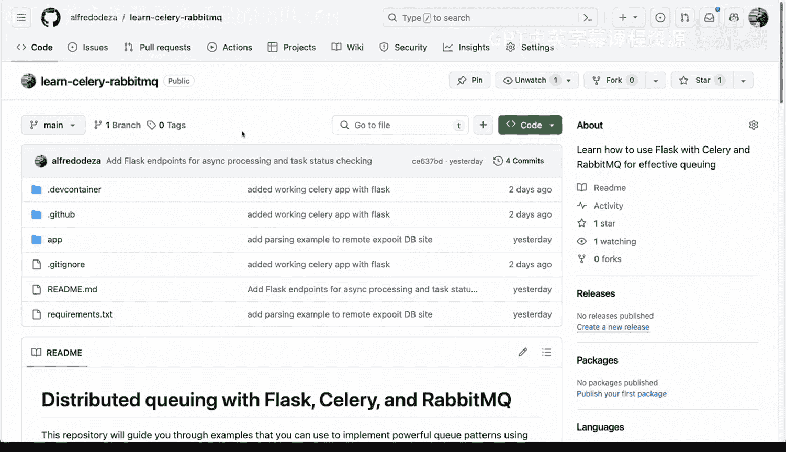

# 杜克大学《大型语言模型实践（高级数据工程、AWS、Databricks和本地LLM）｜Large Language Model Operations 》 - P7：07_01_08_Flask与Celery应用概述.zh_en - GPT中英字幕课程资源 - BV1oi421Q7GT

Let's do an overview of a flask and salary N RaMQ application and this has a couple of examples baked in so don't expect things to be super clean in the sense of like there's no single purpose for this application other than to demonstrate these different capabilities so let's take a look at the requirements let's start here by taking a look at what we've installed so we have flask salary and these two libraries here beautifulut soup4 and requests are going to be supporting libraries what we need is we're going to have flask the application that the web framework and we're going to have salary as you know the application that is going to act as the middlemen the interesting bits and pieces for these application are going to happen in here in the app。

Subdirecty and in here I'm going to click on mainda pi and I'm going to walk you through a little bit of what's going on。

 not in super detail but just like a very quick overview。

So you're going to find usually things like these where you have helper functions that are going to set things up for you again this is just setting up salary and we're not going to going into detail right now as to what that is then similar for flask we're going to set a flask and we're going to be setting some configurations for salary we'll see those in more detail later so let's take a look at the application so whenever there's a request to the root of the website we'll just return these very crappy HTML that I have here where I'll show you give you an example of a curl curl request that you can do so that you can actually try salary。

Then this is the typical one of the typical use cases that we have so say for example。

 you want to send an email and again I'm gonna to go into a lots of detail。

 but you will have something like a synchronous route so requests will come here will get processed and then it will called a synchronously these other function and how is that as synchronous function going to work well we have a shared task right here and you can see here that I'm important sleep and sleeping five seconds on purpose so that you can see how how that will be put into the queue and process later after five seconds without a problem this is a typical pattern where you have a route that is exposed and requests are going to be processed synchronously and then they're going to go through an asynchronous piece of code that is going to work with that later on similarly I'm going to show you。

And in detail， how you're going to have other types of exposed routes where not only you can do something like send an email。

 but want to return you may want to return the result ID so that you can get processed later。

 not only processed later， but the results can actually be requested later。

So that's a very quick overview of a salary with RaitMQ application and very simple。

 very straightforward， and all of these components are going to work together and when I see that later when we get into the details of this application and these examples in work in order。

