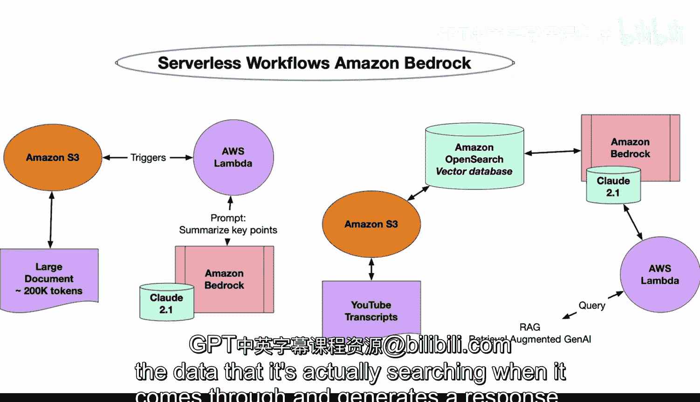

# 杜克大学《大型语言模型实践（高级数据工程、AWS、Databricks和本地LLM）｜Large Language Model Operations 》 - P80：14_01_02_基于AWSBedrock的无服务器架构图.zh_en - GPT中英字幕课程资源 - BV1oi421Q7GT

Here are a couple different workflows for Amazon bedrock that I'd like to discuss On the left。

 we have Amazon S3， and this is a traditional workflow for many AWS Lada applications。

 You put some document in S3， it triggers Lambda， and you would potentially do something with it。

But with bedrock， it enables you to do even more things， for example。

 anything like summarization or figuring out a way to enhance the document， etc。

 and so with AWs Lada talking to bedrock， you could invoke the large language model in this case。

 let's say Cla 2。1 feed it in this document that can be up to 200，000 tokens and then let's say。

 for example， summarize key points so why would you use something like this。

 well good example could be reading filings right for the SEC if you wanted to analyze certain companies and see if they're going to be profitable or see what key conditions are changing you could feed that information into this system and one by one。

 get an analysis and get a uniform analysis， depending on what kind of prompt you would generate。

On the right here is another new emerging workflow。

 which is a retrieval augmented generative AI workflow or RA and this example you could have。

 for example， the YouTube transcripts from a professor and you would download all those transcripts。

 put them into S3 and then Amazon has their own open search serverless vector database and then uses embeddings。

To make those available to a bedrock and then at that point you're able to query this knowledge base that uses the large language model in this case。

 cloudud 2。1。 So how would the serverless come in well all those components or serverless and then EW Lada could be the interface so you could expose this via an API。

 you could expose it via KA tool， you could expose it via a webfront end so there's lots of opportunities for extremely fast development and automation using generative VI from kind of traditional extension of what you do with serverless or going into RaG and actually grounding the generative A model to look at exactly what you want it to look at and actually to give you a reference for the data that is actually searching when it comes through and generate a response。

