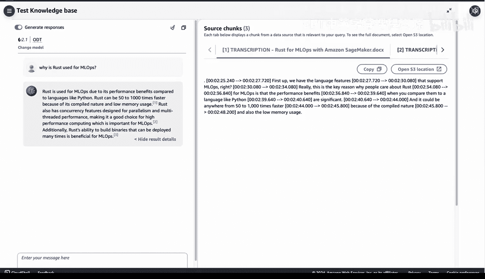

# 杜克大学《大型语言模型实践（高级数据工程、AWS、Databricks和本地LLM）｜Large Language Model Operations 》 - P81：15_01_03_AWSBedrock知识代理演示.zh_en - GPT中英字幕课程资源 - BV1oi421Q7GT

Here we have Amazon bedrock and I have a knowledge base set。

 and what I'm doing in this knowledge base is using a vector database for retrieval。

 augmented generative AI。 So you can see that there's a knowledge based data source here。

 which is some transcripts I've uploaded from S3。 These are some lectures that I've done。

And I'm using the Titan embeddings model here as part of this knowledge base。

 And you can see where it says vector engine， Amazon open search serverless。 right。

 So really all I need to do here is to test it out。Is to first see if my vector database is working。

 So let's go ahead and type in you know what is rust and see what happens here。

 So it's going to now go ahead and do a search here。

 we can see all the different times that I've mentioned rust in different transcripts and then what we can do next is actually use geneerative V in order to to do that I'll selected the model right so I've gone through here and I've selected the cloud 2。

1 model to help out with generative VI and so let's go ahead and type in why is rust used for。

Emoapse。Let's see what happens。 So now I'm able to actually ground things on my data here that's been uploaded。

 and it's going to reflect a generative AI response that is actually going to reference anything I've done。

 So this is really a powerful technique because you can see here it says Ru is used for MLOs due to the performance benefits and notice I'm actually seen exactly my results here that again I can actually reference in the transcript。

 So this is a very powerful technique is to have your own data obviously the more data you have the better that is about the particular topic that you want。

 And then you can use a generative AI model to ground itself on what you consider to be the location for serving out these generative AI results。

