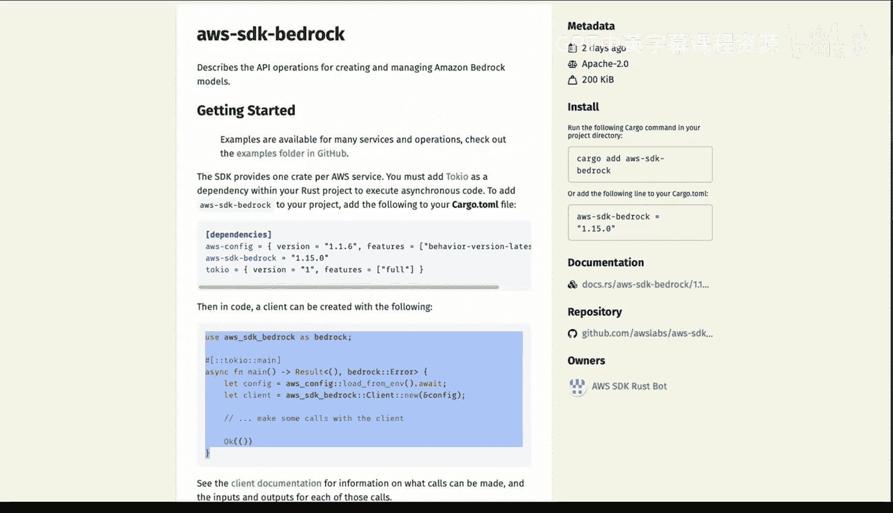
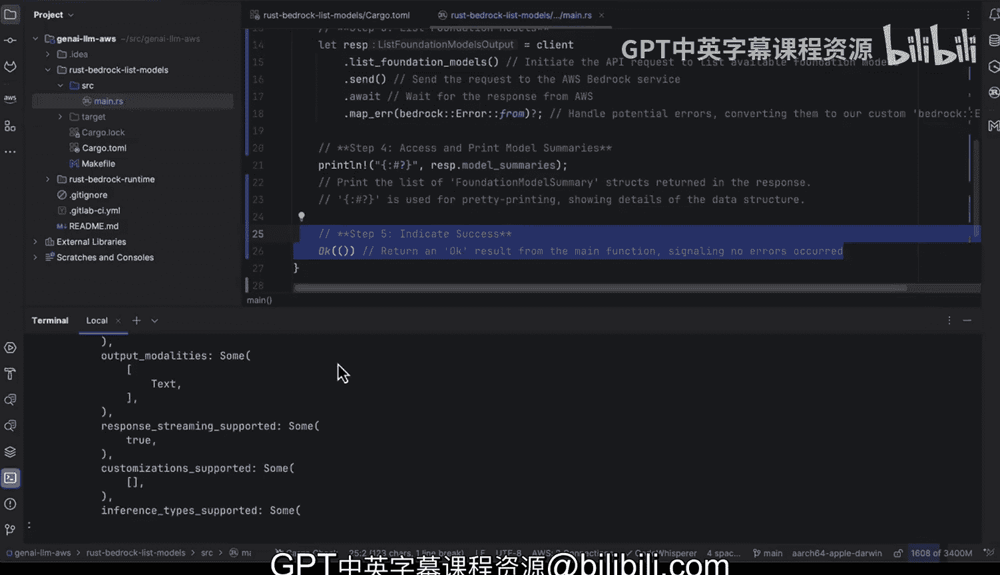

# 杜克大学《大型语言模型实践（高级数据工程、AWS、Databricks和本地LLM）｜Large Language Model Operations 》 - P82：16_01_05_AWSBedrockCLI演示.zh_en - GPT中英字幕课程资源 - BV1oi421Q7GT

Here we have the interface for Amazon bedrock in the AWS console and you can see you can go to the icon view and look at some descriptions about the foundation models that are hosted here or you can also look at the list view and see really a wide variety of different models and how many tokens they take one of the premier ones is Kod version 4。

1 by anthropic but beyond this another way to interface with bedrock is to use rust and so here we see AWS SDK for bedrock and what's nice about it is it's pretty straightforward to actually invoke bedrock from rusts so let's go ahead and get started here here we have the Gennyi project that I'm working on and inside of cargo I have AWS config I have AWS SDK for bedrock and I also have Tokyo which gives the Async capabilities for rust and if we take a look here at the code next。

 we can walk。

Through step by step so first step， I import this AWS bedrock SDK next。

 this marks the main function so that we can actually do asynchronous calls and this is where the Tokyo runtime comes into play。

 then we have a async function here and this asnc function。

 which is the main function is going to be able to return a result here and also handle errors。

And then we have a config。 So this loads the configuration for what we're going to call。

 including the environment that has the region。 And then we have step 2 here。

 which is create the client。 So just one liner here， pretty simple。

 And if we scroll down the next step is to list the foundation models。 So again。

 if we remember the interface。 we could list all of the models that were on that particular console pane。

 And then right here we say list foundation models， send the request， wait for it。

 and then handle any errors that occur。 Finally， all we have to do is print this out。

 and this does pretty printing right here。And then at the very end。

 we return in OK to say that it's successful， so let's go ahead and do this， let's type in cargo run。

There we go。 And now it's a little bit difficult to read。

 So what we can do is actually pass it into less。This is one of the tricks that I like to use and you can just scroll through and see all of the different bedrock models so if you're going to invoke rust as your main interface。

 it would work very well in a serverless runtime like AWS Lambda apprunner， potentially Fargate。

 so Ru has a lot of potential here for the new world of large language models because of the efficiency and it's the newest general release SDK for the AWS platform。

