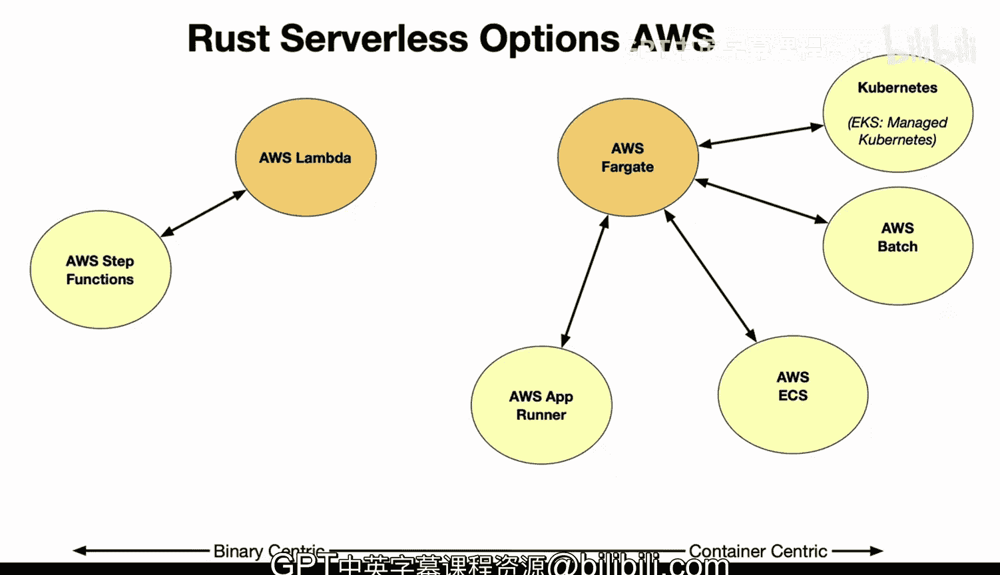

# 杜克大学《大型语言模型实践（高级数据工程、AWS、Databricks和本地LLM）｜Large Language Model Operations 》 - P83：17_01_06_Rust无服务器方案架构图.zh_en - GPT中英字幕课程资源 - BV1oi421Q7GT

Yeah。Here are some rust serverless options for AWS。

 First on the left we have binary centric and this is a real advantage of a language like rust is that you don't have to package the dependencies you can put in many cases the dependencies inside of the binary if you use cargo lambda for example。

 it'll make it easy to deploy a serverless function and this function could do things like do data engineering with polars or use pipe towards etc and then you could extend it with step functions to wrap that functionality So it's a competitive advantage in the world of serverless to have the rust ecosystem and also the latency。

 the performance， the energy usage， the cost is going to be in many scenarios 1010 maybe1 thousand times more performanceant depending on the use case Now we also have other options that are centered around Fargate Fargate can make things easy because it has interfaces into。

Different services Let's talk about a few of these services First up。

 we have apprunner apprunner is pretty compelling because it allows you to take a container image you push it into ER it does auto deploy so you get continuous delivery really right out of the gate with AWS apprunner we also have AWS ECS which is the container service that is managed by AWS and you could do some things where you're running maybe bespoke jobs etca that are longrun and those would work with fargate so itd be serverless we also have AWS batch itself。

 which is pretty compelling and that if you wanted to run shortlive jobs。

 maybe even use spot instances， etc ce you could put some rust。

 let's say GPUbased training or maybe some inference etc or some data engineering tasks into AWS batch and get a great performance。

We also have Kubernetes and Kubernetes can be managed via EKS and that also works with AWS Fargate。

 so there's lots of different options if you want to go more container centric。

 you could go to these services like Fargate， if you want to go more serverless binary centric。

 you could go to the AWS Lada use cases， they're both great options for Ru on AWS。

