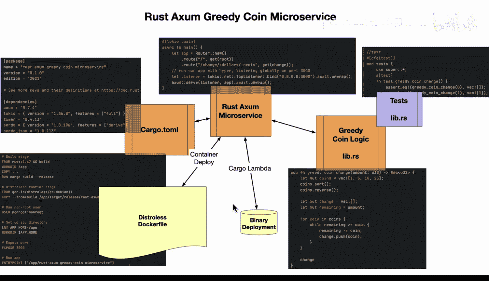

# 杜克大学《大型语言模型实践（高级数据工程、AWS、Databricks和本地LLM）｜Large Language Model Operations 》 - P84：18_01_07_RustAxum贪婪硬币微服务组件架构图.zh_en - GPT中英字幕课程资源 - BV1oi421Q7GT

Here we have a rust axiom greedy coin microservice。

 let's break up each of these components into its segment and talk about it。

 first we have the microservice itself， it uses the Tokyo framework to get aync capabilities so it's one of the fastest frameworks that's available so that's one of the pluses of it and you can see it's pretty intuitive as well if you go to the route change。

 it's going to accept a dollars and cents parameter。

And then that's going pass it to a change function Now the other thing to be aware of is that I've divided the logic into a LibRS directory that's a pattern that is a nice pattern to really separate things so that you have the controller which is the microservice and then you have the business logic in a library here and you can see it's a pretty simple function it uses the greedy heuristic here that is able to first take the largest coins process as many as it can with the largest coins which are the 25 cent pieces and then if there's any change left it tries the next largest and then it tries the next largest and what's efficient about this is that it makes the least amount of iterations in order to give you the change and it gives you the largest amounts of change first so that you're not going to exhaust the smaller denominations We also see that there's a test here and this is in the LibRS and this is a pattern that's pretty nice with a lot of rust projects where you can put some test。

The bottom and then you're testing the business logic as well。

 which is the part that's oftentimes the most tricky make sure that you've got the core logic working now in terms of the cargo。

2ml file you can see I've got the packages installed here we have axiom Tokyo we have the3 library as well for dessterilization and serialization and then we have the disless Docker file so this is optional but if you wanted to do a containerbased deploy here what's nice about this disless Docker file is that it shrinks things down just to basically the binary and puts that binary somewhere so it could be as small as let's say 20 megabytes 30 megabytes extremely small Docker image which makes deployment very easy Now there also is binary deploy when you're using rust and rust axiom actually it works very well with AWs lambda as well and so you could use cargo lambmbda and you could take your code make some small changes to it and then do a binary。

basedase deploy there are all are even libraries that can proxy between the two different styles so you don't have to change your code at all so you can see there's a complete framework here that you're able to use when you're using rust aom and you could do serverless deploys right you can deploy to containers maybe ECS you can deploy to Kubernetes you can also deploy to binaries so there's lots of options and it works very well in the world of generative AI because you can proxy right into some GenI service。

 potentially something that's using ragG and that ragG service could be something that fits into your microservice。

