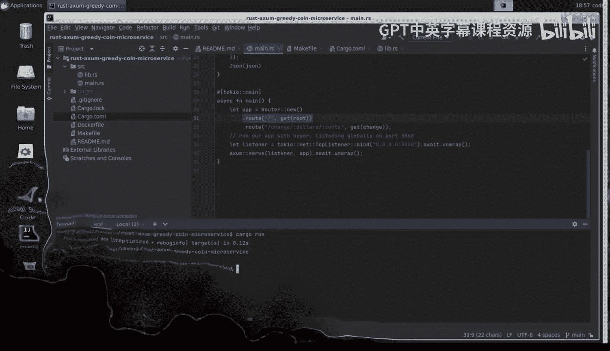

# 杜克大学《大型语言模型实践（高级数据工程、AWS、Databricks和本地LLM）｜Large Language Model Operations 》 - P85：19_01_08_RustAxum贪婪硬币演示.zh_en - GPT中英字幕课程资源 - BV1oi421Q7GT

Here we have Intelligj with a rust microservice project， rust axiom。

 I have a Lib file and a main file。 The Lib file is where all of the logic is kept here。

 let's take a look at this greedy coin change function pretty simple it is able to take a U32 returns of V U32 and this V here contains the coins 151025 cents and what happens is that it's constantly going through and taking first the largest denomination and then once it's exhausted it goes to the next largest denomination so you have a reasonable optimization here for returning the correct amount of change with the least amount of iterations and we can see there is a test here as well so built inside of the LibRS is a test suite so we can test different iterations of the coins and then we also have the main in the main we have the logic for routing。

Also using the use rust axiom greedy coin microservice greedy coin change use statement here and what this does is it makes it able to use that function from the Lib。

RS we have a default route here which is a static route that says basically how to use this microservice and then we have a function here that is able to take the path and it basically disassemble it so that we have the dollars in the sense removed and then what happens at the very end is it returns back a J payload now it gets all put together right here inside of Tokyo and what we do is we say route this one will refer to the root route。

 this route which is changed dollars sense these are the parameters these get passed into the getchan which is right up here and then we have a listener over here the only other thing to point out here is that we have a make file just to keep some handy commands around so we don'll have to remember and。

I also have a cargo。2l file that shows the dependencies that are used for this project Now to run it。

 we could do something pretty simple， which is we could just go down here and we could go to terminal。

And in order to run this thing it pretty straightforward， all I need to do is type in cargo run。

 just go ahead and do that cargo run。And this will just run in the foreground while we're waiting for requests。

 and then we can open up another session right here。

And we can just type in curl and notice we can look at the port that it's running on。

 It's running on port 3000。 So do a local host。 we'll say local host  3000。

And this will give us the default route here and then if we want to put in something fancy here we'll say change and I can put in $ 34 right because the first parameter dollar。

 second parameter a sense and we can see that we get a J payload back that says sense 34 and dollars1 and then we see the exact change that was returned as well which is pretty nice so it shows us that there were one。

2，34 or5 25 cent pieces， a 5 cent piece and then the rest here are 1 cent pieces So this microservice is basically fully functioning not much to do other than to potentially extended change some of the things as well the only other thing that I will point out here is that you obviously could also open up a web browser tried out that way but this is really an overview of the key components of an axom greedy coin microservice。

