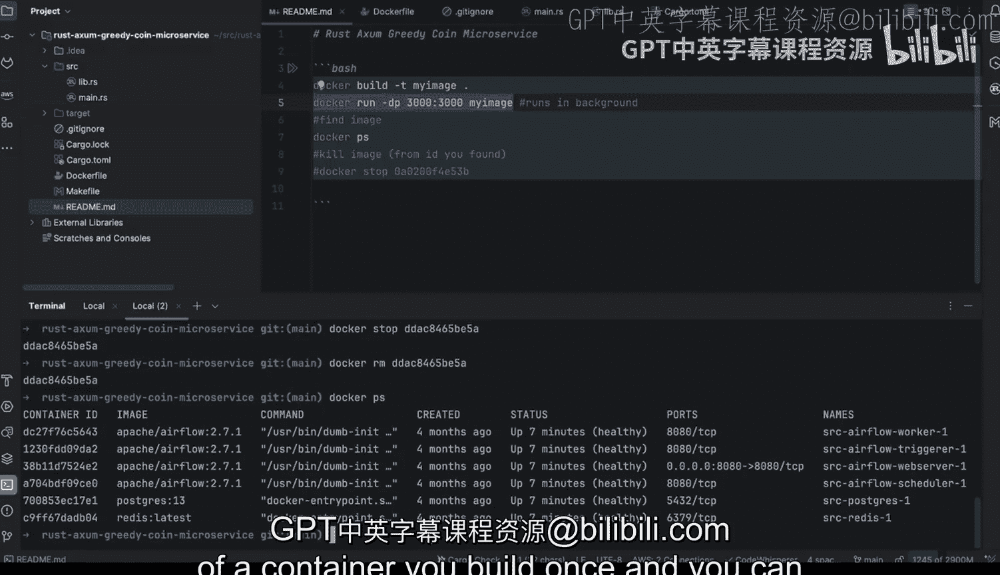

# 杜克大学《大型语言模型实践（高级数据工程、AWS、Databricks和本地LLM）｜Large Language Model Operations 》 - P86：20_01_09_RustAxumDocker工作流演示.zh_en - GPT中英字幕课程资源 - BV1oi421Q7GT

Yeah。Here we have Intellaj and I have a Docker file opened up for a rust microservice。 In this case。

 there is a lib here that's got the logic of this particular application。 I've got a main here。

 which has some routes setup up here， we return back these routes。

 But the part that I want to talk about is the Docker file。 So if we take a look at this docker file。

 one thing that I'm doing here is I'm using diststrs。

 which is a way of making containers that are extremely small the container images。

 and in this case I'm taking this binary， and I'm putting it inside of here。

 This is the app directory and then expose the port。

 and what happens is it creates an extremely small container image。

 which makes it very easy to deploy。 Now let's go ahead and take a look at what are the commands that I'm going to run。

 So in order to do that we'll go to readme here where we can take a look at this setup。

 So I'm going go ahead and run this first step。 I'm going go Docker build dash T。My image。

There we go。And this will take a second to go through。

 set everything up and build it Now while it's running。

 what we can do is we can also take a look at what it looks like inside of the Docker desktop。

 you can see the Docker desktop here shows all the different things that are happening how much CPU the containers are using what are the current containers in this case we can see my image from earlier that I was playing around with I could start things I could delete things So a lot of times it can be very handy to play around with both the desktop and also the terminal because depending on what it is you're doing。

 you get different capabilities， there's a lot of speed that you get from doing things on the terminal but sometimes it's nice to look at goi to give you an overview of everything that's actually running on your machine All right so we got this thing built here So really the only step left is to go ahead and do this run command Now if we do this Dp this will run it in the background。

So basically it won't hang the terminal So now how do we even know what's going on Well one of the ways that we can test what's going on is I could just curl it so we know that from the code here that this is the logic it's going to take amounts and then this is the route here so we can curl a local host and actually test out to make sure that it's running so we can say hur local host and then we can do 3000。

Change， and we can say， a dollar，34。There we go。 So we know that it is running。 No。

 the question is where is it running。 So if we go back to the main file right here。

 we can type in Docker P。And then in this particular scenario here。

 we can see that in fact it is exposed right there and we can see that actually 3000 is connecting to the internal port。

 3000， so we can see that in fact on the left this is the external port and that's exposed to the host machine and the port here that's internal。

 is on the right right so this is external， this is internal。Now， in order to kill it。

 what we'll need to do is take this container ID。We'll go through here。And we'll type in Docker。Stop。

And we'll just paste this in。And then at this point。

 we've been able to stop that image so it's not going to take up resources on our machine。

 and later if you wanted to even delete it， we could also do a Docker RM so we could type in Docker RM and we could just again put in that number。

And there we go and if we type in Docker P here we should see that in fact none of these are inside of the list。

 so that's really the gist of running local containers。

 gain the workflow going what's very useful about this is that it simulates production and then later if I wanted to do a production deploy to some service like maybe Amazon ECS or Amazon Kubernetes service or to apprunner or maybe to Lambda can deploy lots of different platforms it would work very well as well as other cloud platforms。

 So cloudrun， for example on the Google Cloud， that's the real advantage of a container you build once and you can deploy it to many different environments。

