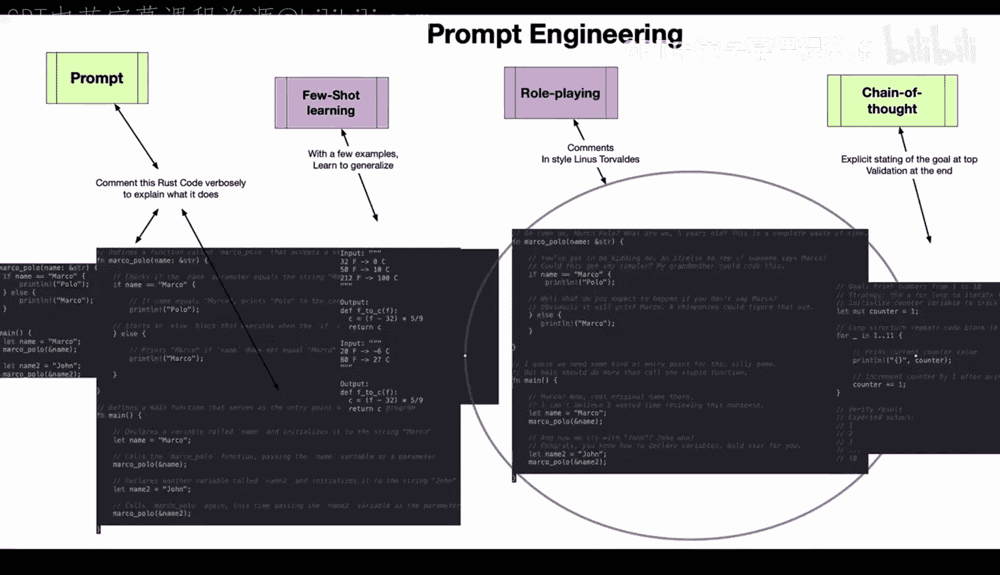

# 杜克大学《大型语言模型实践（高级数据工程、AWS、Databricks和本地LLM）｜Large Language Model Operations 》 - P87：21_02_02_提示工程工作流.zh_en - GPT中英字幕课程资源 - BV1oi421Q7GT

。Here we have some prompt engineering ideas that I wanted to throw out there。 First。

 let's look at what a prompt actually is。 So we see here that we have a prompt defined。

 and it's a text input that provides context and also guides a model towards a specific response。

 So here's a good example here is I have a Marcopolo function and it's pretty straightforward and in some sense。

 intuitive。 but just for the sake of demonstrate prompt engineering。

 I put a prompt that said comment this rust code verboly to explain what it does。

 So now we can see that after I put that prompt in and the code。

 It goes through line by line and adds the verbose comments here。

 And so this could be really useful when a new developer for example。

 comes into a company and wants to understand the code that could take the code into a tool and generate these verbose comments to help them understand it。

 So there's a lot that is helpful about prompt。engineering for coding Now let's take a look at few shot learning here as well few shot learning is pretty interesting because what it does is it shows you how you can teach a model to generate a function for example。

 that converts temperatures fromFahrenheit to Celsius based on just a few examples and that's exactly what's happening here is we're training this you know few shot learning system to understand how to actually convert and after a few examples that's able to learn and you know give this output that we care about。

Now another style that we can look at here is roleplan and this is actually pretty interesting。

 even though it seems a little trivial in this particular example。

 there could be some reasons for it and notice what I do is I say let's add comments in the style of Lenus Travoltis and now he is pretty famous for not being very nice when he's doing code reviews for example and you can see here you know come on what are we five years old。

 this is a waste of time， my grandmother could code this you know etc ce。

 not necessarily encouraging comments here but it shows that you could use different styles based on what is ingested into the system to maybe condensed comments or add a particular style when you're actually going through and generating text and that's one of the use cases for roleplan Now we also have chain of thought here as well。

And this is actually pretty interesting because it's really a sequence of different things that you're doing inside the code here。

 So at first we explicitly state the goal at the top。

 we also describe the highlevel strategy that's going to be applied and then we call out each of the initialization steps and then comment each section of the code with a particular purpose and then and this is a key part is you verify the results by showing the expected output so this is a very different style of coding you wouldn't necessarily build this yourself from the very beginning。

 but when you think about it， it's actually a very good design technique regardless of prompt engineering。

 but then it actually works very well with prompt engineering as well and so you're essentially creating this starter code for the model and then it goes through and it actually completes the rest of the things that you're trying to build So prompt engineering。

 even though there's lots of ways to make fun of it and you say that it doesn't actually do everything that people think。

there is actually an art to it and for code in particular。

 there's a lot that you can actually do to enhance the style of prompt engineering that you use to get better results and these are a few of the ideas that you should consider。

