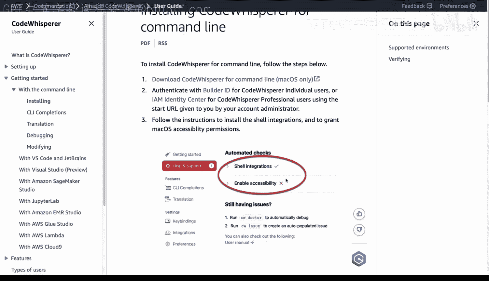
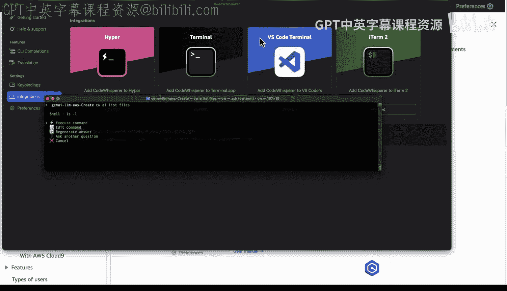

# 杜克大学《大型语言模型实践（高级数据工程、AWS、Databricks和本地LLM）｜Large Language Model Operations 》 - P90：24_02_02_安装配置CodeWhispererCLI.zh_en - GPT中英字幕课程资源 - BV1oi421Q7GT

Here we have the documentation for installing codeWhis for the command line。

 you can see that you can download codeWhis for Mac OS here and then authenticate with a builder ID and then this gives you the ability to have all of these enhanced natural language processing features in your shell。

 So what we can do here is actually bring over the preferences here。

 and you can see some of the things that you can get started with。 So first up here。

We see a window that shows everything that's happening right so you get these nice autocomps here that help you navigate folders。

 maybe give you different options for different directories so that's pretty helpful and then we also have CLI completions as well so what this does。

I it shows you all the different things that you can do and you can even enhance it by you know customizing。

 let's say allow instant execute after space you know execute dangerous commands。

 let's say you're an expert user know you can really tweak lots of settings here as well do you fuzzy searches as well。

 which could be pretty interesting dependingating on the use cases you have and even you configure different fonts etc Now the feature that probably many people are also interested in is being able to run the natural language to bash and you can either do it with the hashtag or you can do CWAI since I use the hashtag a lot for my personal workflows I'm just going to do CWAI and finally you can go through here and configure key bindingd。

 integrations and preferences you can see that。It integrates with hyper terminal。

 also the VS code terminal， IT， and even NS support for Je Brains as well if you're going to do things with。

 for example， Intelate。Once you've got this installed， all I need to do is just type in CW AI。

 and you can put in some kind of question here， let's say， you know， list files。

And it will go through and it'll give you an option， in this case， I'll go ahead and say execute。

