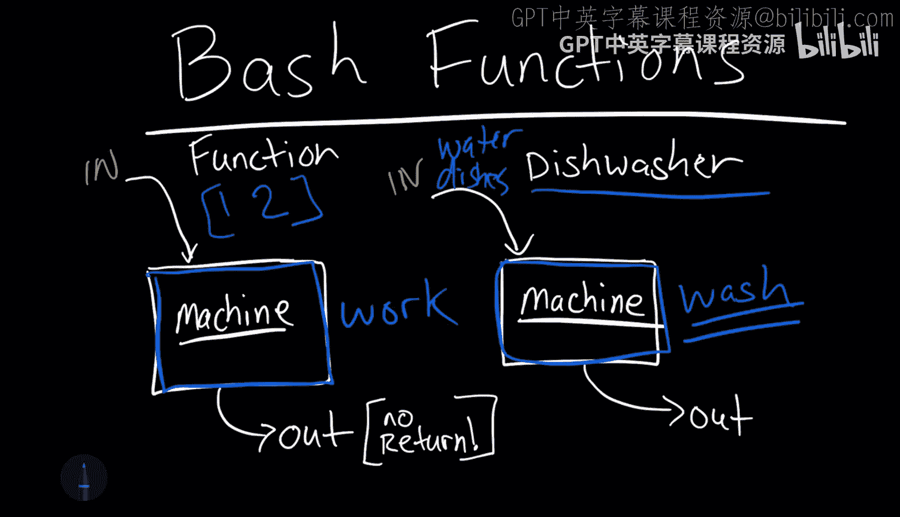
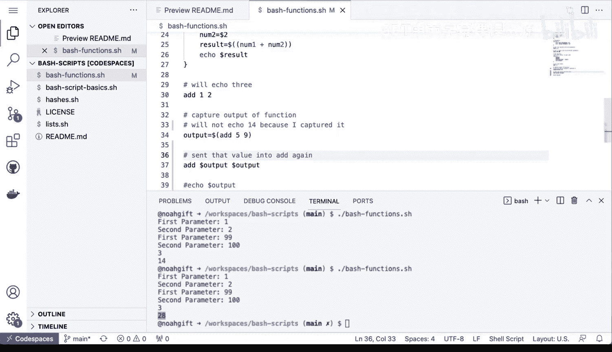

# 杜克大学《大型语言模型实践（高级数据工程、AWS、Databricks和本地LLM）｜Large Language Model Operations 》 - P93：27_02_06_Bash函数.zh_en - GPT中英字幕课程资源 - BV1oi421Q7GT

Let's take a look at bash functions。 Here's a good example of how I like to think about them is there little machines like in your house。

 for example， you have a dishwasher what comes in， well we have the water we also have the dishes so there's these inputs that come into the machine the machine goes through and it washes everything and then you have an output which is you are able to take that clean dish and put it into your cupboard similarly with bash or any programming language you you have similar things you have for example。

 a number one and maybe number two and it goes through into the machine gets added together now the difference here in terms of other programming languages is there is no explicit return in bash so you can't return the value for example of one and two what you could do though is you can echo out the results and then capture that echo so it's just a little bit different than other programming languages。

 but in general though the core concept here。To think about a function as a machine。

 so why would you want to have a dishwasher， well you can use it over and over again。

 similarly why would you want to have a batch function。

 you can use it over and over again so it allows you to reuse your code All right。

 let's go ahead and take a look at an example。

Let's walk through this bash function script here。 You can see at the very beginning of have a Shabang line that tells us that bash itself should run this。

 and then I have some comments。 and all I did here was put the basic structure for a function right which is the name these parentheses and then the curly brackets and inside is where you would run your code。

 So really very straightforward to build a function of bash Here's one of the most simple ones you can build which is a mimic function and all this does is it echoes the first thing and it echoes the second thing you pass in。

 So how would this work Well if we go through here and we call it mimic one and two it'll print out one and2 inside of this statement。

Similarly， this is kind of the whole point of building functions in bash is that when you go down here and you want to call a second time the same function。

 notice that I don't have to rewrite the code， it's reusability that's the core concept with writing a function in bash and again it'll echo out 99 echo out 100 Now let's go ahead and just run this to get an idea for how this would work and I can go through here bash functions notice there we go we did first second and the second time I call it it's doing the same thing So if you're gonna build a backup script for example。

 you wouldn't want to have to write all this code for your backup script every single time you want to just pass in。

 let's say a path to back This is really the core idea with building out logic is you get to reuse it Now let's take a little more complex of a function here and and see some of the unique characteristics of bash because bash does not have the concept of a return。

valueue the only way to get something out is either to capture the echo or to you know do something more complex。

 and so in this example， what I'm gonna do is I'm going to define a function called add and inside of here I assign the first parameter to a variable I assign the second parameter to a variable and then what I do here is I add those two things up right so it's a really simple calculation adding two numbers and then I go through here and I echo out the results so basically after I do my work the only way for me to get this value back out is to actually look at the standard out of the function and so if we do this this will echo out the word three Now one of the things that's important to be aware of here is that I don't have to explicitly let that go to standard out。

 I can actually capture that and assign it to another variable。 So here's a good example of how。

I do this is I run that add function and I pass in four and I pass in nine and what's going to happen is it's going to get captured into this variable right here and then I can do whatever I want with it。

 let's say I needed to pass it into another function right that would be a fine way to do things in fact that might be kind of fun to do。

Why don't we do this， why don't we take that output here？And let's call add again。In this case。

 though， I'm going to put inside of your the output variable twice。

 and so whatll happen is that this output。We'll then go into the function again。Here we go。

And then this should return back 14 plus 14。So let's go ahead and do that。

And let's call batchsh function there we go and you can see that in fact I was able to reuse that value。

 it didn't print out 14 right because of the fact that I didn't echo this out and so this this I'll say this will not echo 14。

Because I captured it。Instead， what I did is I sent。That value into add again。Right。

 so this is really the concept here with bash functions， reusability。

 you can even capture the output if you do a little bit of clever things with the echo and then you can send it again to either the same function or another function。

