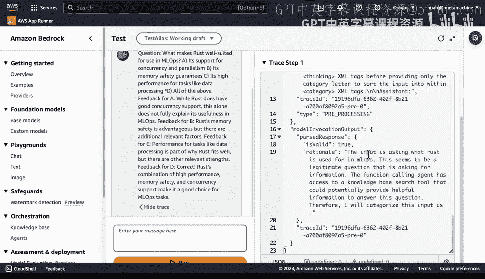
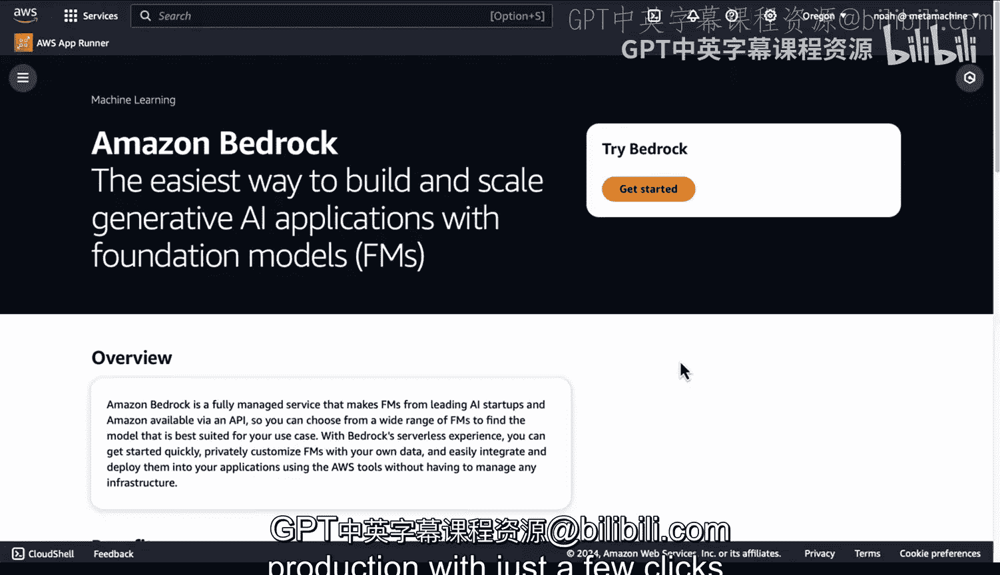

# 杜克大学《大型语言模型实践（高级数据工程、AWS、Databricks和本地LLM）｜Large Language Model Operations 》 - P94：28_03_02_AmazonBedrock核心组件.zh_en - GPT中英字幕课程资源 - BV1oi421Q7GT

Let's check out some of the key components of Amazon and bedrock。

 There's actually a lot going on here， even though if you look at the left pane here。

 it looks pretty straightforward。But there is a lot to explore。 So first up。

 we have an overview here where we get this tab and you can see that really the highlight are these foundation models。

 So the idea with a foundation model is typically these are a billion parameters or more and you can see that they're from different companies and there's also models from Amazon and if you go through here and we look at examples。

 you can get lots of different examples here if you're going to for example。

 do character roleplay you can see exactly what the prompts are Now the big thing to take a look at here is to look at these base models under foundation models And this is one of the premier ones that a lot of people are interested in is that it has a 200 K token interface here for Claude and then once I was able to select this I could actually go ahead and open in playground Now if I go ahead and open and playground。

 it just means that for example， I could say you what。Is a healthy。Fruit， That is purple。Right。

 and then we can go through here and we can run it and get a response。

 So it's a great way to get ideas for things。 just kind of explore the API as well。

 And then if you scroll down， you can also get metrics about exactly what's happening。 Now。

 the chat is pretty good here。 but also， let's take a look at the custom models next here。

 So the idea here is that you can actually fine tune by clicking buttons， which is not bad。

 So if you wanted to go through here and fine tune something， you go model， say customized model。😊。

Go go through， say create fine tuning job。 Now， another thing we can do here is we can actually have an agent that talks to the particular knowledge base。

 And in this case， we can say， you know， what is。Restt used for an MLopse。

And what this does is it acts as an interface to communicate with my knowledge base。

 And so I can actually think of it as a customized chat bod that I'm able to actually enhance and put any other extra prompts inside of it so that I get a really rich experience。

 And so there's a lot to like about both the knowledge base and also the agents because you can point and click and build a solution。

 Here we go。 So we're able to talk to this agent。 the agent says you know what makes well rest well suited for MLOs。

 high support for concurrency， parallelism， etc。 and were able to actually look at the trace here。

 and we can even see exactly how everything was processed And again。

 it's referring to my knowledge base earlier。 So really in a nutshell Amazon bedrock is essentially a playground where you can point and click。

 build things use some of the latest techniques for large language models as well as fine tune them and experiment with building solutions that go into。

with just a few clicks。

