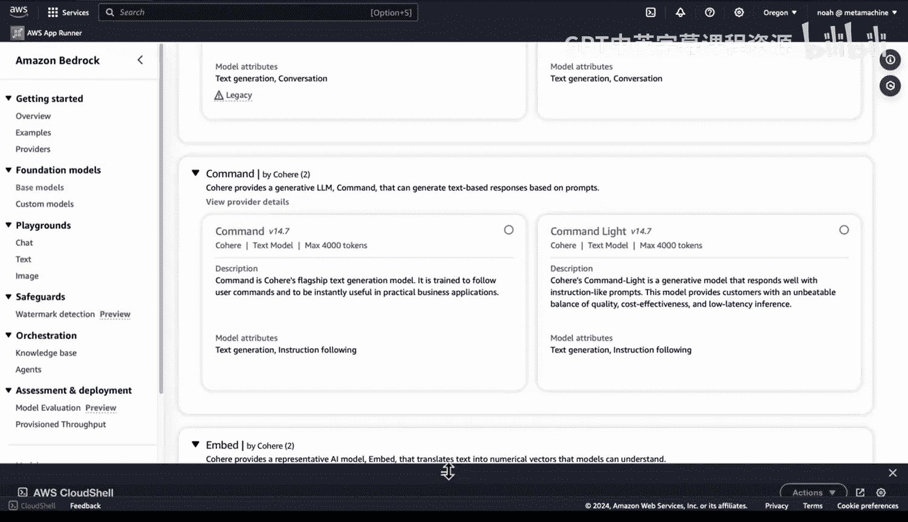
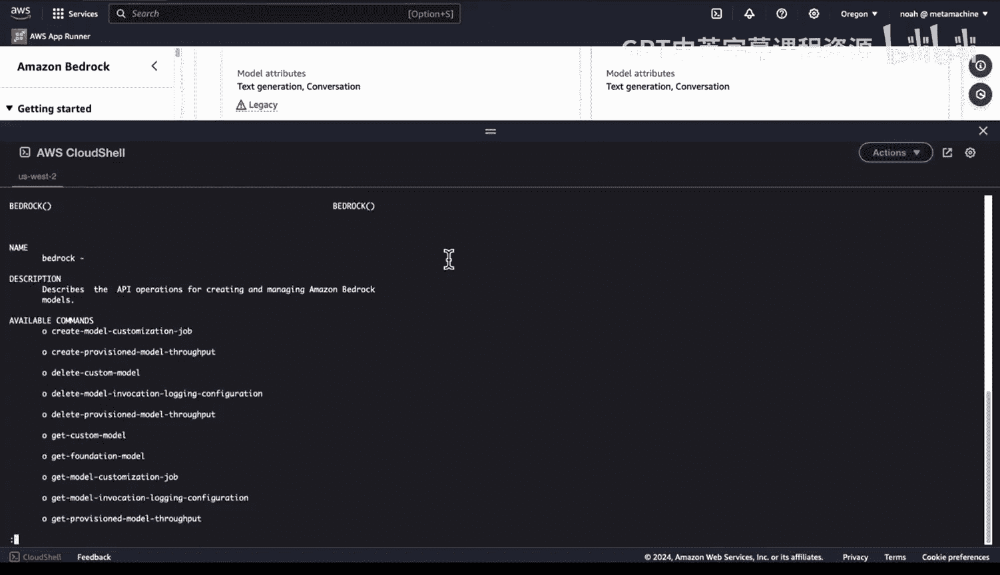
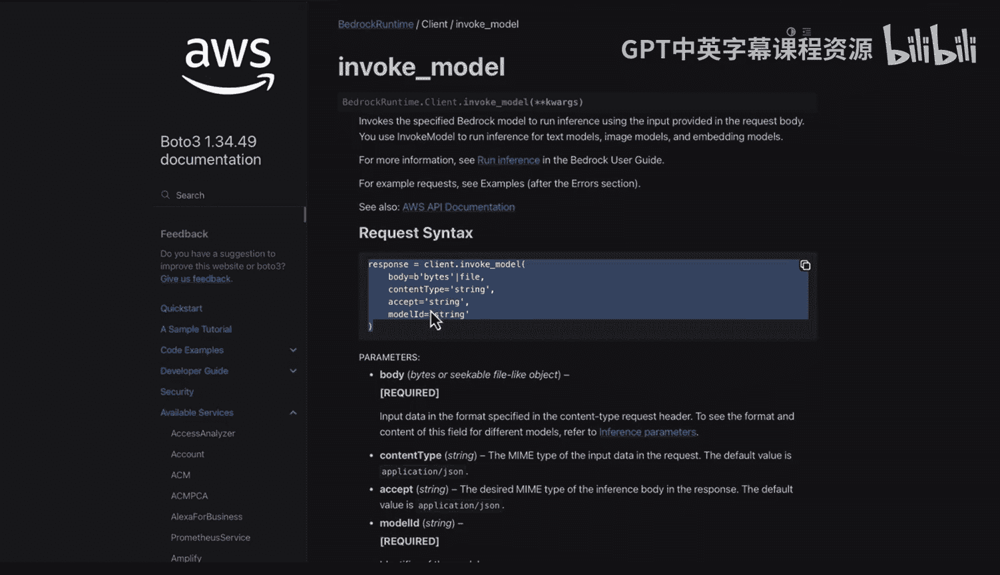
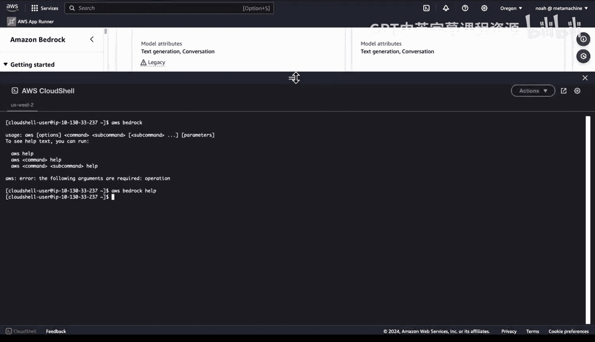
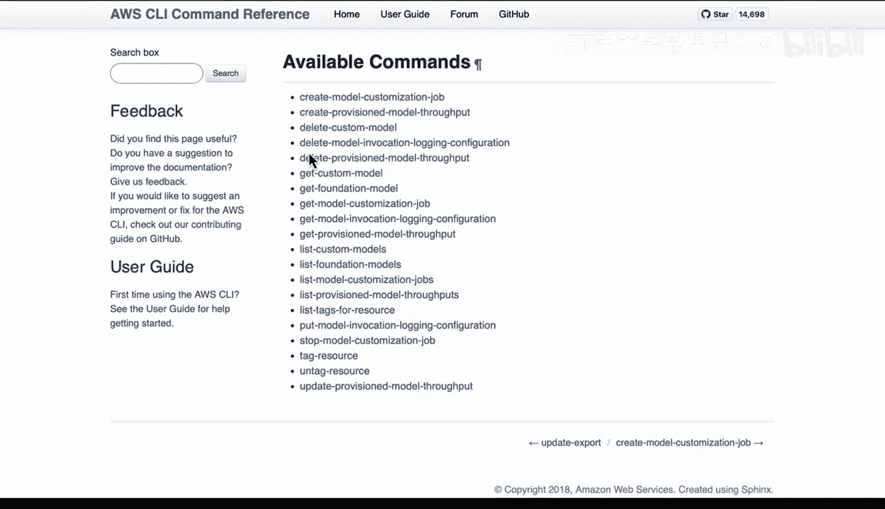
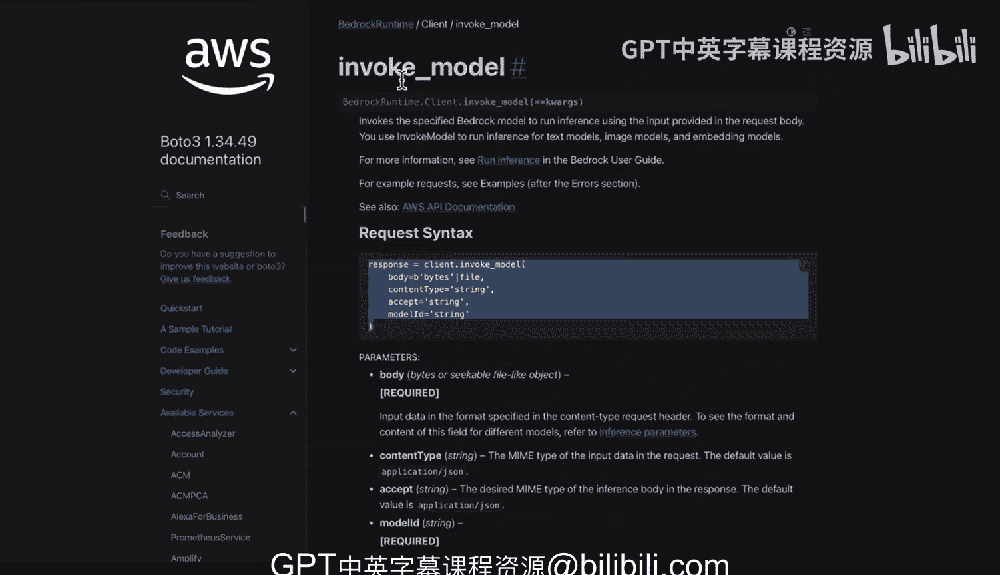

# 杜克大学《大型语言模型实践（高级数据工程、AWS、Databricks和本地LLM）｜Large Language Model Operations 》 - P95：29_03_02_探索Boto3Bedrock客户端PythonSDK.zh_en - GPT中英字幕课程资源 - BV1oi421Q7GT

Here we have Amazon bedrock。 You can see that there's a foundations model section and we can look at the different foundational models here。

 there's cloudde。 there's cloud Ins， etc ce。 There's lots of different models here。

 but how do I programmatically access these models。

 Well first up one of the ways we can do this is go to the Cloud shell。

 So if you go to this section Cloud shellll。 we go right here。

 And I what I'm going to do here is actually say AWs bedrock list foundation models。

 And this is a easy way to get started with plain around with you know exactly what you want to explore and there's really not much to do。

 you don't have to install any packages。 So I prefer to use a Cloud shell environment here to look at the different things that are available。

 And of course you could go through here and you could just type in AWs bedrock and'll give you some other things like oh well let's run hell。

 Okay great。 and then we can see what other commands are actually available。

Now， we can also look at the documentation here as well。 So the AWS CI documentation。

 you can see the current available commands here would be you know list custom models。

 list foundation models， you know， etc cea。 And so this is a good start。

 but a lot of times you want to go a little bit further and write something that's more operationalized。

 So let's go ahead and take a look at Python here。 So AWS has a bedrock Python client。

 And you can see it's pretty straightforward， just like most things with Bo 3。

 you say import Bo3 Go a client there we go。 And you can see these are the available methods。

 So again， you can say you know list custom models， list foundational models。 But in fact。

A lot of times you care more， at least when you're first getting started with actually using the foundation model。

 So what does that actually mean， Well， we have to go over to bedrock runtime。

 So this is a little bit confusing。 I think a lot of people when they're first getting started think that this will have everything you need。

 but in fact， you need to go to the bedrock runtime。 You go to the bedrock runtime。There we go。

 Once you have the runtime， then you can say invoke model， once you do invoke model。

 then you can put in exactly what you want。 So for example， the payload。

 you know the prompt essentially， what is the model I， So then you would go again。

 go back to bedrock here and potentially look at the different models。

 let's say it's going to be you know cloud 2。1。

You actually click on this and look at the actual ID here and this would be the ID that you would use when you're going through this API request right where it says model ID and you would paste that into your API response so there's more than just the console here obviously you can programmatically access it。

 you can do it via the AWB Cloud shellll and you can also do it via looking at the documentation and getting more information and also you can look at the Bodo 3 documentation as well。

