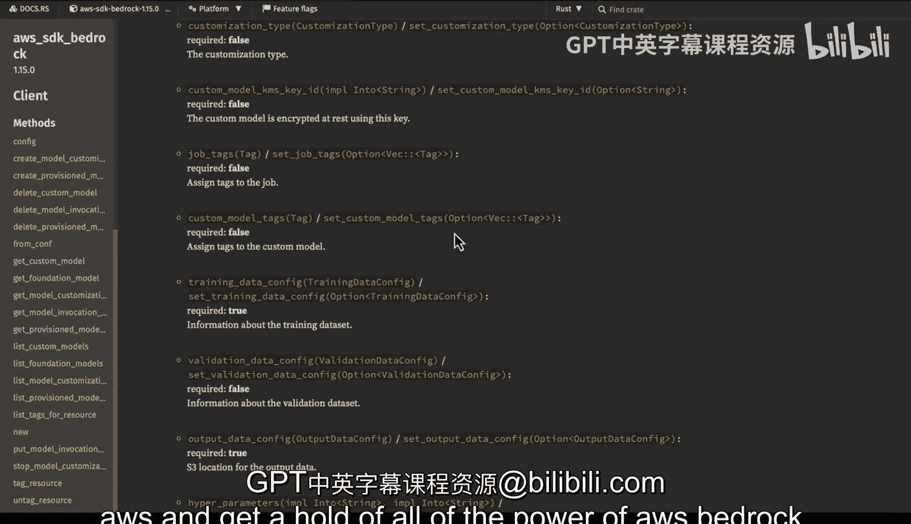

# 杜克大学《大型语言模型实践（高级数据工程、AWS、Databricks和本地LLM）｜Large Language Model Operations 》 - P96：30_03_03_探索CargoRustSDK.zh_en - GPT中英字幕课程资源 - BV1oi421Q7GT

Here we have a crate that is AWS SDK for bedrock。 We can see that it describes the API operations for creating and managing Amazon bedrock models。

 and we see that inside of the cargo dol file， we've got AWS config here。

 We also have the AWS SDK for bedrock and we have Tokyo， which gives us the async power。

 Now it's actually pretty straightforward to use this， you would do use AWs SDK bedrock as bedrock。

 and then you build your main function here。 So it would be whatever calls are available。

 for example， I want to list the foundation models that are available that would be a great one to start with。

 and you can even go further if you look at the client documentation here。

 you can check out what's actually available and they're constantly updating these SDks but we can see here that you could go through here and look at different things that you can do custom model tags。

 training data config etc ce。 So really by looking at。

Create itself looking exactly at the documentation， you can see what's available。

 pull that into cargo， do cargo new project， go ahead and build it。

 do cargo run and you should be able to invoke the RE SDK for AWS and get a hold of all of the power of AWS bedrock。

