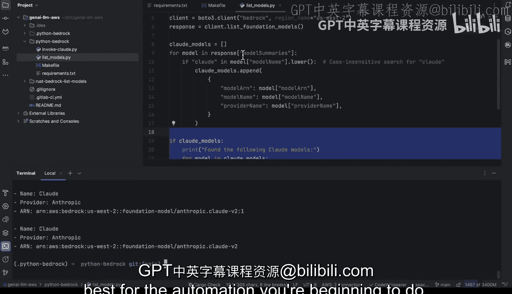

# 杜克大学《大型语言模型实践（高级数据工程、AWS、Databricks和本地LLM）｜Large Language Model Operations 》 - P97：31_03_04_Python调用列表模型.zh_en - GPT中英字幕课程资源 - BV1oi421Q7GT

。Here we have Intelj， which has a Python project that is set up to communicate with Amazon bedrock。

 So let's go ahead and take a look at the structure here first， we're doing Ls。

 you can see I've got a make file and I have requirements file inside because I'm prototyping I'm going fast I'm not pinning anything I have Bodo3 black and rough and then in the make file I have also pretty simple stuff install format lens those are my basics but let's go ahead and take a look at list model here。

 Now how would this work。 Well what we do is we say import Bodo3 and then I make a client request。

 Now because bedrock is still a new service one of the things that you may want to do is actually specifically call out particular regions And this case I would call out US West2 then I would get a response which says let's go ahead and list the foundation models Now what I do here is actually collect that payload and I want to clean it up a little bit because I only care about the ones that say clo because that's the model I'm actually going to。

Use later。 And then what I do is I say look if we find this information。

 let's go ahead and print this out so that I can use it。

 So this is one of the ways you can start to programmatically get access to bedrock is to use Bodo3 It's typically has the best support So how would we run this Well first a lot of times I like to make format make lens make sure everything's clean and then let's go ahead and run it。

 so let'll just say Python list models here and there we go。

 I'm able to actually take a look and we can see that this is exactly what I want。

 I want this thing I want the anthropic cloud V2 and I want the one with 200 K context window So you can actually get a lot of information in fact more quickly by talking to the bedrock Bodo 3 interface here and also write a little bit of boilerplate code here to clean up and get the response in the form that's gonna be best for the automation you're beginning to do。

