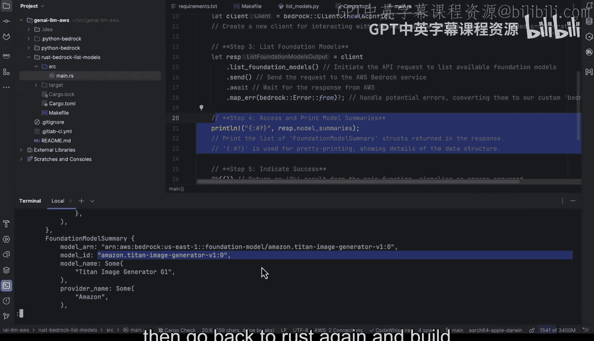

# 杜克大学《大型语言模型实践（高级数据工程、AWS、Databricks和本地LLM）｜Large Language Model Operations 》 - P98：32_03_06_Rust调用列表模型.zh_en - GPT中英字幕课程资源 - BV1oi421Q7GT

Here we have a intelligent environment where I'm going through and I'm writing some code that communicates with the bedrock API。

 Now， if we go through here and we take a look at this first up。

 I can actually just look at the Python version right to say Python list models But because Python has performance issues that I'd like to avoid I'm going actually build this out in rust。

 So how do we do this。 Well， let's go ahead and take a look。

 we can use the Python as essentially documentation and then we can go into this rust project that I set up and if we take a look we can see that there's a cargo do2ml file here and we can see AWs config Aws SDk for bedrock and Tokyo and then it's actually very simple and less code in some ways depend on what it is you're doing to use the rust interface here。

 So first up， I say AWs SDK and I pull in the bedrock and then I do a config here and then I look at。

Creating a client。 and then it's a one liner， right。

 Let's go ahead and list out these foundation models and let's go ahead and print out the model summary。

 So let's go ahead and run this。 We'll just go ahead and type in cargo run。

And you can see here it compiles and then it's so fast in fact。

 that we are gonna to have to actually pipe it into less so we can see exactly what's happening So from here again。

 I could look at the model IDs so I could do later programmatic control of the foundation models and invoke them and give them custom prompts。

 etc。 so there's really a good place to start with the bedrock SDK for rust is to not be afraid to go back to Python every once in a while。

 take a look at it， get get some of the documentation。

 get a feel for it and then go back to rust again and build out an example just like we did here。

