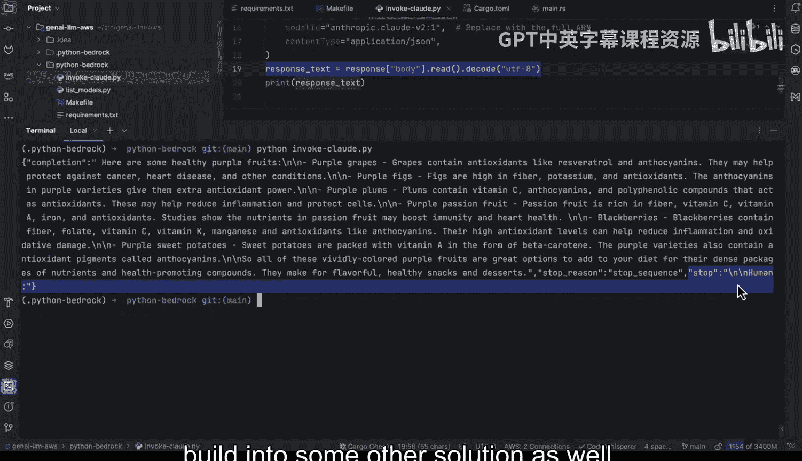

# 杜克大学《大型语言模型实践（高级数据工程、AWS、Databricks和本地LLM）｜Large Language Model Operations 》 - P99：33_03_04_通过BedrockRuntimeAPI调用Claude.zh_en - GPT中英字幕课程资源 - BV1oi421Q7GT

One of the advantages of Amazon bedrock is the ability to toggle between lots of different foundation models with just a little bit of code and if you see here this is a Python example。

 let's go ahead and walk through it first up I have Bodo3 which is the unified interface for the SDK in Python for AWS and now here's a trick here that is important to point out is that I'm using US West2 because that's where this particular model lives so。

Bedrock can be rolled out in different regions， depending on which models that you're looking at。

 And then what I do is just tweak this a little bit to take a look at listing the different foundation models。

 And so let's go ahead and first list the foundation models that are available。

 So Ill go ahead and say Python。 It will say list models， right， So this is pretty nice。

 It tells me that anthropics are available。 And， for example，2。1。 I can go ahead and use that。

 But what I want to do next here is actually invoke it。 So let's go ahead and invoke Cla。

 And so what's cool about invoking here is that。😊，What I do again is do an import of Bodo3。

 but I also import Jason here because I want to return some Jason and it's a little bit different because I need to invoke the bedrock runtime So notice it's not bedrock it's bedrock runtime again I do US West2 and take a look at this we can do body Jason dumps prompt and so what I do is I put in adjacent body that says a question in this case I'll say know what is a healthy fruit that has a color purple and then I also tag it with assistant to give it that prompt so that it knows how to interact with this particular query and I also do a max tokens to sample So I go through here and I say these are the max tokens to sample in the request and then finally I put in here the mono ID which again is the anthropic Cla。

2。1， and then I'm also able to go and tell the API call that I'm going to do content type application Jason。

Finally， what I can do here is I can take the body， right， I don't want just a raw giant， you know。

 J output。 I want just what's inside so that I can make a nice response。

 So let's go ahead and do that next。 So I'm going to go ahead and bring this up a little bit to get the full response。

 and then I'm going to say Python。Invoke Claude。It's gonna to take a little bit of time because whenever you're dealing with anything involving AI right you're going to be talking to an interface that is going to do GPU inference in this case it's thinking and we're gonna to get a response back that tells us a answer to the question about what are healthy purple fruit So we see here it says completion there's some healthy purple fruit。

 purple grapes， purple plums， etc。 right and then we also have the stop sequence as well here So we're able to get a really nice payload back that we can integrate into let's say a serverless application using AWP Lalamda or build into some other solution as well。

 So not too bad to invoke foundation models with Python here obviously could do it in rust as well。

 which has a lot of great performance and installationulation benefits because you can throw a binary somewhere so the big thing to remember here is make sure that you're invoking with bedrock runtime。

