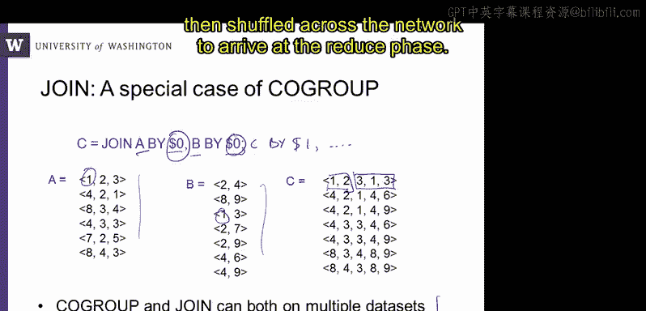
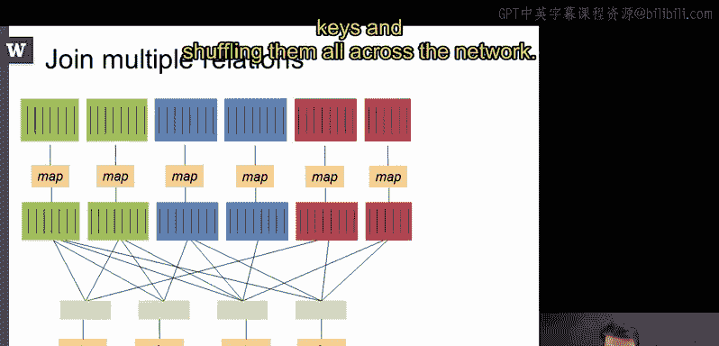

# 杜克大学《大规模数据科学（大数据操作，第1课／共3课有视频）｜Data Science at Scale》 - P100：99_协同分组、连接.zh_en - GPT中英字幕课程资源 - BV12s421T7tJ

。

Okay， so let's take a look at the co group command， so we've seen the group command。

 which we're showing a single data and the co group command does the same thing on multiple data sets。

And we've seen this mechanism before when we talked about map Red， but here in P。

 we make this operation explicit and give it a。Specific command and we'll try to see why that is Okay。

 so the syntax just like this。Say co group， a data set。Bye。Some field reference or multiple fields。

 And here we're referring to a field by name。 and here we're referring to a field by position。

 as we've seen before。 And so if this is a， a bag of tus and this is B a bag of tuples。

 then the co group of them looks like this。 So now we have a。Group field。And we have a data set A。

A field named A。And we have a field named B。All， so we still have the same grouping key。

 but we have two groups associated with it， one from one data set， one from the other。

So a couple things to point out。One is if there are no tuples from one of the data sets。

 then it just gets the empty group。I'm here seeing example from D。

And then the other thing to point out is this is a little different than。

What happens in mapR directly where？You know what we showed with the joint operator with that Purdueuce is that you could。

Use the join key to。Sort of co group to relations。And then all of these tus would all sort of appear in the same group in the reducer。

But here， we sort of make them explicit to make it two separate groups。

I want to come back to Co group in a second， but first let's talk about another。Operator。

 which is just called join， and so it does exactly what you'd expect。So join。

 you say join A by some set of field references and B by some other set of field references。And。

Given A and given B， the result will be what we've talked about in the past， which is。You know。

 you look。For the。First position of a dollar sign0。

And find all the corresponding first positions of B。 So here's one， one and one， so we have one。

 two from a。And 13，1，3 from B。So there's nothing stopping you from having multiple data sets out here。

As many as you want。 And they can all be sort of processed together。

 And so you can think about what's going on here is that this is one map produced job underneath the sheets where in the map phase。

 every tuple from a variety of data sets is all being。Associated with the Jo key。Represented by。

This field reference in the syntax。And then shuffled across the network to arrive at the reduce。

Fse。Okay so here's what it looks like。 Well if we have multiple relations represented by colors here。

 green， blue and red， well they can all be processed by the map phase and associated with keys。

Suffle across the network。To produce the。Join tus here right。

 So there's there's nothing fundamentally binary about this operator right。

 It's just processing tus associated with with the respective join keys and shuffling them all across the network。

