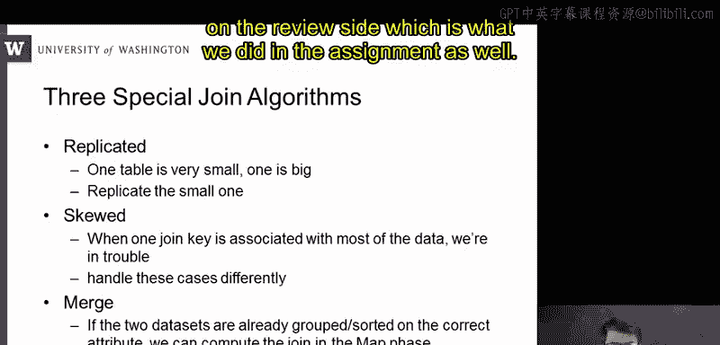
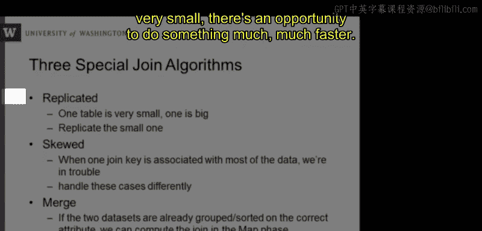
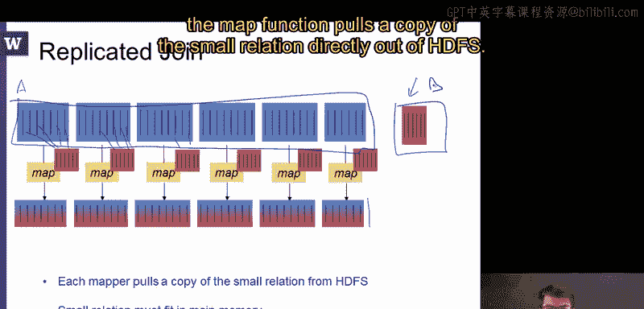
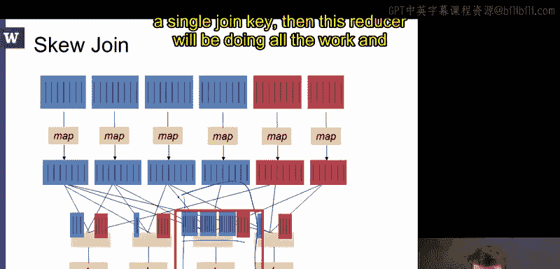

# 杜克大学《大规模数据科学（大数据操作，第1课／共3课有视频）｜Data Science at Scale》 - P101：100_连接算法.zh_en - GPT中英字幕课程资源 - BV12s421T7tJ

。

What can go wrong with this basic。Mechanism。Associating peopleupils with a joint key。

 shuffling them across the network and。Producing the you know computing the joint on the reduce side。

 which is what we did in the assignment as well Well， so one example might be if one table is very。

 very large and that table is very small。

There's an opportunity to do something much， much faster， which is。

Replate the small table across。All partitions of the large table。

Which allows you to do all the work in the math phase。Second。Sort of a special case here is a skewed。

Jo， what do you know that is。If there are many values in one table that join with many， many。

 many values in this second table， then you'll end up with one reducer doing。

All the most of the work and the effects of parallelism get sort of washed out。

 and the third special case algorithm is to do8。Merge join So this。

Takes advantage of the fact that you may have already。Group two relations in the same way。

 such that the。You know for sure that on a single machine。

 I've got all the tus I need from one relation and all the peoples I need from the other relation。

So let me see if I can make this more clear in pictures in the next of these slide。

So if for replicated join， the situation is we have one large table。

Broken into pieces and one much smaller table。 And so what we could do is just。

Shuffle all these tuples across the network and do the join and the reduced side as we do normally。

But there's an opportunity here that says， well， look。

 if this thing is small enough to fit in memory on a single machine， why don't we just copy it？

Send it out there to every map function that wakes up will go pull it across the network。Directly。

Then we have all the information we need right here in the map side。

 Every one of these tuups can be joined with corresponding tuupples in this partition。

 Every one of these tuups can be joined with corresponding tuups in this partition and so on。

 And so at the end of the map phase， you end up with the right answer， all the join tuups for。

You know， this sort of blue A and this red B。And so why is this cheaper， Well。

 we didn't have to shuffle everything across the network。 We did it all in the math phase。

 and it makes a huge difference。So you might see this called the broadcast join。As well。

So the small relation must fit in memory。And the idea is that each mapper in the map function pulls a copy of the small relation directly out of HFS。

All right， so for the Sw join。The situation。as usual。

 you got two relations to sort of blue one in this red one。And the map phase。嗯。

Associated each tuple with its joint key。But the problem is that most of the data ends up on a single reducer。

 and the reason is because maybe most of the data here is associated with a single joint key Okay so for example。

 if you're。Joined on Order ID and line item。You know。

 you're trying to associate all line items with their corresponding order。

 It could be that one order had millions of parts and all the other orders had five parts。不上。

So if a significant fraction of the overall data set is associated with a single join key。

 then this reducer will be doing all the work and there won't be much benefit parallelism。

