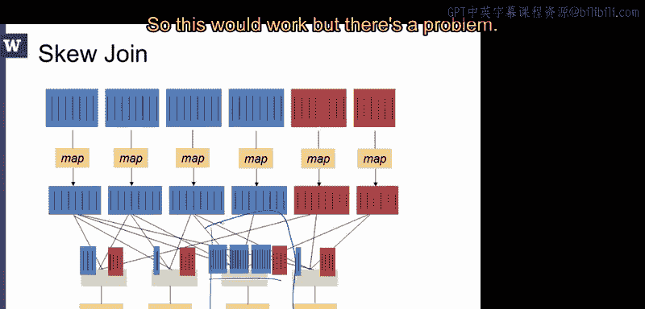
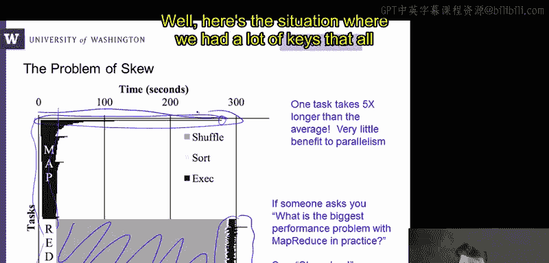
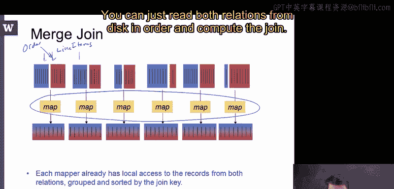

# 杜克大学《大规模数据科学（大数据操作，第1课／共3课有视频）｜Data Science at Scale》 - P102：101_数据倾斜.zh_en - GPT中英字幕课程资源 - BV12s421T7tJ

。

So this would work， but。

There's a problem。So。This is from a。Forer student here at UW who did some work on this problem。

 and this plot shows time and seconds on this X axis。And this is just a list of all the tasks。

And so you see that the reduced tasks here。They can't start until all the map tasks。Are finished。

And the map tasks mostly finish quite quickly。Sort of maybe 20 seconds。

But one or two of these map tasks take a very long time， you know。

 sort of on the order of 270 seconds or so。Okay， so all this space in here is sort of wasted work。

There's a couple of problems here， one is fundamentally a map produce in many applications。

 you logically actually could start doing some work early。

Based on the map output that's already been finished。

 and that's just not the way Ma produceuce is designed。

You can't it's not designed to be able to take advantage of those applications because you can't guarantee that it's safe to do so。

 so for example if you're adding up numbers you can start adding up in the reduced phase。

 you can start adding up numbers early， but if you're doing something more complicated you may actually need to wait for all the results to be present in order to get the correct result and so since they can't guarantee that it's safe。

They make you wait。So fine， so this s problem ends up sort of killing parallelism and turns a job it you know could take sort of 50 seconds and the one that takes 350 seconds and it's not even significantly longer than doing this sequentially。

 if you should have add all these pieces up Well， I shouldn't say that this is so worse and sequential。

 but you certainly lose a lot of your bandwidth and parallelism。

So one task might take five times as longer than the average answer there's a little benefit and so one takeaway here。

 so I'll tell you one way to partially solve this problem on the next slide。

 but the takeaway here is someone asks you what the one of the biggest performance bottlenecks of map produce is you should say stragglers or SU SkeU is more of a term for this in the database community but stragglers is maybe a little bit more。

Common。So this is a stragggr task that takes a lot longer。All right， so what can we do about this。

 Well， here's the situation where we had a lot of keys that all ended up on the same reducer and this guy's taking too long。

One thing we can do is。Split this data up into more reducers。

So take allocate a few more reduced tasks。And move that data over here and split it into three more。

 Now， broadcast that little。Red relation。RightSo I made it disappear from over here。

 recognizing that this is perhaps small and replicated to all three of these reducers。

 So it's sort of a combination of the replicated or broadcast join and the regular。Redduce side。

Hash join。So now you've got three reducers working on this problem as opposed to just one and you get things a little bit more balanced。

 and so this s join is something that pig can do if you specify it。

They won't do it automatically though。So fine， so now we get our entire joint relationship which is what we want。

So finally merge join is the third special case。And this is let's see。

 so the first special case was an opportunity to do things much faster if one relation was very large and the other relation was small enough to fit in memory。

Skeew join is more of a， there's a problem that can occur and you need a special trick to be able to address the problem。

Merge joint is more like the former。 It's it's looking at an opportunity to。Use it more round。

A higherer performance algorithm。With certain conditions are met and so what are those conditions。

 well， when you recognize that。The red relation， and the blue relation are。

Already been copartitioned on the appropriate joint key。系い。

Then the map phase alone has enough information to just compute the join itself。

 it doesn't actually need to assign it all to assign GPL to a join key of shufflet across the network。

So you know that。All the line items。For a particular order。You knowFor every order that's here。

 all of its line items are also here on this machine。If you know that to be true。

 then you can do it in the math phase。So the question may be。Win is that true？Well。

 that's when we go back to the co group operator。 It's possible that you've already partitioned。

These two tables。On the appropriate join key because of a previous。Command and pig。And so， we can。

Be aware of that and use a merge join。You still specify explicitly the you want you use Emge join。

 but so pig's not doing that automatically， but you can。

Take advantage of this situation when it arises。So since each mapper already has local access to the records from both relations。

 they're already grouped and sorted by the Jo key， you can just read and both relations from disk in order and compute the join。

