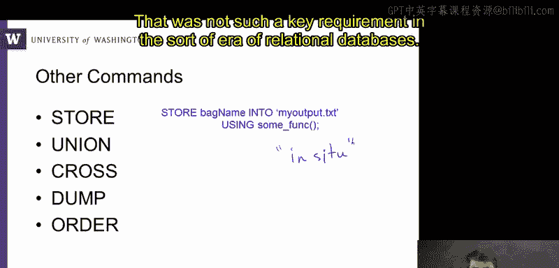

# 杜克大学《大规模数据科学（大数据操作，第1课／共3课有视频）｜Data Science at Scale》 - P103：102_其他命令.zh_en - GPT中英字幕课程资源 - BV12s421T7tJ

。

So we have this co group operation and we have joint operation， and why do we need both？Well。

 the reason they make co group explicit is that if you think about a join is really a two step process。

 right there's one step to create the groups based on the join key。

And then a second step to actually produce the joint tus， but that group creation step。

Hes useful for a lot of applications， not just producing a joint。So for example。

 if you want to co group and add up all the contributions from each relation。

You can do that in a single step。 You don't need to sort of join the tus first and do another grouping afterward。

 which is something you would have to do in relational databases so that's a chance to take what would be two mapreduce chop and combine just one。

 And so here I guess the example if you want to just count the tuples so you know what to point out here is that you can express join join is essentially just inctic sugar。

 you can't express a join in terms of co group first step is to co group on the same column on the join columns and the second is to run this for each command that would generate a flat view of。

Results in revenue。Sorry， I guess I should say A and B here that's lovelyloppy。I changed the names。F。

 so other commands that we're not going to talking about in detail are store。

 which writes data out to HDFS is available for。You know。

 futureture commands union that combines two data sets together and removes duplicates cross product。

 which finds all possible pairs between two data sets， which can be。

Useful if you're able to compute some sort of similarity function as we talked about。

And then dump which prints outputs at the screen。And an order which source the output。

So as an example of store here， remember you can also just like you can use your own custom function to parse data。

 you can also use your own custom function to write it out。Okay， which means it？

Allows the data to be more compatible with say， some other system that you're using。

 say map itself or some other application that expects data in a certain way and's。Again。

 I sort of stress this with the load command as well。

 but this is actually pretty powerful and a pretty big difference from this walled garden approach that relational databases take where everything sort of goes in and then it's in under complete control of the database this sort of has more permeable boundaries where you can kind of have data lying around in whatever format and you're still able to process it with PG but you can also process it with other other。

Systems and what as well。 And so the reason this is。

Crucially important is not just sort of a performance optimization for know reduced load time or something all。

 sometimes that can help as well It's because this data is too big to move nowadays right you can't put it all in the database and then suck it all out and move it over to some other system for working with It's just too big。

 you can't move a petabyte right you have to bring the computation to data as opposed to bringing the data to the computation。

And so these abilities to work with in situ data。You know produce。Sort of insitu data。

I iss emerging as a sort of a key requirement in this big data era that was not such a key requirement in the sort of。

Arror relation databases。

