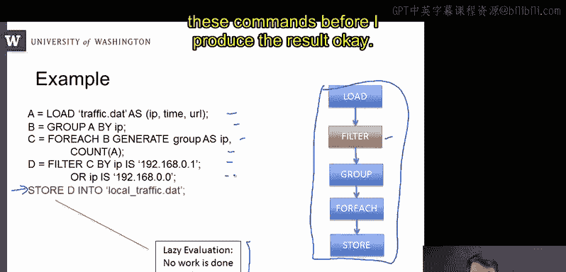

# 杜克大学《大规模数据科学（大数据操作，第1课／共3课有视频）｜Data Science at Scale》 - P104：103_评估演练.zh_en - GPT中英字幕课程资源 - BV12s421T7tJ

。

So let's consider an example of a pig program and see how expressing the program in terms of these high level operations offers optimization opportunities that the system can。

Exercise unilaterally without the programmer having to specify it。So in this example。

 we're looking at。Traffic web web log traffic data with。Sort of three columns here。The IP address。

 the time， and the URL being accessed。And so in the first step。

 we load the data and here we don't need to use the using clause to specify our own parsing function because presumably the trafficd is in some format that pig already natively knows how to。

Parse， so some sort of simple delimited format。Okay， so it's expecting to find three columns。

And if it doesn't， it'll be an error。So the second command is group， so we group A by IP address。

And then third， we say well for each of those group tus。I just want the I P address。

 and I want the number of。Web log entries associated with that I address。

So this is counting the number of。Accesses。By particular eyes out there on the Internet coming in。

And the next step， well， we maybe in this particular task， we're only interested in sort of。

Looking at traffic that originated from two particular gateways on our local network。

 and so we filter for just those IP addresses with the filter command。And then we store the result。

Into a file on HDFS。And so the observation here is that， know if you look at this carefully。

 you can see that。As written， this is somewhat inefficient， right。Load a very large data set。

We apply a grouping operation to a very large data set。

 we do some manipulation of those groups across the very large data set。

 and then we filter it down to something that's much smaller because we're only interested in these two IP addresses。

So it would be nice as if we could。Apply the filter first。

And so one thing you could do is just rewrite this program and in this case that's probably reasonable you could probably notice that this was going on and rewrite it yourself manually。

 but in a more complicated program。You may or may not。

 and this is not the only example of an optimization that can be done。

And so what pigG will do is actually move the filter automatically。嗯。Beforehand。

 and before the group。And use。I guess I didn't modify the program here I modified the abstract plan it it won't actually produce the text here。

 the ASCI is done remember we talked about an execution plan and then it'll manipulate that and so it moves the filter beforehand because it knows it's safe to do so and this is again I keep coming back to this but。

This is the。know one advantage of a high level language might be that it's easier to express your program in。

 but that may or may not be true in many cases it could be actually harder to express your program in terms of these you know limited operators。

So you know， you might prefer kind of a a Java program or might prefer a full width Java interface where they can just write whatever code they want。

 but the point is that if you can you know tie one arm behind your back and express your task in terms of these operations。

 the system can take over。And make manipulations that it would be very difficult for it to do if you wrote in a lower level language。

The other point to make here is that remember this is what we call lazy evaluation。

 So when this command is executed， that when makes an that's when it has an opportunity to apply these optimizations right so it did nothing but sort of build up your。

Your execution plan， as you were executing these communities， it didn't actually do any work。

And then find them when you say okay， now I really want the result， you can say。

 a I see your list of sequences or sorry I see your sequence of commands。

 I'm going to do some manipulation of those to figure out the right way to execute these commands before I produce the results。

