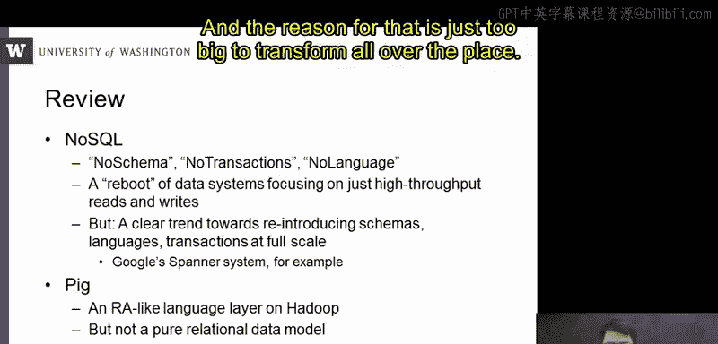
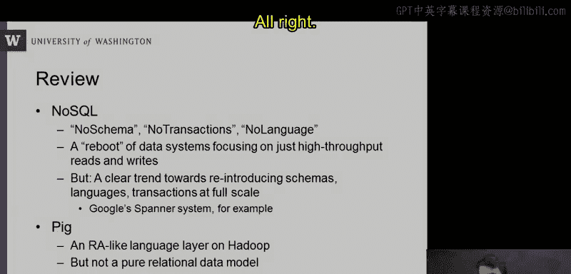

# 杜克大学《大规模数据科学（大数据操作，第1课／共3课有视频）｜Data Science at Scale》 - P105：104_回顾.zh_en - GPT中英字幕课程资源 - BV12s421T7tJ

。

We're not done， we now have to map this abstract execution plan down into a sequence of map reduced jobs。

And so the way it does is it first identifies all the group and co group。Operators in the plan and。

Assigns an individual map produced job to each one of those operators。And then incrementally。

 what it's going to try to do is。Walk forward and backward and put as much work as it can into the same map producedd job。

Okay so。The group command。Needs to be its own not reduced job because it's going to shuffle things across the network。

But filtering I could apply the filtering condition as unloading data off of disk。

Or as I process a tuple， I can check its condition to make sure it's from one of these IP addresses before I actually apply the group。

 so I might as well do that in the same app reduced job I don't need a whole independent app reduced job just to do that。

Further， the load command is just reading things off disk。

 It doesn't actually do anything difficult at all。 I can put that on the same map produce job as well。

 And so it ends up with this one map function that's going to look something like。You know。

As you process a value， it's going to say you parse the data。And thenm just going to say if。

Bll do IP。Equals this or。Ful out IP。Equals this。Then。Imit。IP Val。About that IP。Vo。

And so this little program essentially gets generated。By the compiler as one。

 as just one map function， and then gets executed。 And then the reduced side。

 you can do a couple things you can。Construct the groups。

 but you don't actually care about the groups because you're immediately going to count the results。

 And so it's smart enough to see that group plus for each is really going to。

Just produce tus like this IP。En count and not。You know not。I P。Plus。Some big group。

And that's actually pretty significant savings because constructing these objects and sort of passing them around。

It's pretty expensive， so you don't actually need them。Want to use them。

So there's sort of two levels of optimization here。 One is it moves operators around， which I like。

 so they have this algebraic flavor。And two， it。Compresses logical operations into single physical operations and the overall name of the game here is to reduce the total number of map reduced jobs being executed because they're expensive。

And then finally you can write the things out and that can also happen in the same reduce phase。

 so this entire task ends up being just one Mareduce job in other cases you may need to do sort of multiple groupings or you may need to sort or so on each one of those requires its own Mareduce job so for example。

 certain commands always require Ma reducedduce job like sorting。

So what do we talk about in the last several segments while we described no SQL systems。

And argue that they're important for a data scientist to understand in part because you may be using them。

 but also because you may be asked to weigh in on their relative strengths and weaknesses compared to other systems。

 and so we talked about NoSQL sort of meaning no schema and no transactions and no language and maybe less about specifically about SQL。

And overall， they're kind of a reboot of data systems。

Zing in on just high throughput reads and write。RightAnd so now the design space of these large scale data systems is sort of being more fully exploitd with different permutations and combinations of particular features。

 but overall there's a clear trend back toward reintroducing schemas and transactions and languages and so on。

 and so we talked about Google's Spner system as an example of this。Trim。No sQL is not。

You know it's an evolving sort of concept， the main thing to realize that the entire space of possibilities in large scale data systems is being explored and no SQL represents one segment。

 relational databases represent another and there's new segments emerging so you might hear the term New SQL for example。

 which is kind of a rearchitected database that does try to achieve some of these。Other features。

So fine。 then we talked about pig in particular as an example， not so much of a nosQL system。

 but as a analytic system that puts a layer on top of map or do。

 And we chose pig because it has this relational algebra like。Layer on top of he dobe。

 and so I want to make the point that Re algebra comes up。In a lot of different contexts， you know。

 and in this one it's a little bit interesting because although it has a clear relational algebra flavor。

 it's not actually a pure relational data model， you've got these sort nest structures and the point here is that you can kind of cherry pick some of these concepts and techniques。

Pioneer by databases， and you don't necessarily have to use them in the context of databases。

 So you don't need to sort of throw the baby out with the bathwater if a database doesn't appear to be。

Meeting your needs。 And these systems are sort of doing that。

 So as you review different systems emerging as a data scientist。You can start to understand。

The particular set of features they offer and understand the providence of those features and the history there and the pros and cons there'rein。

And so pig also the you know one takeaway of it is that has this sort of schema on read flavor rather than schema on write。

 meaning that you can work with in situ data。 Okay。

 I mentioned this a couple of times I was wanted to point out that that's really one of the。

New requirements associated with maybe no SQL， as well as。

even S like systems is that you have to be able to work with data in its kind of native format and the reason for that is it's just too big to transform all over the place。

