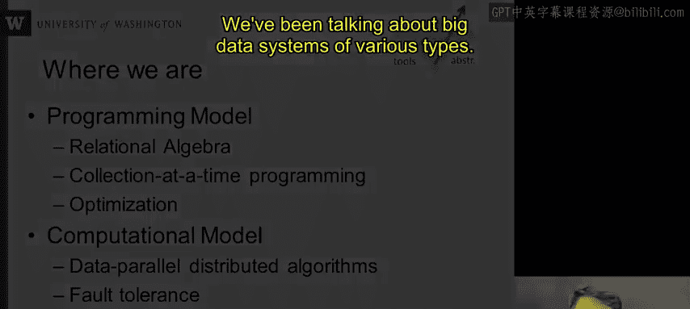
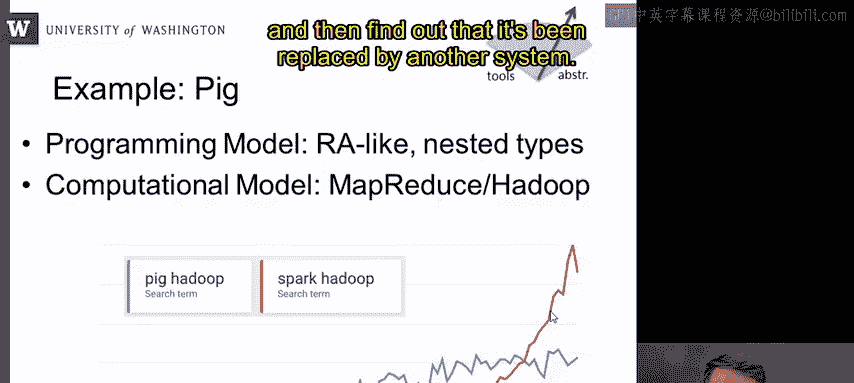

# 杜克大学《大规模数据科学（大数据操作，第1课／共3课有视频）｜Data Science at Scale》 - P106：105_背景.zh_en - GPT中英字幕课程资源 - BV12s421T7tJ

。

All right， where are we， we've been talking about big data systems of various types， databases。

 maprebased systems， No SQL systems and so on， and remember at the beginning of this course we talked about the emphasis would be on abstractions rather than specific tools and some of the abstractions that we've identified have to do with the programming model we've been seeing examples of where relational algebra comes up over and over again even outside of the database systems for which it was originally designed and that this is an example of collection at a time programming。

 allowing you to transform entire data sets at once where a single call as opposed to having to write low level code that operates on individual records and manages the parallel computation。

And further this collection of time level programming allows the system to do optimization that you yourself as a programmer don't have to do and so this is all great stuff that comes up over and over and over again。

 no matter what system you're looking at and when it's absent it's noticeable in addition。

 one step below the programming model is the computational model and there we've been talking about how to think in terms of data parallel distributed algorithms。

 how to reason about computation in terms of working with lots and lots of machines at the same time on a single data set and we've been talking about some of the issues that come up when you think in those terms such as fault tolerance。

 if you have 1000 machines， the odds that one of them is going to do something bad during the course of computation is becomes very high and you have to design systems that's tolerate this and in some cases you have to actually design your code to tolerate this and then there's all sorts of other performance issues that we've talked about performance and non-performance on this versus in memory indexes to speed up search transactions or the lack thereof and how you handle that and so on。

Okay， so that's where we are。 Now， one particular system we looked at。Was pig。

 The programming model there was very relational algebra like。

 except that it had nested types and a few other bells。

 but you could recognize the relational algebra in there。

 It had an optimizer that was taking these relational algebra expressions and translating them into other expressions and then mapping them down into the computational model that computational model was literally just mapreduce Hadoop right so instead of programming directly against theoop layer。

 you programmed at this higher level and let the system translate that down And that theme we're going to see over and over again。

 or we did see over and over and over again。 Okay now when I first offered this course pig was。

More popular than another system that was still more or less just a research platform called Spark。

 Since that time， we see a trend like this where pig。This is from Google Trends。

 and this is the search termPg and Hadoop together versus the term Spark and Hadoop together。

 and you see PG is still an upward trajectory， so it's still a very relevant system to learn and be familiar with。

 but it's been overshot recently pretty dramatically by a system called Spark。And again。

 what we like to focus on is the abstractions rather than specific tools。

 because of effects like this， you'll see one system that you might learn all the details of and then find out that it's been replaced by another system。

 but that's okay because you're learning the underlying concepts。

