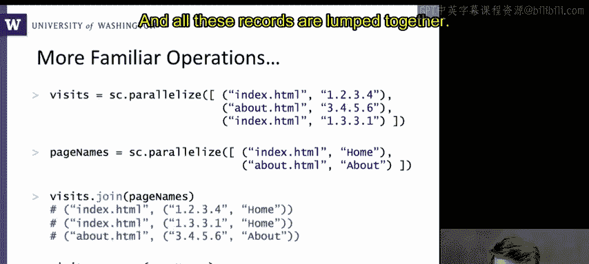
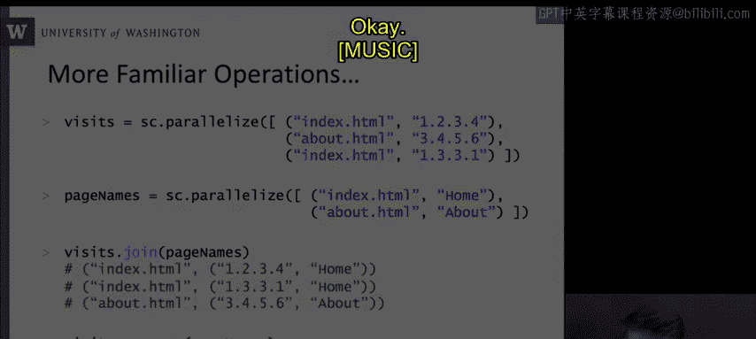

# 杜克大学《大规模数据科学（大数据操作，第1课／共3课有视频）｜Data Science at Scale》 - P107：106_Spark示例.zh_en - GPT中英字幕课程资源 - BV12s421T7tJ

。

Here is a program written in Spark。So the question is， what does this do？Well， the first line。

Has a variable that's a spark the spark context here reads in a file from some path and gives it to the variable named text file the next line。

Calls a method on that text file object。 and that method is flatmap。

 We mentioned flatmap briefly in the past， but it may be unfamiliar to you。

 but we'll see in a second what that does。 And then the argument you pass to this flatm is this funny expression here。

 which is actually a function， an anonymous function， a lambda function。

 if youre familiar with the term that takes in a single argument that we call line and then does something to that line。

 In this case， what it does to that line is split it on white space。

 So this takes in a single line and produces all the tokens in that line。

The result of that flat map operation is then passed to this map operation， which。Sounds familiar。

And the map operation is also past a single function， and that function is takes in a word。

And produces this pair， word and the number one。The result of that map operation is in passed to this reduced by key operation。

 which should also start to found familiar that takes in a function that's just addition。

 It takes a left argument， the addition takes a left argument and the right argument has together。

 and it will reduce by applying this addition over and over and over again。 And then finally。

 the result of that reduce can is。Pas to this variable counts and counts can then just be saved as a text file。

 So what does this entire computation do， I hope that you recognize it It's just word count。

 And here's what it actually looks like。 We've seen an example of this broken out in detail。

 The line that comes in just has these three tokens 2 B and or。

 That's the flatmap operation splits that into three separate tokens。The map operation didn't。

Attaches the number one to each one of those tokens。

And then the reduce operation groups up everything by key and adds the instances of the number one together to get a total count。

 So B appears twice across this across all these lines and two appears twice and or appears once and not appears once。

 Okay so we've seen that over and over again， here's how you write it。

 Here's how you spell that computation in Sp。 So since we understand map and reduce。

 we understand how to program one way in spark and flatm。

You know you could ask why is that sort of written differently than map in Hadoop。

 there's only one concept just called map and it's allowed to take in a record and produce sort of anything at once any number of records out so it's essentially what they're calling a flatmap here map is only producing a single item out Flmap is producing a list of items right so Flmap had to take in a line and produce a list of tokens。

A collection of tokens I really should say， and map takes in a single。

Record a single item and produces a single item。 So no real conceptual difference there。

 They spelled them differently here for。Type safety reasons， really。O。So great。

 so we already know one way to program in Spar， but there's other familiar operations here here you see the word join。

 you know what a join is because we looked at it in some detail。

 you know what a co group is perhaps because we saw that in P and the only reason why you need a co group and why you don't see the word co group when you think about relational algebra and databases is because it' only sensible when you're talking about nested types and so let's look at this。

This is a。Spark。Function called paralyed。 that takes in a。

Collection type in the host programming language， in this case， Python， by the way。

 we just switched the code in the previous slide was Scala。And。Coode in this slide is Python。

 so this is just a regular Python list of tus and the parallelzed method turns it into a distributed data。

 It's a single list on your local client and this turns it into a big distributed data sets on the cluster。

 doesn't run into a big one。 It's the same size that it is here。

 but it makes it available on the cluster。So we do that twice on these two different literal lists。

 then if you join them together， join assumes that you're joining them on the key。Which is it。

 which is this URL。And it produces the， the relational join indexed at HTML。

 along with the record from page names。 It's not exactly relational join you may you may notice because this is a tuple as opposed to oops。

 as opposed to。The flattened version。Okay， so that's the join and then codegroup does almost the same thing except here there's only index HTML appears twice in join and it only appears once in code group and all the associated records are lumped together and this is exactly what。

Pig dude， as well。Okay。

