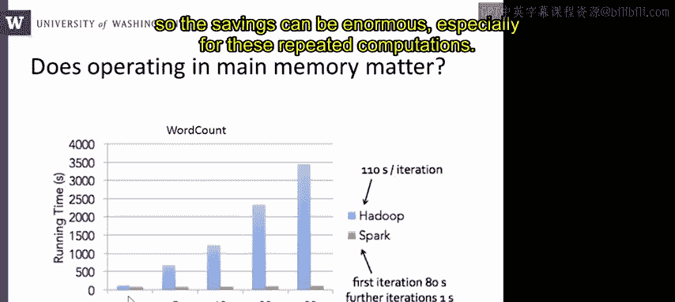

# 杜克大学《大规模数据科学（大数据操作，第1课／共3课有视频）｜Data Science at Scale》 - P108：107_RDD优势.zh_en - GPT中英字幕课程资源 - BV12s421T7tJ

。

So the concepts used in Spark are exactly those concepts you've been studying in the contexts of other systems and you can apply all that knowledge you learned in order to understand what's going on inside of Spark。

 but there is some terminology that you should be familiar with that is specifically associated with Spar and one such term is the resilient distributed data。

 the RDD this is a distributed collection of keyvalue pairs。

 which should sound familiar because it's exactly the same data model used in mapre and Hado and is very similar to data model used even in a relational database the difference between a keyvalue pair and a record potentially with a primary key defined is not terribly significant the other key distinction about an RDD is that it can be persisted in memory across tasks so unlike mapRuce where we wrote everything out to disk after every task for full tolerance reasons。

 these can hang around in memory and you can apply multiple tasks to them across iterations even across jobs and that in memoryory caching is really the key feature and we'll talk about that again in just a minute or two。

So working with these RDDs， there's really two kinds of actions you can take。

 and these is spark terminology。 Again， there's transformations， and then there's actions。

 Transforms are the operators that we've been discussing。

 So this is the map and the reduce and the filter and the join in the code group and so on。

 And they take in an RDD or more than one RDD and。Produce another RDD。Actions， on the other hand。

 take in an RDD and produce a value returning extracting a value from the RDD into the host language。

 Python or scholar or Java that then can be manipulated using that programming language。

 So let's look at an example。D。textext file is read from some path and saved in a text file variable that creates an RDD。

We apply a transformation to it， in this case， the filter transformation that takes in another function。

This lambda， if you're not familiar with that term。

 that's how you spell an anonymous function in Python。

TheImportant thing is that dysfunction takes one argument， the line。

 and then if that line contains the word sparkk， if sparkk is in line。

 it returns value this expression evaluations to true， otherwise it evaluates to false。

And only those records for which this whole function evaluates to true are saved into the resulting data set lines with Spark and that's why it's named lines with Spark。

 and then finally the action taken is perhaps to count the number of records in lines with Spark。

 which in this case I guess is 74 or to take the first record out。

From this data set so these things actually return values and one evaluation principle to Sp uses is lazy evaluation。

 which means that transformations aren't actually executed as soon as that line of code is encountered。

 rather it waits until an actual value must be returned to the host language before it。

Stacks up all the transformation required to compute that value。Potentially optimizes them。

And then runs them through and extracts the value， okay。So there's a bunch of RDD operations。

 we've seen that you can program directly in mapRuce you have map and you have reduced calls that behave in the same way as they do in map Red and do。

 but you also have these other operators you can do to look a little bit more like what you find in the relational algebra based system。

 including P or even more generally a。Aing more generally or a database system okay so you can sort of program in a variety of different ways。

 all against Sp， but all of these concepts you've already learned。

So let's remind ourselves of some of the important weaknesses of map reduce Hadoop。

 the first of which is that map and reduce functions have to be written by hand。

 so this can become tedious and error prone and this。

Problem was recognized by people very early on and systems like Hve and PG were designed to address it in part。

 so you could program at a higher level model in the case of Hve that was SQL in the case of PI。

 it was this relational algebra based language that we explored and those expressions would generate the distributed computation in Mareduce itself。

The second problem or a second problem was that there are no indexes available for efficient lookup。

 so if you only wanted to find a particular set of records，In a very， very large map reduced data。

 you had no choice but to scan the entire data set in a memoryory。

 apply some map function that identified the records you' were interested in and then passed those on to the next task。

 and this problem was also recognized pretty early on and addressed by attaching a key value store into the Hadoop ecosystem and HBase which is based on this。

A system called Big T from Google。Is perhaps one of the most well known。Examples of this。

 So the third problem， though， is that every step at a Mareduce workflow writes its entire output to disk for fault tolerance reasons。

 And so this is good for fault tolerance， but it's absolutely abysmal for performance。

 And so this third problem is really what spark was designed to fix The first problem。

 the second problem were addressed by other systems， but。

The raw performance of a dope primarily because of the writing anything out the disk。

 although perhapsps not exclusively because of that was really seen as fatal and so bringing everything into memory and operating things are operating on large data sets in memory was the key design goal of Spark itself and so you can ask does this optimization matter and the answer is absolutely。

So this first iteration of this task， the times are approximately the same。1 is 80 seconds。

 Spark is 80 seconds。 and Hadoop is 1 hundred 10 seconds， But then as the computation proceeds。

 every other iteration of Hadoop has to reread the same data set over and over and over again。

 And so the time just goes linearly up。 Spark only has to read it that first time。

 And so all the other computation is able to。All other iterations are able to operate on it directly in memory。

And。Not taking any additional time， and so the savings can be enormous。

 especially for these repeated computations。

