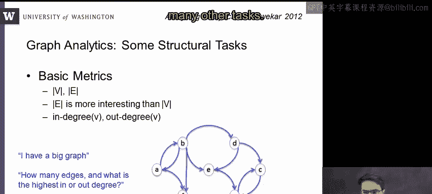

# 杜克大学《大规模数据科学（大数据操作，第1课／共3课有视频）｜Data Science at Scale》 - P109：108_图概述.zh_en - GPT中英字幕课程资源 - BV12s421T7tJ

。

So I want to spend some time talking about graphs and graph analytics。

 so we've encountered these before in the context of the Elastic Mareduce assignment。

 but we haven't spent too much time in the lectures talking about them。

 but they're increasingly important in a data science context for reasons we'll talk about so what is a graph a graph is a pair of sets。

 a set of vertices and a set of edges。You might also see vertices referred to as nodes。

 but I'm going to try to avoid that terminology to avoid confusion with。

Clus of computers where each computer is referred to as a node Okay。

 so V is a set of vertices and E a set of edges， and each edge is a pair。A vertices。

A source and a target。 And so edges may be considered directed or undirected。

 And we'll talk a little bit more about this。 But maybe it's an edge from a source to a target。

 or maybe it's just a pair。 And the order doesn't matter。

So these graphs are increasingly common in the wild right the web itself can be modeled quite directly as a graph where every page is a vertex and every link between pages is an edge。

 the internet underlying the web can be modeled as a graph where every computer is in the vertex and every route is an edge or maybe even every packet。

 social networks as we've seen in some of the assignments。

 these are becoming increasingly important as a political driver and as a driver for social change。

 the influence they have is pretty difficult to overstate。

 and this is very obviously a graph where every connection between two people in the social network is an edge。

Communication logs can be modeled as a graph， every phone call between two people is an edge and of course in the news recently this is becoming quite important with the prisonM program。

And so many more and so one reason these are so ubiquitous is that it really does kind of get the fundamentals of communication right you have a big set of actors and any anytime one actor interacts with another that can be model is an edge and so this is just a very。

Common paradigm to， to。They can capture the behavior of a lot of different kinds of systems。

The other reason you see this to be so be ubiquitous in kind of a data modeling aspect is that。

You know， objects and relationships between those objects。You can't really get any lower than that。

 right， so relations talk about。You know the relational data model talks about tables where you have records and attributes。

 but even here there's a bit of complexity and you have to sort of think about a schema and you have to sort of think about every record is going to have the same schema and so on。

 graphs kind of blow up all that and disintegrate everything down to just objects and relationships and so in some sense it's the lowest common denominator data model we'll get into a little bit is my opinion that I think you throw out quite a bit when you sort of drop everything down to that level。

But we'll talk about that in a bit。So what do we want to do with these graphs so Bor of Wihar in 2012 wrote a paper about analyzing analytics where they tried to sort of categorize various analytics tasks in a variety of categories and one of the categories was graph analytics and he broke it down into these three pattern structural algorithms。

 traveral algorithms and pattern matching algorithms and I think this is as good a breakdown as any other so this is one we'll use in the next several slides。

So you think about just structural tasks， structural algorithms。

 you know the first thing to do in encountering a graph that you're expected to work with or understand is just to collect some basic metrics。

 right， how big is it， how many vertices and how many edges。And。

One of the takeaways I want you to have is that the number of edges is more relevant than the number of vertices when you're trying to understand the scale of a graph so you know many times you have a conversation with someone and they'll say well I have this really big graph I'm working with so the next question you should ask is how many edges I have not how many bytes and not how many vertices and the reason you don't care about the bytes is because there might be all kinds of other information。

Packed into the the labeling of these things。 But that can really be factored out from the graph itself and modeled maybe more traditionally in a relational database。

 And so the performance。May not depend so much on exactly the number of bytes。

But the graph structure， the is is a challenge， as we'll see。 Okay。

 And so the number of vertices is is one measure， but the number of edges is another。

 So why is the number of edges more important than the number of vertices， Well。

 because it scales quadraically with the number of。Vertices， right。

 you can have at most number vertices squared number of edges， and that's a really。

 really big number in some cases， right's。2 billion people using a social network。

 well 2 billion squared is the number of possible friend relationships you have and if you're expected to do some analytics on this graph you're going to be processing all of those edges perhaps。

And then the second question you should ask out to the number of edges is what is the highest in or out degree？

As a proxy for really what is the degree distribution here。

 so what do I mean by degree Well the in degree of a vertex is the number of edges that are coming into it and the out degree of a vertex is the number of edges that go out of it。

Okay， and。How the edges are distributed among all the vertices tends to be a driver of how difficult the graph is to work with if they're all pretty evenly distributed。

 then this isn't much of a problem you can paralyze things as we'll see and everything works out nicely however very。

Almost never do graphs in the wild have this property where things are sort of。Randomly distributed。

 there tends to be very skewed， so there's you know in a social network。

 there tends to be a person who is friends with it， everybody in the graph， right very。

 very popular people。Almost everybody in the graph。In a。You know， on the web。

 there are pages that tend to be linked to by everyone， right， very， very popular pages。 and so this。

Inbalance in the degree distribution is one of the challenges in working with very。

 very large graphs and so if you know the number of edges you've got one indication of sort of gross scale and then if you know about high how many edges are in the most popular vertex that gives you some idea of how skewed things are。

So fine， so when you're working with graphs， these are the things you're going to be able to do。

 can you just count the ors count the edges， can you say given a vertex。

 can I get the number of in edges and out edges for that vertex and can I maybe do that for every vertex in the graph？

And so this is hard to work with。This is going to be the basis for many other tasks。

