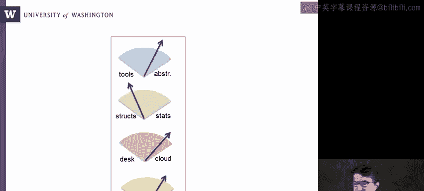

# 杜克大学《大规模数据科学（大数据操作，第1课／共3课有视频）｜Data Science at Scale》 - P10：9_数据科学的四个维度.zh_en - GPT中英字幕课程资源 - BV12s421T7tJ

。

So as a preface， let me show you this quote from Aaron Kimball who's a CTO theO at Wey data And we said to me that he worries that the data scientist role is perhaps like the mythical webmaster of the 90s that they were expected to do everything the web companies knew they needed to get on the Internet in the mid-90s but they didn't know how and they said。

 well， we'll hire a webmaster problem solved the webmaster will。

Write all the content for the website， they'll do the design and manage the user experience。

 they'll write the code that will wire the website to the order fulfillment system in the back end。

 they'll actually structure the pages and do the navigation。

They'll do the logging required to make sure that the site stays up all the time and has reasonably high availability。

 they'll design the schema to hold the data that will be served out through the website and so on and so it wasn't really feasible that you're going to get this in a single person and so instead the internet strategy became a broader team。

Similarly， that might be what we see happening with data science， but here's what it means to me。

 the term data science tells me that if you're a database administrator and your skills are solely about relational databases。

The current trend is you will need to learn more about unstructured data and statistical modeling。

 If you're a statistician， you will need to learn to deal with data that does not fit in memory。

 If you're a software engineer who's used to。So of building systems and working with files directly。

 you'll need to learn some statistical modeling and how to communicate your results to your managers。

 you'll need to work with these data sets and actually use them to make decisions。

If you're a business analyst who is trained to make the decisions based on data。

 you're going to need to start understanding a little bit more about the algorithms and tradeoffs。

 especially at scale。For a couple of reasons， one is the cost。changenge dramatically。

Based on the technology you're picking， the what's happening with cloud computing that we'll talk a little bit about and what's happening with these algorithms is that。

You know can you might be able to get an answer， but it may cost more or less than it did five years ago The other reason is that you know as we do more fly by wire business meaning you know we trust algorithms more and more to make some decisions for us they become these opaque black boxes and if you don't understand what's going inside going on inside that black box you're bound to mis with the results and so it's not。

It's no longer safe to just sort of throw your trust over the wall to some algorithm。

Or to your staff that's running these algorithms， you may need to sort of understand internalize the trade offs and choosing one model versus another yourself。

So here are the dimensions by which I like to describe these different courses。

 the first one is breadth。And so I divide breadth into tools versus abstractions and so。

Sophisticated course would prefer to cheat towards abstractions right you want concepts that transcend any particular implementation however。

 what students are interested in is handson experience using tools they can use you know tomorrow at a job。

 and so you always have this tension between these two。All right。

 and so some examples here are you know Hadoop， which we'll talk about is an implementation of an abstraction called Mareduce and then the Mareduce abstraction。

Certainly transcends its particular implementation in in Hadoop。 Okay， And so here as will。

As I'll mention in the next segment， I want to cheat towards abstraction whenever possible。

 but make sure that there are assignments that give you the hands on skills that people are interested in。

 the next dimension here is depth and so by depth I。

Intend the distinction between structural manipulation of data and statistical manipulation of data Okay。

 and so here you can。Think about the relational algebra。As a structural formalism。

 a formalism for manipulating data structurally， while the linear algebra is perhaps a formalism for manipulating data statistically okay。

 and so here， try to strike a balance， but I actually lean more towards structure and I'm going to defend that position in the next segment。

The next dimension you can think about is scale。And so here is one end is yes。

 it fits in main memory on a single machine versus what I'll call cloud。

 meaning it might require hundreds of machines to work on it。

 and here I cheat towards cloud and the reasons that I've already sort of described are that it's no longer safe to assume the data fits in main memory and to train people to work only with data of that size。

 the whole world changes when you start moving to even two machines let alone 100 and to not have give you some exposure to that change。

Would not equip you to be an effective data scientist。Okay。

And then the final dimension I use is sort of the target audience right is is for hackers or more for analysts and by hacker。

 I mean you know you already have significant programming experience and you're looking sort of round out your skills and some of the。

Mathematics。Or are you more of a。Technology decision maker who is trying to bring a little bit of technical depth。

 And here I like to actually strike a balance。 I don't want this course to be solely assuming that you that you are a seasoned developer。

 but nor can nor can we sort of。Ignore all programming whatsoever。

 so we're going to try to strike a balance between these two。Yu。All right， so here's the choices。

We sort of made in this course so one is we cheat towards abstractions， we cheat towards strs。

 we definitely like large scale and then I say we'll strike a balance。

 but we actually cheat towards the analyst side we favor we favor the fact that there are going to be analysts in the room who don't necessarily have significant programming experience and I've already gotten a lot of questions from folks of email who say。

 hey look you know I haven't done been doing programming day to day am I going to be able to。

Take something away in this course and I think the answer is yes。

 although there will be some programming， so be ready。

。