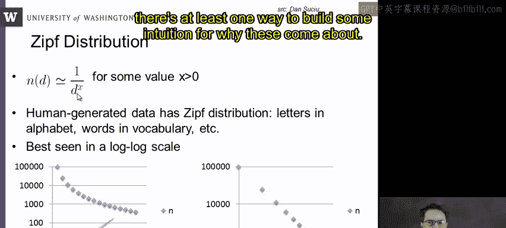

# 杜克大学《大规模数据科学（大数据操作，第1课／共3课有视频）｜Data Science at Scale》 - P110：109_结构分析.zh_en - GPT中英字幕课程资源 - BV12s421T7tJ

。

So one structural task you can do that's a little more detailed is to construct the histogram of a graph and you saw this in the elastic math produce assignment if you completed it。

 so we saw that the out degreee of a vertex is just the number of outgorowing edges。

 so some notation let's say for each integer D will let in of D be the number of vertices with that out degree D。

Okay， so for example， in this graph。We have。 what is the out degree of this vertex。 It's 0。

 There are no outgoing edges。 The out degreee of this vertex is 2。 There are two outgoing edges。

 The out degree of this vertex is 4。 There are four outgoing edges。 So now we can count them up。

 We can say how many。Vertices in this graph have our degree zero， well there's just one。

 it's this one。How many vertices in this graph have out degree1， Well， there are three of them。

 this one， this one and this one， and so on。 And then you just plot D versus n of D and create this histogram。

 So we see。One vertex at zero，3 at1，2 at 2， and so on。ok。So why might this be a good idea to do Well。

 it tells us something about the graph we're looking at。So if we see this kind of a pattern。

 so we might see this kind of a pattern where very few or sorry。

 very many vertices in the graph have a very small out degree and fewer and fewer as you go out the x axis。

Or potentially you could see this other。Pattern where very few have。A small lab degree。And many。

 many more have a high out degree， so this is a much more connected graph。

Everybody tends to be connected to everybody else in this case。

 most people have a very high out degree。People， most vertices have a very high out degree。And here。

 very few have a very high out degree， okay。And it could be sort of more mixed。

Like there' could to be sort of bimodal。So what's going on here， well， if we see this pattern。

Then you can model this as an exponential distribution where D is in the actual exponent。

And what this tells you is that it becomes very， very unlikely the further you got the x axis。

 it becomes exponentially less likely to find a vertex that has that out degree right， so most have。

A small out degree， one or a few， and as you go further out， it's。Much， much less likely okay。

 and so you can see this effect very clearly if you plot it on a log scale。

It becomeses linear on a log scale。Mao。The thing about this distribution is a random graph has this distribution。

 what do I mean by a random graph Well this is take a set of vertices and then choose two vertices at random and connect them with an edge。

 then choose another two vertices completely at random and connect them with an edge and so on。

 If you follow that process you'll get this kind of a distribution of the connectivity right They'll be very。

 very it's very very unlikely to construct a vertex that is connected to lots and lots of other vertices using this process。

ok。So fine， so it turns out that you don't find random graphs in nature very often。A。

That's unfortunate because。If if you did have a random graph。

 it's actually fairly easy to work with and by work with。

 I mean implement some of the tasks that we'll be talking about， say in parallel。

 because you can split the edges up across a bunch of different machines and just work with them all。

😡，Sort of independently。But what you see more often in practice are these power law distributions。

 the zip the distribution。Where。There's some X that's in the exponent。

 You're raising the degree D to to that exponent and human generated data tends to have this distribution。

 And if you think about it， there's。At least one way to get to build some intuition for why these come about。

