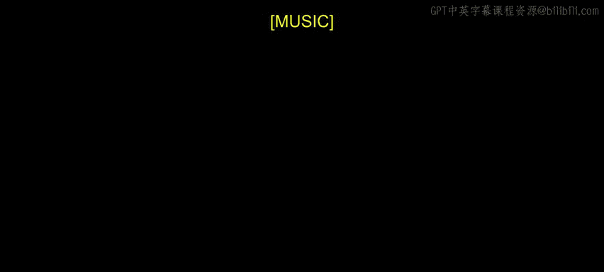
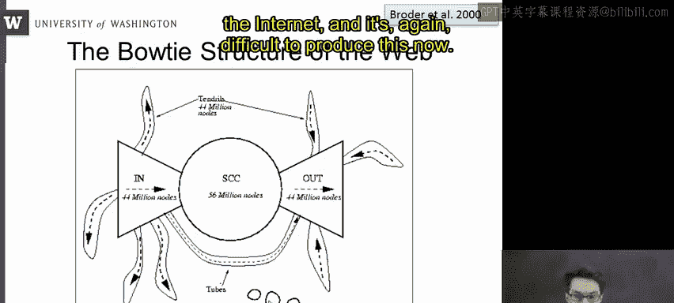

# 杜克大学《大规模数据科学（大数据操作，第1课／共3课有视频）｜Data Science at Scale》 - P111：110_度直方图：Web的结构.zh_en - GPT中英字幕课程资源 - BV12s421T7tJ

。

So instead of choosing two vertices at random and connecting them with an edge。Instead。

When you choose a vertex to connect with an edge。Favor those ones that are already well connected。

Okay， so why would you bother or why would this happen sort of naturally Well think about it if you're in a social network and you join you have someone who joins Facebook for the first time。

 are they more likely to connect themselves to someone who's already very popular or are they more likely to connect themselves to a bunch of people who don't already have lots of friends。

Well， it's much more likely to connect yourself to someone who's already very popular。

 That might be who introduced you to Facebook in the first place。Or with Twitter。

 are you more likely to follow people that are already have a lot of followers or more likely to follow people that do not have a lot of followers。

 Well， more likely you're going to connect and follow。You join Twitter in order to follow。

Popular people。Okay， you can also think about this in terms of maybe the Internet or the web when you create。

 when you create a web page and put it on the web， are you more likely to link to sites that already have a lot of links。

Or。Not。Okay， and the answer is you're more likely to think to。You you。

It's reasonable to say that you're more likely to connect to web pages and already have a lot of links。

😡，With this preferential attachment model of constructing graphs。

 you'll generate the zippy and power of distribution。

 these are the distributions you tend to find in nature。Or on the web。

 whether you call that nature or not。And they have a distribution like this they have this。

Fattter tail， this long tail。 So now it's not quite so unlikely to find vertices that have a very。

 very， very high out degree。And you can see this effect more clearly on a log log scale plot where both axes are on a log scale。

 I'm not a huge fan of using log log scale， except very sparingly because lots of things。

 lots of distributions end up looking linear on a log log scale。

 but these are defined to be linear on a log log scale。

 So you can do this kind of structural analysis。 You can construct this histogram of very large graph like the web。

 which Bro it all did in 2000 and we're probably overdue for another analysis of this type。

 but it's become。Computationally pretty difficult to produce these kinds of plots about for the current internet。

Okay， so here's the plot， here's the histogram of the web。And the question is。

 is this an exponential or is this a Zthian power law distribution？And you can see it's kind of。

Here in the description， but it's pretty clearly a power log。

 This is a log scale axis and this is a log scale axis and this looks。Pretty linearly linear。

So what the authors went on to do， which I think is。Pretty interesting he produced this kind of。

Schematic。Of the overall structure of the web and this circle in the middle here is a big。

 strongly connected component， meaning that。The page within that component。If you can reach x from y。

 you can reach y from x。For any to。Pages。Okay， but then there's also an in and an out。Instead of。

Vertices pages that are kind of about the same size as the strongly connected component。

 So these are things that are。You can reach the strongly connected component from these。

 but you cannot reach back back from the strongly connected components。

 so they link into the main mass of the internet。Okay， and then similarly on the outside。

 there are things that link from the strong component， but you can't get back。

And it's about these big three3s。And then they pointed out that there are indeed tubes that connect the in to the out directly。

 not going through the strongly connected component， and there are these tinrils that sort of go off。

Nowhere， but these are minor perhaps minor components relative to the main three。

 and then you also have these sort of disconnect components that are smaller。

But this is sort of interesting to understand the basic physiology of the internet， and it's again。

 difficult to produce this。Now。

