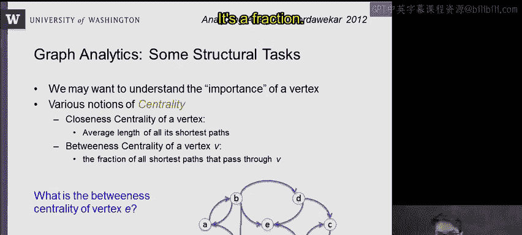

# 杜克大学《大规模数据科学（大数据操作，第1课／共3课有视频）｜Data Science at Scale》 - P112：111_连通性和中心性.zh_en - GPT中英字幕课程资源 - BV12s421T7tJ

。

So we can also measure the connectivity coefficient of a graph as a structural analysis task。

 so this is the minimum number of vertices you need to remove that will disconnect the graph。

And so you can think of this intuitively as a sense of a measure of the fragility of the graph。

 how much redundancy is built into it。So if you're designing a network and it turns out the connectivity coefficient of the graph is one。

 that means that potentially if one machine goes down。

 you could partition in the network where nobody can communicate。so if you're an advertiser。

 you might be interested in the connectivity coefficient of a graph。

 if you're trying to reach as many people as possible。

 it could be that if a few people don't pay attention to the ads。

 then a whole bunch of other people won't send the message to your sort of in viral advertising or social media advertising。

And so remember in the cap theorem that we discussed in the No SQL lectures。

 P was partitioning right， so this was the if you're great if you're。System becomes partitioned。

 if your network becomes partitioned， can the systems still function and so connectivity coefficient could be a measure to help you estimate how likely it is that your network is going to be partitioned。

Okay， so what is the connectivity coefficient of this graph。

 Well depends on exactly what we mean by connectivity first， so we can say that two vertices。

 x and y are strongly connected if x is reachable from y and y is reachable from x。Okay。

 and we might say that they're just connected if x is reachable from y or y is reachable from x。

 And so this is sort of equivalent to ignoring the directionality of the edges。

 So if we just assume that everything's undirected。

 then we'll be using the second definition so let's assume that for a second。

 let's assume we just mean connected here。 Well， look if we don't care about direction of traversing。

 then if we remove E。Is the graph disconnected？No。Because you can still reach everything through this other edge up there。

And so the only node here that appears to not be redundant here is B， and so if you remove B though。

 you'll have two partitions in the network， A and F and all the other ones here。就。

The connectivity coefficient of this graph is one because we can find a vertex that if we remove it。

It'll be a part network。And so we already discussed why you might want to compute this。

So the connectivity coefficient is a measure of the graph itself and doesn't really give us a way to understand the relative importance of an individual vertex and so for this purpose there's been various notions of centrality defined so one is the closeness centrality of a vertex which is the average length of all the shortest paths that pass through it right so this intuitively this is you can maybe compare this with the diameter of the graph right if the diameter is long and the average length of all the shortest path that go through a particular vertex is short then it's。

Not part of the diameter。Of the paths that define the diameter of the graph。

 and so in some sense it may be less central or less important。Okay。

So another is maybe more common is the between the centrality of a vertex。

 and this is the fraction of all the shortest paths in the whole graph that pass through this vertex。

So if you need to go all roads lead through Rome， if you need to go from Seattle to Atlanta in the US。

Then。Perhaps all paths go through。One of two different major highways or one or two。

 maybe one or two cities， the northern route and the southern route or something。

 And so the between the centrality of these two intermediate hubs is。High。

 and so if you think about a public transportation system where all trains lead into some central hub and then go out again。

 that central hub will have a high between the centrality because the shortest path to get from point A to point B always goes through this one central vertex。

ok。So what is the between the centrality of vertex？E in this case， well， there's a shortest path。

 A to B to D to C。That we found the shortest path made to see is goes through there and the shortest path from。

A to G， A， B， E G。Is， is a。th3。So if you to add all these up。

 you'll see that E is only involved in A， B， E， G， and then a bunch of ones that are rooted in E itself。

 E to C and E to G， so between the centrality of E is3。All right， sorry。

 three divided by the total number short passed in the graph。It's a fraction。

