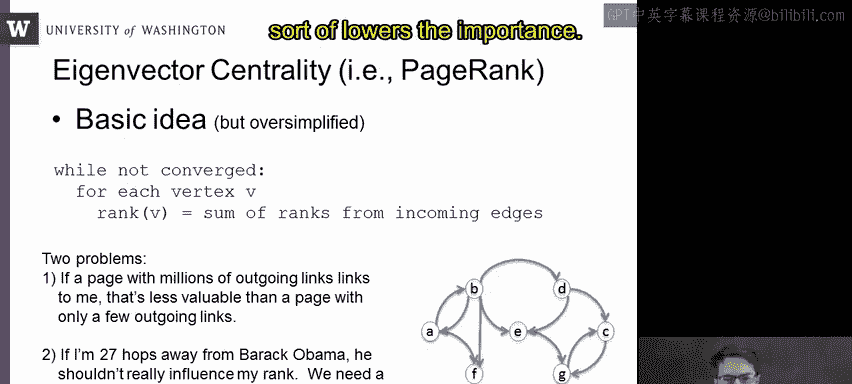

# 杜克大学《大规模数据科学（大数据操作，第1课／共3课有视频）｜Data Science at Scale》 - P113：112_PageRank.zh_en - GPT中英字幕课程资源 - BV12s421T7tJ

。

So we talked about a couple different notions of centrality and one more is degree centrality。

 which is just the degree of a vertex divided by the total number of edges right。

 so this is the fraction of all the edges that。Touch me okay。

 and so Matt so maybe this is a good candidate for our， you know。

 we're seeking some notion of importance of a vertex in a graph。All right。

 so imagine we have a social network and you know， then the degree of invertex is the number of friends you might have。

 while people with more friends are in some sense some sense more important than people with fewer friends in the context of a social network。

Fine， but if you know say we both have five friends well then we have the same degree centrality by this definition。

 but what if your five friends are they themselves much more connected than my five friends in some sense you should be more important than I am in the context of the social network and this notion of degree centrality doesn't capture that。

All right， so let's see if we can improve on this。Another notion of centrality is eigenvector centrality。

 which is actually just Page rank。 And so if you are familiar with Page drink or there's maybe be another way of looking at it and if you're not familiar with Page rank。

 then this is a great way to develop an intuition for it。

 So the basic idea for computing page rank is， you know， while things are not converged。

For each vertex in the graph。Compute the rank of that vertex by adding up the ranks。

Of all of its neighbor vertic。All the incoming edges have we the directed graph。

RightSo this allows you to say， well， look， if Barack Obama。

 if the president of the United States is。Connected to you by one hop is your friend。

 say follows you on Twitter and like that。 Well， then you're more important than somebody who doesn't have such such an influential。

Person the graph， you add up the rank of。The president to your rank， Okay， Meanwhilewhile。

 you distribute your rank to all your。啊。Friends， right， So and you do that you repeat this。

Passing of rank of weight of importance。to across the network。

 across the graph until you reach some convergence condition。

 and then that converence condition give you a relative score of whos more important than who perhaps which vertex is more important than which other vertex。

But there's a couple of problems with this approach。 So one is， you know， one page。

Or one person of the social social network with millions of outgoing links if they link to me。

That's somehow less valuable than a page that only links to a few people right So if you've got one of these。

啊。Crawls that follows everyone in order to collect as much， you know。

 follow everyone on Twitter in order to collect as much data as possible。

 It's not very important that they follow you， right， You don't consider that。

 you don't consider that to be very prestigious that you have some automatic robot crawler following you。

 Meanwhile， if you have an aggregator page that sort of links out to everyone on the Internet。

 Similarly， that's not very important that it。Links to you so somehow you want to make sure that they divide their rank amongst all their outgoing edges as opposed to just give their total rank to each outgoing edge。

Fine， so that's easy to fix。knowAnother notion here is that well if I'm 27 hops away from Barack Obama。

 that's less important than if I'm one hop away， and so we really shouldn't count that as very influential。

And so we need some sort of a damping factor that as you get further away。

 it sort of lowers the importance。

